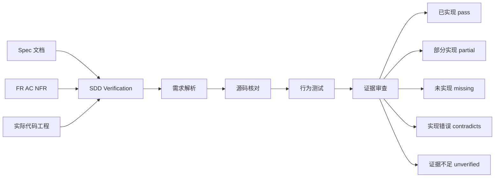
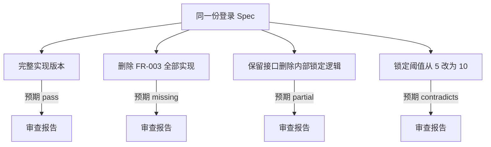

# P0.6：Spec ↔ Code 实现一致性验证

## 目标调整背景

P0.6 原目标为 A/B 对比实验（A0/A1/B 三组 × 3 次运行），验证 SDD 相比普通 Coding Agent 的价值。

调整原因：
- A0 组（无 SDD）3 次运行中 2 次已 37/37 全过，区分度不足。
- A0-03 漏了 NFR-004（锁定事件审计日志缺来源 IP），恰好是 P0.5 Reviewer R1 抓到的同类缺口——SDD 的零遗漏能力已在 P0.5 验证。
- A/B 对比关注的是"性价比"，而当前真正需要验证的是"SDD 能否以 Spec 为基准，独立检查 Code 是否真正实现了需求"。

因此 P0.6 目标正式调整为：**Spec ↔ Code 实现一致性验证**。

---

## 一、核心定义

P0.6：给定一份 Spec 和一个已开发的代码工程，SDD Workflow 能否准确判断每条需求是否真正实现，并找出遗漏、部分实现或实现不符合 Spec 的地方。

输入：`spec.md` + 实际项目源码
输出：每条需求的实现状态、代码证据、测试证据和问题报告



关键原则：
- `unverified` 状态是独立状态，不能直接判定已实现。
- P0.6 不需要让 Coding Agent 再写代码，应先具备独立审核现有代码的能力。
- 自动修复属于后续功能，不影响当前准确性验证。

---

## 二、5 种测试场景

| 测试场景 | 代码实际情况 | SDD 预期结果 |
|---------|------------|-------------|
| 1. 完整实现 | 功能行为符合 Spec | `pass` |
| 2. 完全遗漏 | Spec 要求的功能在代码中不存在 | `missing` |
| 3. 部分实现 | 类和方法存在，但关键逻辑缺失 | `partial` |
| 4. 实现错误 | 功能存在，但行为与 Spec 冲突 | `contradicts` |
| 5. 证据不足 | 看起来已实现，但没有足够证据 | `unverified` |

重点验证第 2、3、4 种情况。

尤其关键场景：**已有单元测试全部通过，但代码中故意遗漏一条 Spec 需求。**

如果 SDD 仍然能发现缺口，说明它确实在核对 Spec 和代码，而不只是依赖测试结果。

---

## 三、P0.5 已有验证及不足

P0.5 决定性测试中，故意让 Implement Agent 不完整实现 FR-003（登录锁定规则）。

Reviewer 发现：
- FR-003：自动锁定逻辑缺失（partial）
- FR-006：密码迁移未集成（partial）
- 多个 NFR：功能不完整或缺乏证据

后续通过第二轮修复实现了收敛。

这是积极证据，但不足之处：当时同时发生了编译失败，Reviewer 可能受到测试失败信息的提示。

现在需要单独验证：**当代码能正常编译、全部已有测试通过时，Reviewer 能否发现 Spec 与实现之间的差异。**

---

## 四、Audit 模式设计

让 `sdd-feature.js` 支持独立审查模式：

```
args.mode = 'audit'
```

### Audit 模式阶段执行表

| 阶段 | 是否执行 | 说明 |
|------|---------|------|
| Specify 生成新 Spec | 不执行 | 使用已有 Spec |
| Plan 生成设计 | 不执行 | 不修改设计 |
| Tasks 生成任务 | 非必需 | 审查不依赖任务清单 |
| Implement 修改代码 | 不执行 | 不修改目标业务代码 |
| Test 执行真实测试 | 执行 | 获取测试证据 |
| Reviewer 逐条对照 Spec 与源码 | 执行 | 核心阶段 |
| validate-review | 执行 | 结构校验 |
| is-converged | 执行 | 收敛判定 |
| append-findings | 不执行 | 不生成修复任务 |
| 自动修复循环 | 不执行 | 只验证不修复 |

### 输出格式

```json
{
  "feature": "login",
  "fullyImplemented": false,
  "requirements": [
    {
      "id": "FR-001",
      "status": "pass"
    },
    {
      "id": "FR-003",
      "status": "partial",
      "reason": "缺少达到失败次数阈值后锁定账号的逻辑",
      "codeRefs": [
        "src/auth/lockout-service.ts:26"
      ]
    }
  ]
}
```

保留当前已有的 `verifications` 和证据引用字段，不因 Audit 模式降低 C4 校验标准。

---

## 五、决定性验收实验

### 实验设计

不需要运行 9 次，不需要准备三组模型。

只需要准备同一份 Spec，以及 4 个受控的代码版本：



| 版本 | 代码状态 | 预期 SDD 结果 |
|------|---------|-------------|
| V1 | 完整实现，所有需求已实现，测试通过 | 全部 pass |
| V2 | 删除整个 FR-003 实现，确保工程仍能编译 | FR-003 = missing |
| V3 | 保留接口，删除内部锁定逻辑，模拟真实漏实现 | FR-003 = partial |
| V4 | 故意实现错误的锁定阈值（Spec 要求 5 次，代码实现 10 次） | FR-003 = contradicts |

### 关键约束

- 每个版本提前记录真实缺陷位置，作为独立标准答案，不让 Reviewer 提前看到。
- **缺陷版本最好仍能通过原有测试**，排除 SDD 仅根据编译或测试失败猜测问题的可能性。
- 审核流程不修改目标业务代码。

---

## 六、验收标准

P0.6 完成判定（7 条）：

1. SDD 能完整枚举 Spec 中所有必需 FR、AC、NFR。
2. 能在已有代码中找到对应实现，报告可追踪的文件与代码位置。
3. 能检测出人为注入的完全遗漏、部分实现和行为冲突。
4. 不会因为测试全部通过就自动认为所有 Spec 都已实现。
5. 对证据不足的需求不会错误判定 `pass`。
6. 对完整实现版本，不会产生阻断级的错误缺口报告。
7. 整个审核流程不修改目标业务代码。

重点关注的不是测试数量，而是 **漏报**（有缺陷但 SDD 没发现）和 **误报**（没缺陷但 SDD 报告有缺口）。

最终根据预先记录的缺陷清单，逐条核对 SDD 的实际输出；如有遗漏，保存原始 Reviewer Session 和证据，分析未发现原因。

---

## 七、执行计划

### 现有基础

已有组件（不新增）：
- Coverage Gate（coverage.mjs）
- Test Runner + Evidence（run-tests.mjs）
- Reviewer Agent（review.json + freeze-review.mjs）
- validate-review.mjs（8 项结构校验）
- is-converged.mjs（7 条件收敛 + C4 四层证据绑定）
- append-findings.mjs（3 种 finding 类型）
- 29 项回归测试（regression-tests.mjs）

### 执行步骤

| 步骤 | 内容 | 产出 |
|------|------|------|
| 1 | 在 sdd-feature.js 中增加 audit 模式 | 支持 `args.mode = 'audit'` |
| 2 | 准备 V1（完整实现版本） | 基于 A0-01 成功实现 |
| 3 | 准备 V2（删除 FR-003 实现） | 受控缺陷版本，确保编译通过 |
| 4 | 准备 V3（保留接口删逻辑） | 受控缺陷版本，确保编译通过 |
| 5 | 准备 V4（阈值 5 改 10） | 受控缺陷版本，确保编译通过 |
| 6 | 对 V1-V4 分别运行 audit 模式 | 4 份审查报告 |
| 7 | 逐条核对审查报告与标准答案 | 漏报/误报分析 |
| 8 | 如有遗漏，保存证据并分析原因 | 经验文档 |
| 9 | 更新进度文档和执行报告 | P0.6-执行报告.md |

### 完成后决策

验证通过后，再决定是否继续开发：
- 自动修复（audit → fix loop）
- Workflow Gallery
- 其他功能

---

## 八、引用说明

- P0.5 决定性测试报告：`dev-docs/progress-result/P0.5-执行报告.md`
- P0.5 Reviewer 设计：`dev-docs/design/sdd-artifact-contract.md`
- SDD 工作流设计：`dev-docs/design/sdd-workflow-pack-design.md`
- 验证工具回归测试：`sdd/tools/regression-tests.mjs`
- A/B 实验数据（A0 组）：`experiments/results/A0-01.json`、`A0-02.json`、`A0-03.json`
