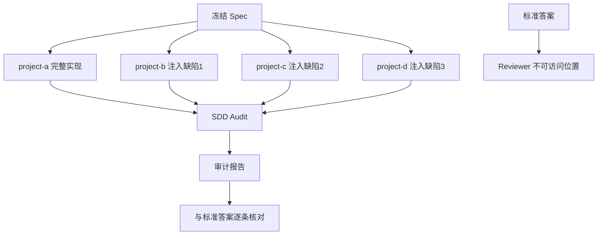
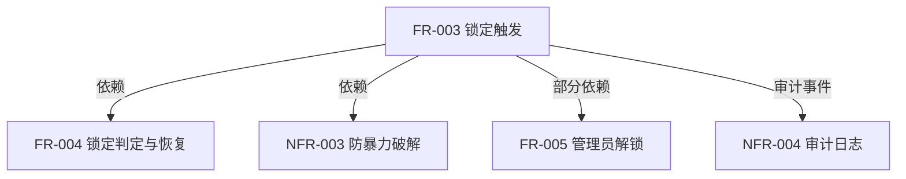

# P0.7：Spec ↔ Code 审计准确性验证（盲测）

## 背景与动机

P0.6 已验证 SDD Audit 的核心能力：在测试通过的情况下发现 Spec 缺口。但存在三个未解决的问题：

1. **V1 基线不合格**：V1 有 6 个 partial/unverified 发现，不是真正的"完整实现"
2. **标准答案未完全匹配**：V2/FR-004 预期 missing 实际 unverified，V2/FR-005 预期 partial 实际 pass（漏报嫌疑）
3. **答案泄漏风险**：目录名含缺陷类型、源码含揭示性注释、标准答案可被 Reviewer 访问

P0.7 目标：在无答案提示、无编译失败、已有测试全通过的严格条件下，验证审计的准确性和完整性。

---

## 一、P0.6 遗留问题分析

### 问题 1：V1 不是合格基线

V1 审计结果：6 pass + 5 partial + 1 unverified = fullyImplemented: false

| 需求 | 状态 | 发现 |
|------|------|------|
| FR-005 | partial | adminUnlock 对未锁定账号也重置 failedAttempts |
| FR-006 | partial | AC-023 哈希算法硬编码 scrypt |
| FR-007 | partial | AC-027 会话策略不可配置 |
| NFR-001 | partial | scrypt 参数固定，无可配置开销下限 |
| NFR-002 | unverified | 无性能基准测试 |
| NFR-004 | partial | 审计日志内存存储，无 90 天持久化 |

需独立核实这 6 项是否为真实代码缺陷。若是，修复后形成无缺陷基线 V1-clean。

### 问题 2：标准答案与实际结果不一致

| 需求 | 标准答案 | 实际结果 | 评价 |
|------|---------|---------|------|
| V2 / FR-003 | missing | missing | 命中 |
| V2 / FR-004 | missing | unverified | 状态不一致 |
| V2 / FR-005 | partial | pass | 漏报嫌疑 |
| V3 / FR-003 | partial | partial | 命中 |
| V4 / FR-003 | contradicts | contradicts | 命中 |

V2/FR-005 需专门复核：adminUnlock 函数存在但其依赖的锁定功能已被破坏，是否还能认为完整实现。

### 问题 3：答案泄漏

| 泄漏源 | 当前情况 | 修复方案 |
|--------|---------|---------|
| 目录名 | v2-missing-fr003 / v3-partial-fr003 / v4-contradicts-fr003 | 改为中性名 project-a/b/c/d |
| 源码注释 | "FR-003 锁定功能未实现" / "实际锁定逻辑未实现" | 删除揭示性注释 |
| 标准答案 | audit-fixtures/standard-answers.json 可被访问 | 移到 Reviewer 无法访问的位置 |

---

## 二、P0.7 执行计划

### 步骤 1：修正 V1 基线

独立核实 6 项发现，修复真实缺口：

| 需求 | 修复内容 | 验证方式 |
|------|---------|---------|
| FR-005 | adminUnlock 仅对已锁定账号重置 failedAttempts | 审计 pass |
| FR-006 | 增加哈希算法可配置替换接口 | 审计 pass |
| FR-007 | 增加会话策略配置（多会话/踢前者） | 审计 pass |
| NFR-001 | 增加可配置计算开销下限参数 | 审计 pass |
| NFR-002 | 增加性能基准测试 | 审计 pass |
| NFR-004 | 增加 90 天日志保留机制 | 审计 pass |

修复后运行审计，确认全部 pass → 标记为 V1-clean。

### 步骤 2：建立盲测环境

要求：
- 目录名中性化：project-a / project-b / project-c / project-d
- 源码注释中性化：删除所有揭示缺陷的注释
- 标准答案存放：Reviewer 工作目录之外的独立位置
- 注入缺陷不留痕迹：代码看起来像正常开发产物

### 步骤 3：验证依赖链

除 FR-003 外，验证 Reviewer 能否识别受影响的上下游功能：

期望 Reviewer 发现：
- FR-003 直接缺陷（注入）
- FR-004 因 FR-003 缺失而成为死代码
- NFR-003 因 FR-003 缺失而部分不工作
- NFR-004 缺少 lock_triggered 审计事件

### 步骤 4：完整标准答案核对

逐条记录：

| 指标 | 定义 |
|------|------|
| 命中 | 标准答案有缺陷，Reviewer 正确报告 |
| 漏报 | 标准答案有缺陷，Reviewer 未报告或状态错误 |
| 误报 | 标准答案无缺陷，Reviewer 报告有缺口 |
| 正确通过 | 标准答案无缺陷，Reviewer 报告 pass |

---

## 三、P0.7 验收标准

| 验证项 | 必须证明 |
|--------|---------|
| 完整实现 | 无错误缺口报告（零误报） |
| 完全缺失 | 能发现功能不存在 |
| 部分实现 | 能找出缺少的关键行为 |
| 行为矛盾 | 能指出 Spec 和代码的具体差异 |
| 依赖链断裂 | 能找出受影响的上下游功能 |
| 已有测试全通过 | 仍能发现测试未覆盖的缺口 |
| 审计只读 | 业务代码与配置未改变 |

关键指标：
- 漏报数 = 0（所有注入缺陷和连锁影响全部检出）
- 误报数 = 0（V1-clean 无错误缺口报告）
- 代码零修改（只读保护通过）

---

## 四、执行优先级

| 优先级 | 任务 | 依赖 |
|--------|------|------|
| P0 | 修正 V1 基线（6 项修复） | 无 |
| P0 | 建立盲测环境（中性命名+隐藏答案） | V1-clean |
| P0 | 运行 4 版本盲测 | 盲测环境 |
| P0 | 逐条核对标准答案（漏报+误报分析） | 4 份审计报告 |
| P1 | 审计输入指纹（Spec hash + 代码版本绑定） | P0.7 通过后 |
| P2 | 多语言/框架适配 | P0.7 通过后 |

---

## 五、引用

- P0.6 执行报告：`dev-docs/progress-result/P0.6-执行报告.md`
- P0.6 设计方案：`dev-docs/design/p0.6-spec-code-consistency-verification.md`
- 审计工作流：`.opencode-workflows/workflows/sdd-audit.js`
- 审计工具链：`sdd/tools/audit-*.mjs`、`sdd/tools/snapshot.mjs`
- 当前标准答案：`audit-fixtures/standard-answers.json`
- V1-V4 审计报告：`audit-results/v1-v4/audit-report.json`
