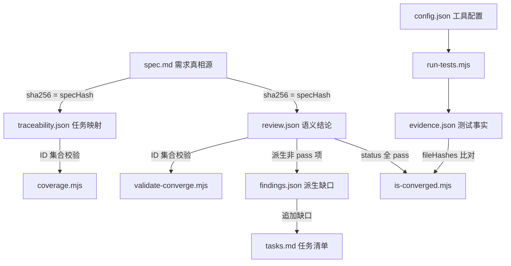

# SDD Artifact Contract

> 日期：2026-10-13
> 状态：契约定义（P0 开发前置条件）
> 关联：`dev-docs/design/sdd-workflow-pack-design.md`

## 一、契约总览

SDD 系统的核心防御目标：**防止需求在拆解、开发和验收过程中被悄悄遗漏**。

以下 Artifact 构成完整的证据链。每个 Artifact 有明确的写入者、读取者和校验规则。任何环节都不能仅凭 Agent 的一句"已完成"代替。



## 二、Artifact 速查表

| Artifact | 真相源角色 | 写入者 | 读取者 | 文件格式 |
|----------|----------|--------|--------|---------|
| `spec.md` | 需求真相源 | Specify Agent | Coverage/Reviewer/所有工具 | Markdown |
| `source-prd.md` | 原始需求原文（EARS-P2） | Intake Agent（逐字写入） | validate-source-map（prdHash 基准） | Markdown |
| `source-map.json` | 原始需求清单与来源映射（EARS-P2） | Intake Agent（sources）+ Source Mapping Agent（mappings） | validate-source-map / 人工审查 | JSON |
| `intake-review.json` | 提取遗漏审查结论（EARS-P3） | Gate A explore Reviewer（宿主提取落盘） | validate-intake-review | JSON |
| `preservation-review.json` | 逐条语义保真审查结论（EARS-P3） | Gate B explore Reviewer（宿主提取落盘）+ freeze-preservation | validate-preservation | JSON |
| `plan.md` | 技术设计参考 | Plan Agent | Tasks Agent/Reviewer | Markdown |
| `tasks.md` | 任务清单 | Tasks Agent + append-findings | Coverage/Coding Agent | Markdown |
| `traceability.json` | 任务映射 | Tasks Agent | coverage/is-converged | JSON |
| `review.json` | 语义结论（全量） | Reviewer Agent | validate/is-converged/append | JSON |
| `evidence.json` | 测试事实 | `run-tests.mjs` | is-converged | JSON |
| `findings.json` | 派生缺口（仅未通过项） | `append-findings.mjs` | 下一轮 Coding Agent | JSON |
| `sdd/config.json` | 工具配置 | 人工 | run-tests 等工具 | JSON |

## 三、各 Artifact 详细契约

### 3.0 source-prd.md 与 source-map.json（EARS-P2 新增）

**角色**：PRD → Spec 方向的防遗漏追踪基准。

- `source-prd.md`：原始需求原文逐字保存，prdHash 冻结后不可改写（validate-source-map.mjs 校验哈希）。
- `source-map.json`：`sources`（SRC-NNN 需求点清单，含 claimType/loadBearing/sourceRef 元数据，Intake Agent 写入）+ `mappings`（每 SRC 一条处置：covered/excluded/pending，Source Mapping Agent 写入）。
- 校验规则：每个 SRC 必须有处置结果；covered 引用须真实存在且归属正确；loadBearing functional exception 的 covered 必须含 AC；quote 与原文行号区间一致；Spec 中每个 FR/NFR 必须追溯到至少一个 SRC（拦截无依据新增）。
- 位置：Source Coverage Gate 位于 Plan 之前，未通过则阻断流程。

### 3.0.1 intake-review.json 与 preservation-review.json（EARS-P3 新增）

**角色**：Claim 逐条保真的审查结论（独立于 source-map 的声明式映射）。

| Artifact | 写入者 | 校验器 | 锚定哈希 |
|---------|--------|--------|---------|
| `intake-review.json` | Gate A explore Reviewer（宿主 extract-agent-json 落盘） | validate-intake-review.mjs | prdHash |
| `preservation-review.json` | Gate B explore Reviewer（宿主 extract-agent-json 落盘）+ freeze-preservation.mjs 冻结三哈希 | validate-preservation.mjs | prdHash + specHash + sourceMapHash |

- intake-review：missedClaims（quote/lineStart/lineEnd/suggestedClaimType/reason）+ verdict pass/fix；两轮内补齐否则 Specify 不启动。
- preservation-review：claims 覆盖全部 SRC、六状态枚举、证据要求（非 preserved 需 sourceEvidence+finding，partial/contradicted 还需 specEvidence）、unsupportedRequirements、verdict pass/fix/clarify；哈希不匹配即过期结论拒绝（重跑链保障）。
- 位置：Gate A 在 Specify 前，Gate B 在 Plan 前；均为 explore 只读 + 宿主侧持久化，禁止 Reviewer 自写。

### 3.1 spec.md

**角色**：需求真相源。所有 FR/AC ID 的权威来源。

**格式约定**：

```markdown
# Feature: login

## 功能需求

### FR-001: 用户登录
用户可通过账号密码登录系统。

**验收条件**：
- AC-001: 正确账号密码登录成功
- AC-002: 错误密码登录失败

### FR-002: 密码错误提示
...

### FR-003: 失败锁定
连续失败 N 次后锁定账号。

**验收条件**：
- AC-003: 达到阈值后阻止登录
```

**ID 规则**：
- `FR-NNN`：功能需求，三位数字，从 001 起，不重复
- `AC-NNN`：验收条件，三位数字，从 001 起，不重复
- 每个 FR 下至少有一个 AC
- ID 一旦分配不可变更（内容可改，ID 不动）

**specHash 计算**：
- `sha256(spec.md 文件内容)`，由工具脚本计算
- 写入 `traceability.json.specHash` 和 `review.json.specHash`
- Spec 变更后 specHash 变化，所有依赖此哈希的 Artifact 失效

### 3.2 plan.md

**角色**：技术设计参考。非真相源，不参与确定性校验。

**格式**：自由 Markdown，建议按 FR 组织。

**写入者**：Plan Agent。

**读取者**：Tasks Agent（参照设计拆任务）、Reviewer Agent（参照设计核验）。

### 3.3 tasks.md

**角色**：任务清单。Coverage Gate 校验任务 ID 存在性。

**格式约定**：

```markdown
## T-001: 实现登录表单组件
- **FR**: FR-001
- **AC**: AC-001, AC-002
- **Status**: done

## T-002: 实现密码校验逻辑
- **FR**: FR-001
- **AC**: AC-002
- **Status**: done

## T-003: 实现失败锁定机制
- **FR**: FR-003
- **AC**: AC-003
- **Status**: pending
```

**ID 规则**：
- `T-NNN`：任务，三位数字，从 001 起，不重复
- append-findings 追加任务时继续编号，不回收已用编号
- 旧任务不删除，只改 Status

**Status 枚举**：`pending` | `in-progress` | `done` | `blocked`

### 3.4 traceability.json

**角色**：任务映射。Coverage Gate 的校验对象。

**JSON Schema**：

```json
{
  "feature": "login",
  "specHash": "sha256-abcdef...",
  "mappings": [
    {
      "requirementId": "FR-001",
      "taskId": "T-001",
      "acceptanceIds": ["AC-001", "AC-002"],
      "verificationMethod": "test"
    },
    {
      "requirementId": "FR-003",
      "taskId": "T-003",
      "acceptanceIds": ["AC-003"],
      "verificationMethod": "test"
    }
  ]
}
```

**字段校验**：

| 字段 | 类型 | 必填 | 校验规则 |
|------|------|------|---------|
| `feature` | string | 是 | 与调用参数一致，kebab-case |
| `specHash` | string | 是 | `sha256-` + hex；必须等于当前 `spec.md` 的 sha256 |
| `mappings` | array | 是 | 非空数组 |
| `mappings[].requirementId` | string | 是 | 必须存在于 spec.md 的 FR 集合 |
| `mappings[].taskId` | string | 是 | 必须存在于 tasks.md 的 T-NNN 集合 |
| `mappings[].acceptanceIds` | array | 是 | 非空，每项必须存在于 spec.md 的 AC 集合 |
| `mappings[].verificationMethod` | string | 是 | `test` 或 `manual` |

**Coverage Gate（`coverage.mjs`）通过条件**：

1. spec.md 中所有 FR ID 集合 == traceability.json 中 requirementId 集合（不多不少）
2. spec.md 中所有 AC ID 都出现在某条 mapping 的 acceptanceIds 中
3. 每个 taskId 在 tasks.md 中真实存在
4. FR/AC ID 不重复
5. `specHash` == 当前 `spec.md` 的 sha256

### 3.5 review.json

**角色**：语义结论。Reviewer 对每条 FR/AC 的审查结果。**必须包含全部 FR/AC**。

**这是防止 Reviewer 偷懒的核心机制**：如果 Spec 有 10 条 FR，review.json 必须有 10 条审查记录。少一条都不行。

**JSON Schema**：

```json
{
  "feature": "login",
  "round": 2,
  "specHash": "sha256-abcdef...",
  "reviewerLabel": "Reviewer-2",
  "requirements": [
    {
      "id": "FR-001",
      "status": "pass",
      "evidenceRefs": ["AC-001", "AC-002"],
      "finding": null
    },
    {
      "id": "FR-002",
      "status": "pass",
      "evidenceRefs": ["AC-002"],
      "finding": null
    },
    {
      "id": "FR-003",
      "status": "partial",
      "evidenceRefs": ["AC-003"],
      "finding": "已记录错误次数，但未阻止锁定用户登录"
    }
  ]
}
```

**字段校验**：

| 字段 | 类型 | 必填 | 校验规则 |
|------|------|------|---------|
| `feature` | string | 是 | 与调用参数一致 |
| `round` | number | 是 | 当前收敛轮次 |
| `specHash` | string | 是 | 必须等于当前 `spec.md` 的 sha256 |
| `reviewerLabel` | string | 是 | Reviewer Agent 的 label |
| `requirements` | array | 是 | 非空数组 |
| `requirements[].id` | string | 是 | FR-NNN，必须存在于 spec.md |
| `requirements[].status` | string | 是 | 枚举：`pass`、`partial`、`missing`、`contradicts` |
| `requirements[].evidenceRefs` | array | 是 | 关联的 AC ID 列表 |
| `requirements[].finding` | string\|null | 条件必填 | status 非 `pass` 时必填，`pass` 时为 null |

**Status 语义**：

| Status | 含义 | 后续动作 |
|--------|------|---------|
| `pass` | 需求已满足，有证据支撑 | 无 |
| `partial` | 部分实现，有缺口 | append-findings 追加修复任务 |
| `missing` | 完全未实现 | append-findings 追加新建任务 |
| `contradicts` | 实现与 Spec 矛盾 | append-findings 追加修复任务 |

**validate-converge.mjs 通过条件**：

1. review.json 中 requirements 的 ID 集合 == spec.md 中 FR ID 集合（不多不少）
2. 每条记录的 status 在枚举范围内
3. status 非 `pass` 时 finding 非空
4. `specHash` == 当前 `spec.md` 的 sha256
5. `feature` 和 `round` 与调用参数一致

### 3.6 evidence.json

**角色**：测试事实。由程序（`run-tests.mjs`）生成，不由 Agent 写入。

**JSON Schema**：

```json
{
  "feature": "login",
  "round": 2,
  "buildStatus": "success",
  "buildCommand": "npm run build",
  "buildExitCode": 0,
  "buildOutput": "...（截断）",
  "testCommand": "npm test",
  "testResults": [
    {
      "testName": "login-lockout",
      "status": "failed",
      "exitCode": 1,
      "output": "AssertionError: expected lockout to prevent login..."
    },
    {
      "testName": "login-success",
      "status": "passed",
      "exitCode": 0,
      "output": "2 passed"
    }
  ],
  "fileHashes": [
    { "file": "src/auth/login.ts", "hash": "sha256-abc123..." },
    { "file": "src/auth/lockout.ts", "hash": "sha256-def456..." },
    { "file": "tests/login-lockout.test.ts", "hash": "sha256-ghi789..." }
  ],
  "generatedAt": "2026-10-13T12:34:56.789Z"
}
```

**字段校验**：

| 字段 | 类型 | 必填 | 校验规则 |
|------|------|------|---------|
| `feature` | string | 是 | 与调用参数一致 |
| `round` | number | 是 | 当前收敛轮次 |
| `buildStatus` | string | 是 | `success` 或 `failed` |
| `buildExitCode` | number | 是 | 构建命令退出码 |
| `testResults` | array | 是 | 可为空（构建失败时无测试结果） |
| `testResults[].status` | string | 是 | `passed` 或 `failed` |
| `testResults[].exitCode` | number | 是 | 测试退出码 |
| `fileHashes` | array | 是 | 非空，含所有 sourceGlobs + testGlobs 匹配文件 |
| `fileHashes[].file` | string | 是 | 相对项目根的路径 |
| `fileHashes[].hash` | string | 是 | `sha256-` + hex |
| `generatedAt` | string | 是 | ISO 8601 时间戳 |

**run-tests.mjs 退出码约定**：

| 退出码 | 含义 | 触发条件 |
|--------|------|---------|
| 0 | 脚本正常执行（含测试失败） | 成功读取 config.json、执行了构建/测试命令、生成了 evidence.json |
| 1 | 脚本本身出错 | config.json 缺失、feature 未配置、命令不存在等 |

关键：测试失败时退出 0，失败记录在 evidence.json 中。测试是否通过由 `is-converged.mjs` 判定。

### 3.7 findings.json

**角色**：派生缺口。**由程序从 review.json 派生，不由 Agent 写入**。

**派生规则**：从 `review.json` 中提取所有 `status != "pass"` 的条目。

**JSON Schema**：

```json
{
  "feature": "login",
  "round": 2,
  "derivedFrom": "review.json",
  "items": [
    {
      "requirementId": "FR-003",
      "status": "partial",
      "evidenceRefs": ["AC-003"],
      "finding": "已记录错误次数，但未阻止锁定用户登录",
      "action": "fix"
    }
  ]
}
```

**字段校验**：

| 字段 | 类型 | 必填 | 校验规则 |
|------|------|------|---------|
| `feature` | string | 是 | 与调用参数一致 |
| `round` | number | 是 | 当前收敛轮次 |
| `derivedFrom` | string | 是 | 固定值 `review.json` |
| `items` | array | 是 | 可为空（全部 pass 时） |
| `items[].requirementId` | string | 是 | 来自 review.json 非 pass 条目 |
| `items[].status` | string | 是 | `partial`、`missing` 或 `contradicts` |
| `items[].finding` | string | 是 | 来自 review.json |
| `items[].action` | string | 是 | `fix`（partial/contradicts）或 `create`（missing） |

**append-findings.mjs 行为**：

1. 读取 `review.json`，提取非 `pass` 条目
2. 写入 `findings.json`
3. 对每个 item：
   - `action=create`（missing）：在 tasks.md 追加新任务，继续编号
   - `action=fix`（partial/contradicts）：找到关联的已有任务，改 Status 为 `pending`
4. 不重复编号（检查已有 T-NNN）
5. 不删除旧任务

### 3.8 sdd/config.json

**角色**：工具配置。人工维护。

**JSON Schema**：

```json
{
  "features": {
    "login": {
      "appDir": "fixtures/login-app",
      "buildCommand": "npm run build",
      "testCommand": "npm test",
      "sourceGlobs": ["src/**/*.ts"],
      "testGlobs": ["tests/**/*.ts"],
      "timeoutMs": 300000
    }
  }
}
```

**字段校验**：

| 字段 | 类型 | 必填 | 说明 |
|------|------|------|------|
| `features` | object | 是 | 以 feature 名为 key |
| `features[feature].appDir` | string | 是 | 受测项目目录（相对项目根） |
| `features[feature].buildCommand` | string | 否 | 构建命令（无则跳过构建） |
| `features[feature].testCommand` | string | 是 | 测试命令 |
| `features[feature].sourceGlobs` | array | 是 | 源码文件 glob，用于 fileHashes |
| `features[feature].testGlobs` | array | 是 | 测试文件 glob，用于 fileHashes |
| `features[feature].timeoutMs` | number | 否 | 测试超时（默认 300000） |

## 四、版本关系与失效规则

### 4.1 specHash 串联

```
spec.md (sha256 = H1)
  |
  +-> traceability.json.specHash = H1  (Coverage 比对：H1 == 当前 spec.md sha256)
  +-> review.json.specHash = H1       (validate-converge 比对：H1 == 当前 spec.md sha256)
```

Spec 变更后：
1. spec.md 内容变 -> sha256 变为 H2
2. traceability.json.specHash 仍为 H1 -> `coverage.mjs` 检测不匹配 -> 退出 1
3. review.json.specHash 仍为 H1 -> `validate-converge.mjs` 检测不匹配 -> 退出 1
4. Workflow 在对应 `check()` 处终止

### 4.2 fileHashes 时效

```
evidence.json.fileHashes = [文件当前内容 sha256]
  |
  +-> is-converged.mjs 比对：evidence.json 中的 hash vs 文件当前 sha256
```

Coding Agent 修改代码后：
1. 源码文件内容变 -> sha256 变
2. evidence.json.fileHashes 中的旧 hash != 当前文件 hash
3. `is-converged.mjs` 检测不匹配 -> 返回 false（未收敛）
4. 下一轮 `run-tests.mjs` 重新执行，生成新的 evidence.json

### 4.3 P0 与 P1 哈希机制区分

| 层次 | P0 | P1 |
|------|----|----|
| Coverage 版本检查 | `coverage.mjs` 比对 `traceability.json.specHash` | 同 P0 |
| Review 版本检查 | `validate-converge.mjs` 比对 `review.json.specHash` | 同 P0 |
| Evidence 时效检查 | `is-converged.mjs` 比对 `evidence.json.fileHashes` | 同 P0 |
| Journal 缓存失效 | **不做**；外部修改 Spec 后禁止 Resume | Runtime 层自动检测文件变更，使相关 Agent journal 失效 |

P0 的哈希校验全部在**工具层**（.mjs 脚本读取文件比对），与 P1 的**运行时层**（Runtime 自动失效 journal 缓存）完全不同。

## 五、收敛条件完整定义

`is-converged.mjs` 的 7 项条件，**全部满足**才返回 true（退出 0）：

| 序号 | 条件 | 检查来源 | 失败时的缺口描述 |
|------|------|---------|----------------|
| C1 | Spec 中必需 FR/AC 全部有 Task 映射 | traceability.json vs spec.md ID 集合 | 列出未映射的 FR/AC |
| C2 | review.json 包含每条必需 FR/AC | review.json vs spec.md ID 集合 | 列出缺失审查的 FR/AC |
| C3 | 所有必需 FR/AC 审查状态都是 `pass` | review.json 中 status 字段 | 列出非 pass 的 FR/AC 及 status |
| C4 | 所有必需验收项关联真实通过的测试或审核证据 | review.json.evidenceRefs + evidence.json.testResults | 列出无证据的 AC |
| C5 | 构建与必须执行的测试通过 | evidence.json.buildStatus + testResults | 列出失败的构建/测试 |
| C6 | 测试证据文件哈希对应当前代码内容 | evidence.json.fileHashes vs 当前文件 sha256 | 列出哈希不匹配的文件 |
| C7 | 不存在未解决的阻断级问题 | review.json 中无 `missing`/`contradicts` | 列出阻断级问题 |

**输出格式**：无论是否收敛，都输出 JSON 报告到 stdout：

```json
{
  "converged": false,
  "feature": "login",
  "round": 2,
  "conditions": {
    "C1": { "passed": true },
    "C2": { "passed": true },
    "C3": { "passed": false, "details": ["FR-003: partial"] },
    "C4": { "passed": false, "details": ["AC-003: no passing test"] },
    "C5": { "passed": false, "details": ["login-lockout: failed"] },
    "C6": { "passed": true },
    "C7": { "passed": false, "details": ["FR-003: partial"] }
  }
}
```

退出码：`converged=true` -> 0；`converged=false` -> 1。

## 六、工具脚本退出码汇总

| 脚本 | 退出 0 | 退出 1 |
|------|--------|--------|
| `coverage.mjs` | 覆盖率达标 | 覆盖率未达标（含 specHash 不匹配） |
| `run-tests.mjs` | 脚本正常执行（含测试失败） | 脚本本身出错（配置缺失等） |
| `validate-converge.mjs` | review.json 完整且合规 | 缺 FR/AC 或字段不合规 |
| `is-converged.mjs` | 7 项条件全满足 | 任一条件不满足 |
| `append-findings.mjs` | findings.json 派生 + 任务追加成功 | 派生或追加失败 |

## 七、引用参考

| 参考 | 路径 |
|------|------|
| SDD Workflow Pack 设计方案 | `dev-docs/design/sdd-workflow-pack-design.md` |
| Workflow Runtime 源码 | `thirdparties/opencode-dynamic-workflows/src/runtime/workflow-runtime.ts` |
| DSL Runtime API 文档 | `thirdparties/opencode-dynamic-workflows/skills/workflow-authoring/references/runtime.md` |
| GitHub spec-kit | `thirdparties/spec-kit/` (https://github.com/github/spec-kit) |
