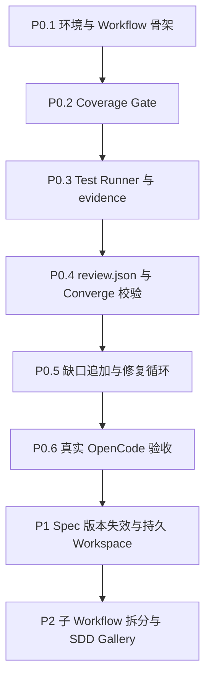
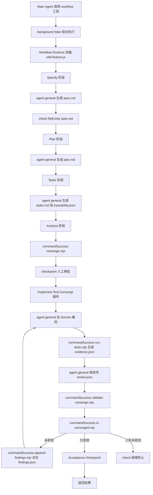

# SDD Workflow Pack 设计方案

> 日期：2026-10-13
> 状态：方案设计 v2（评审修正版）
> 基于：opencode-dynamic-workflows v0.11.2（OpenCode V1 插件 API）
> 修订：修正 4 个 P0 阻塞问题 + 3 个小问题（见修订记录）

## 修订记录

| 版本 | 日期 | 修订内容 |
|------|------|---------|
| v1 | 2026-10-13 | 初版方案 |
| v2 | 2026-10-13 | 修正 4 个 P0 阻塞：Reviewer 权限、测试证据步骤、review.json 完整性、收敛条件明确化；修正 3 个小问题：opencode.json 路径、tui.json、P0/P1 哈希区分；补充目录结构 |

## 一、概述与定位

### 1.1 是什么

**SDD Workflow Pack**：基于 Dynamic Workflows 运行时构建的规格驱动开发（Spec-Driven Development）流程包。

它模仿 GitHub Spec Kit 的核心流程（Specify -> Plan -> Tasks -> Analyze -> Implement -> Test -> Converge），但**不修改 Workflow Core**，完全在现有 JS DSL 之上实现。

### 1.2 设计边界

```
+-----------------------+-------------------------------------------+
| 层                     | 职责                                       |
+-----------------------+-------------------------------------------+
| Dynamic Workflows     | Agent 编排、控制流、重试、恢复、可观测性        |
| (Core, 不修改)         |                                           |
+-----------------------+-------------------------------------------+
| SDD Workflow Pack     | Spec/Plan/Tasks 生成、需求追踪、收敛策略       |
| (本方案, 应用层)       |                                           |
+-----------------------+-------------------------------------------+
| Coverage/Evidence 工具 | 确定性验证：覆盖率校验、测试执行、收敛判定      |
| (外部 .mjs 脚本)      | 不能交给 LLM 自行宣称成功的部分               |
+-----------------------+-------------------------------------------+
```

核心原则：**不新增 DSL 原语，不把通用 Workflow 框架变成 SDD 专用工具**。

### 1.3 五条工程约定

| 角色 | 真相源 | 不能替代 |
|------|--------|---------|
| Spec | 需求真相源 | Agent 不能凭空新增需求 |
| Traceability | 任务映射 | Agent 勾选不能代替映射 |
| Evidence | 测试事实 | Agent 描述不能代替真实测试 |
| Review | 语义结论 | 程序不能代替语义判断 |
| Converged | 程序计算的最终状态 | 任何单一环节不能代替收敛判定 |

其中任何一个环节都不能仅凭 Agent 的一句"已完成"代替。

### 1.4 Spec Kit 能力映射

| Spec Kit 能力 | 现有实现 | 本方案是否需要新增 |
|--------------|---------|----------------|
| Specify 需求生成 | `agent()` | Prompt 模板 |
| Plan 技术设计 | `agent()` | Prompt 模板 |
| Tasks 任务拆解 | `agent()` | Task 模板 |
| Analyze 需求覆盖分析 | `agent()` + `check()` | `coverage.mjs` |
| Implement 编码 | `agent({agentType:'general'})` | 编排逻辑 |
| Test 构建与测试 | `commandSuccess()` | `run-tests.mjs` + `evidence.json` |
| Converge 需求反向核验 | `agent()` + `check()` | `review.json` + `validate-converge.mjs` + `is-converged.mjs` |
| 人工审核 | `checkpoint()` | 已支持，需显式前台配置 |
| 子工作流组合 | `workflow()` | 已支持 |
| 中断恢复 | Journal + `resumeFromRunId` | 已支持，需验证循环场景 |

## 二、源码验证

以下假设已对照 `thirdparties/opencode-dynamic-workflows/` 源码逐条验证：

| 假设 | 验证结果 | 源码位置 |
|------|---------|---------|
| 版本 0.11.2，基于 OpenCode V1 插件 API | `package.json:3` version=0.11.2；`peerDependencies` = `@opencode-ai/plugin: 1.18.27` | `package.json` |
| Registry 只扫描 `.opencode-workflows/workflows/` 下一级 `.js`，不递归 | `fs.readdirSync(dir, {withFileTypes:true})` 无 recursive 选项 | `src/runtime/workflow-registry.ts:30` |
| VM 沙箱无 fs/import/require，globals 仅注入 DSL 原语 | globals = agent/workflow/parallel/pipeline/sequence/fallback/race/check/fileExists/commandSuccess/phase/log/args/setConcurrency/verify/judgePanel/retry/checkpoint/console | `workflow-runtime.ts:1280-1300` |
| Worktree 隔离是临时的，结束自动拆除，不自动合并 | `finally { if (worktree?.isolated) await removeWorktree(worktree) }` | `workflow-runtime.ts:644` |
| `checkpoint({ headless:'abort' })` 无通道时抛错终止 | `headless === "abort"` 时抛 `WORKFLOW_ABORTED` | `workflow-runtime.ts:1238-1244` |
| `check()` 失败抛 `CHECK_FAILED`（recoverable: true），不返回 false | `passed === true ? return true : throw CHECK_FAILED` | `workflow-runtime.ts:861-867` |
| `commandSuccess()` 返回 `Promise<boolean>`，不抛错 | `exec(command, ..., (error) => resolve(!error))` | `workflow-runtime.ts:879-891` |
| `fileExists()` 同步返回 boolean，相对 `shared.cwd` | `fs.existsSync(path.resolve(shared.cwd, target))` | `workflow-runtime.ts:873-876` |
| `background:false` 走前台，后台 checkpoint 走 headless 默认值 | 需要人工确认时显式传 `background:false` | `skills/.../runtime.md:178` |
| Agent 默认 agentType 为 explore（只读），写文件需显式 `agentType:'general'` | "缺省 agent 为 explore（只读）" | `skills/.../runtime.md:18` |

## 三、三大约束

### 3.1 VM 沙箱限制

Workflow 脚本运行在 VM 沙箱中，**不能**直接使用 `import`、`require` 或 Node.js 的 `fs` 读取 Spec 文档。

- 读取/写入文档：交给有权限的 Agent（`agentType: 'general'`）
- 确定性检查：通过 `commandSuccess()` 执行外部 `.mjs` 校验脚本

### 3.2 Worktree 隔离不能当持久开发空间

`agent({ isolation:'worktree' })` 创建临时 worktree，执行结束后自动清理，不自动合并代码。SDD 的连续编码、测试、修复必须在同一份可持续访问的代码上进行。

**P0 决策**：不给每个编码 Agent 加临时 worktree。使用 `fixtures/<feature>-app/` 作为受测项目，Coding Agent 在该目录中操作，与 SDD Workflow 自身代码完全分开。

### 3.3 Checkpoint 必须前台

`workflow` 工具默认后台执行，后台无交互通道时 checkpoint 可能按默认值处理。需求审批和最终交付审批必须显式 `background:false` + `headless:'abort'`。

## 四、目录结构（适配当前项目）

```
E:\WorkProjects\spec-kit-workflow/
├── opencode.json                         OpenCode 配置（加载插件、权限、skill 路径）
├── tui.json                               TUI 插件配置（可选，看进度树）
├── .opencode-workflows/
│   └── workflows/
│       └── sdd-feature.js                P0 主 SDD Workflow（平铺，不建子目录）
├── sdd/
│   ├── config.json                        SDD 配置（测试命令、源码 glob、feature 映射）
│   ├── templates/                         文档模板（Agent 参照生成）
│   │   ├── spec.md
│   │   ├── plan.md
│   │   └── tasks.md
│   ├── prompts/                           Prompt 片段（可复用，按阶段组织）
│   └── tools/                             确定性校验脚本
│       ├── coverage.mjs                  Coverage Gate：Spec -> Tasks 覆盖率
│       ├── run-tests.mjs                 执行构建与测试，生成 evidence.json
│       ├── validate-converge.mjs         review.json 完整性与结构校验
│       ├── append-findings.mjs           从 review.json 派生 findings.json，追加缺口任务
│       └── is-converged.mjs              收敛判定（7 项条件全部满足）
├── specs/
│   └── login/                            示例 Feature（P0 验收用）
│       ├── spec.md                       需求规格（FR/AC 稳定 ID）
│       ├── plan.md                       技术设计
│       ├── tasks.md                      任务清单
│       ├── traceability.json             需求 -> 任务 -> 验收映射
│       ├── review.json                   全量审查结果（每条 FR/AC）
│       ├── findings.json                 派生缺口（仅未通过项）
│       └── evidence.json                 测试事实（退出码、输出、文件哈希）
├── fixtures/                             受测项目（SDD 代码与生成代码分离）
│   └── login-app/
│       ├── src/
│       ├── tests/
│       └── package.json
├── scripts/
│   └── setup.ps1                         环境搭建脚本（junction、构建、验证）
├── thirdparties/
│   ├── spec-kit/                         GitHub spec-kit 参考实现
│   └── opencode-dynamic-workflows/      Junction -> 引擎仓库（.gitignore 忽略）
├── dev-docs/
├── dev-examples/
├── docs/
├── CLAUDE.md
├── README.md
└── .gitignore
```

### 4.1 关键路径约定

| 路径 | 用途 | 写入者 | 读取者 |
|------|------|--------|--------|
| `.opencode-workflows/workflows/sdd-feature.js` | 主 Workflow 脚本 | 人工 | Registry 自动扫描 |
| `sdd/tools/*.mjs` | 确定性校验脚本 | 人工 | `commandSuccess()` 调用 |
| `sdd/templates/*.md` | 文档模板 | 人工 | Agent 参照生成 |
| `sdd/prompts/*.md` | Prompt 片段 | 人工 | Agent 参照组装 |
| `sdd/config.json` | 测试命令与源码 glob | 人工 | `run-tests.mjs` 等工具读取 |
| `specs/<feature>/spec.md` | 需求规格 | Specify Agent | Coverage/Reviewer 读取 |
| `specs/<feature>/traceability.json` | 需求映射 | Tasks Agent | Coverage/is-converged 读取 |
| `specs/<feature>/review.json` | 全量审查 | Reviewer Agent | validate/is-converged/append 读取 |
| `specs/<feature>/evidence.json` | 测试事实 | `run-tests.mjs` | is-converged 读取 |
| `specs/<feature>/findings.json` | 派生缺口 | `append-findings.mjs` | 下一轮 Coding Agent 读取 |
| `fixtures/<feature>-app/` | 受测项目 | Coding Agent | 测试运行、Reviewer 审查 |

### 4.2 Registry 扫描约束

`workflow-registry.ts:30` 只扫描 `workflows/` 下一级 `.js` 文件，不递归。

- P0：单文件 `sdd-feature.js`，平铺
- P1 拆分时仍保持平铺：`sdd-specify.js`、`sdd-plan.js`、`sdd-converge.js`
- 不要建 `workflows/sdd/` 子目录

### 4.3 opencode.json 配置

```json
{
  "$schema": "https://opencode.ai/config.json",
  "plugin": ["./thirdparties/opencode-dynamic-workflows"],
  "permission": {
    "workflow-checkpoint:*": "ask"
  },
  "skills": {
    "paths": ["./thirdparties/opencode-dynamic-workflows/skills"]
  }
}
```

- `plugin`：相对路径基准为 `opencode.json` 所在目录，显式 `./` 前缀明确本地路径意图
- `permission`：checkpoint 需要人工确认权限
- `skills`：加载引擎仓库的 workflow-authoring skill

### 4.4 tui.json（可选）

如需查看 Workflow TUI 进度树，单独配置 TUI 插件。P0 不强制要求，开发调试时可用。

### 4.5 sdd/config.json

```json
{
  "features": {
    "login": {
      "appDir": "fixtures/login-app",
      "buildCommand": "npm run build",
      "testCommand": "npm test",
      "sourceGlobs": ["src/**/*.ts"],
      "testGlobs": ["tests/**/*.ts"]
    }
  }
}
```

`run-tests.mjs` 读取此配置决定执行什么命令、哈希哪些文件。

### 4.6 scripts/setup.ps1

`thirdparties/opencode-dynamic-workflows` 是 Windows Junction，不纳入 Git。换机器 Clone 后路径不存在。

`setup.ps1` 负责：
1. 检查/创建 junction 指向引擎仓库
2. 构建引擎插件（`npm install && npm run build`）
3. 验证插件加载（`opencode run` 预热检查）

## 五、P0 主 Workflow 设计

### 5.1 编排骨架

以下骨架基于当前 DSL API（已对照 `workflow-runtime.ts` 全部原语签名验证）。

**v2 修正点**：Reviewer 显式 `agentType:'general'`；新增 Test 步骤；Reviewer 写 `review.json`（非 findings.json）；`is-converged` 接收 round 参数。

```javascript
export const meta = {
  name: 'sdd_feature',
  description: 'Spec Kit 风格的规格驱动开发流程'
}

const feature = args.feature
const goal = args.goal

// 输入校验
await check(
  () => typeof feature === 'string' &&
    /^[a-z0-9-]+$/.test(feature) &&
    typeof goal === 'string' &&
    goal.trim().length > 0,
  '需要合法的 feature 和 goal'
)

const dir = `specs/${feature}`
const appDir = `fixtures/${feature}-app`

// 1. Specify：生成需求规格
phase('Specify')
const spec = await agent(
  `依据需求：${goal}
参照 sdd/templates/spec.md 格式。
生成 ${dir}/spec.md。
使用 FR-001、AC-001 等稳定 ID。
覆盖正常流程、异常流程及边界条件。
禁止调用 workflow 工具。`,
  { label: 'Specify', agentType: 'general', timeoutMs: 3600000 }
)
await check(() => spec !== null, 'Spec 生成失败')
await check(() => fileExists(`${dir}/spec.md`), 'Spec 文件不存在')

// 2. Plan：技术设计
phase('Plan')
const plan = await agent(
  `读取 ${dir}/spec.md，参照 sdd/templates/plan.md 格式。
生成 ${dir}/plan.md。
为每个需求设计相应实现方案。
禁止调用 workflow 工具。`,
  { label: 'Plan', agentType: 'general', timeoutMs: 3600000 }
)
await check(() => plan !== null, 'Plan 失败')

// 3. Tasks：任务拆解与追踪
phase('Tasks')
const tasks = await agent(
  `读取 ${dir}/spec.md 和 plan.md。
参照 sdd/templates/tasks.md 格式。
生成 ${dir}/tasks.md 和 ${dir}/traceability.json。
traceability.json 必须包含 specHash 字段（spec.md 内容的 sha256）。
每个 FR/AC 必须有明确任务与验收关联。
禁止调用 workflow 工具。`,
  { label: 'Tasks', agentType: 'general', timeoutMs: 3600000 }
)
await check(() => tasks !== null, 'Tasks 失败')

// 4. Analyze：确定性覆盖率门禁
phase('Analyze')
await check(
  () => commandSuccess(`node sdd/tools/coverage.mjs ${feature}`),
  'Spec -> Tasks 覆盖率未达标'
)

// 5. 用户确认后进入编码
await checkpoint(
  '需求、技术计划和任务已生成，批准进入编码？',
  { headless: 'abort' }
)

// 6. Implement -> Test -> Converge 循环
let converged = false

for (let round = 1; round <= 3; round++) {
  // 6a. Implement：编码
  phase(`Implement-${round}`)
  const code = await agent(
    `读取 ${dir}/spec.md、tasks.md、findings.json（如有）。
在 ${appDir} 目录中执行尚未完成的任务。
根据真实测试结果修复问题。
禁止调用 workflow 工具。`,
    { label: `Coding-${round}`, agentType: 'general', timeoutMs: 3600000 }
  )
  await check(() => code !== null, '编码失败')

  // 6b. Test：真实执行构建和测试，生成 evidence.json
  phase(`Test-${round}`)
  await check(
    () => commandSuccess(
      `node sdd/tools/run-tests.mjs ${feature} ${round}`,
      600000
    ),
    '测试执行脚本出错（脚本本身无法运行，非测试失败）'
  )

  // 6c. Converge：Reviewer 逐条审查全部 FR/AC
  phase(`Converge-${round}`)
  const review = await agent(
    `独立核验 ${dir}/spec.md、plan.md、tasks.md、traceability.json
和 ${appDir} 中的真实代码、${dir}/evidence.json 中的测试证据。
逐条检查每个 FR 和 AC，不遗漏任何一条。
不要相信任务勾选状态。
仅写 ${dir}/review.json，禁止修改任何代码文件。
review.json 必须包含 spec 中每一条 FR/AC 的审查结果。
状态只允许 pass、partial、missing、contradicts。
禁止调用 workflow 工具。`,
    { label: `Reviewer-${round}`, agentType: 'general', timeoutMs: 3600000 }
  )
  await check(() => review !== null, 'Review 失败')

  // 6d. 校验 review.json 完整性与结构
  await check(
    () => commandSuccess(
      `node sdd/tools/validate-converge.mjs ${feature} ${round}`
    ),
    '审查记录无效或不完整（缺少 FR/AC 或字段不合规）'
  )

  // 6e. 收敛判定
  converged = await commandSuccess(
    `node sdd/tools/is-converged.mjs ${feature} ${round}`
  )

  if (converged) break

  // 6f. 从 review.json 派生 findings.json，追加缺口任务到 tasks.md
  await check(
    () => commandSuccess(
      `node sdd/tools/append-findings.mjs ${feature} ${round}`
    ),
    '缺口任务追加失败'
  )
}

await check(() => converged, '三轮收敛后仍存在未完成需求')

// 7. 最终交付审批
phase('Acceptance')
await checkpoint(
  '所有必需需求已验证，是否接受交付？',
  { headless: 'abort' }
)

return { feature, converged, output: `${feature} 完成 SDD 验证` }
```

### 5.2 骨架关键设计点

| 设计点 | 说明 | 源码依据 |
|--------|------|---------|
| `check()` 作为门禁 | false 时抛 `CHECK_FAILED`（recoverable），终止当前阶段 | `workflow-runtime.ts:861-867` |
| `commandSuccess()` 取布尔值 | 返回 `Promise<boolean>`，不抛错，用于 `if` 分支和 `check()` 内 | `workflow-runtime.ts:879-891` |
| `fileExists()` 在 `check()` 内用 | 同步函数，相对 `shared.cwd` 检查文件存在性 | `workflow-runtime.ts:873-876` |
| `checkpoint({headless:'abort'})` | 无人工通道时抛 `WORKFLOW_ABORTED`，防止后台误过 | `workflow-runtime.ts:1238-1244` |
| Reviewer 显式 `agentType:'general'` | 默认 explore 只读无写权限；Reviewer 需写 review.json | `runtime.md:18` |
| Agent prompt "禁止调用 workflow 工具" | 软约束：防止 general agent 嵌套调用 workflow 造成递归 | `runtime.md` 文档约定 |
| 不使用 `isolation:'worktree'` | 编码 Agent 在 fixtures 目录操作，保证连续性 | 3.2 节约束 |
| 循环内 `phase()` 带 round 后缀 | 每轮独立阶段名，journal hash 含 phase，不混缓存 | `workflow-runtime.ts:411-412` |
| Test 步骤 `check` 只检查脚本执行 | `run-tests.mjs` 退出 0=脚本正常运行（含测试失败）；退出 1=脚本本身出错 | 6.2 节约定 |
| `is-converged` 接收 round 参数 | 每轮 evidence 独立，避免跨轮证据混淆 | 6.3 节约定 |

### 5.3 Resume 注意事项

Journal 恢复基于 Agent 调用参数（prompt/model/phase/agentType/schema）的哈希匹配。

**P0 规定**：外部修改 Spec 后必须发起新 Run，不能 Resume。

**P0 与 P1 哈希机制区分**：

| 层次 | P0 | P1 |
|------|----|----|
| Coverage 版本检查 | `coverage.mjs` 比对 `traceability.json.specHash` 与 `spec.md` 当前 sha256；不匹配则报错 | 同 P0，保持 |
| Journal 缓存失效 | 不做；外部修改 Spec 后禁止 Resume | 基于文件内容哈希的依赖失效机制，Spec 变更自动使相关 Agent 结果失效 |

P0 的 Coverage 版本检查是**工具层**的校验（`coverage.mjs` 读取文件比对哈希），与 P1 的 Journal 缓存失效是**运行时层**的机制（Runtime 自动检测文件变更并使 journal 失效）完全不同。

## 六、三大工程模块

### 6.1 Coverage Gate（`coverage.mjs`）

**职责**：严格 ID 集合检查，不使用 LLM 推断。

**输入**：`specs/<feature>/spec.md`、`tasks.md`、`traceability.json`

**输出**：包含具体缺口的报告（stdout）+ 进程退出码（0=通过，1=未达标）

**检查规则**：

1. 所有必需 FR 和 AC 必须有任务映射
2. 映射引用的任务 ID 必须真实存在于 tasks.md
3. 每个验收项（AC）必须有验证方案
4. 需求 ID 不能重复
5. `traceability.json.specHash` 必须等于当前 `spec.md` 内容的 sha256（Spec 变更后旧 traceability 失效）

**类比理解**：Coverage Gate 就像建筑验收时的图纸对照检查——不看墙砌得好不好（那是 Converge 的事），只看施工图是否覆盖了设计图的每一面墙、每根管线。少一面墙就拒绝开工。

### 6.2 Test Runner（`run-tests.mjs`）

**职责**：真实执行构建和测试，生成 `evidence.json`。

**这是 v2 新增的步骤**，原方案缺少此环节，导致证据可能只有 Agent 自己写出的描述。

**输入**：`sdd/config.json`（构建命令、测试命令、源码 glob）

**输出**：`specs/<feature>/evidence.json` + stdout 日志

**退出码约定**：

| 退出码 | 含义 | Workflow 行为 |
|--------|------|--------------|
| 0 | 脚本正常执行（**含测试失败**） | `check` 通过，继续 Converge |
| 1 | 脚本本身出错（找不到测试运行器、配置缺失等） | `check` 抛 `CHECK_FAILED`，Workflow 终止 |

关键：测试失败时 `run-tests.mjs` **仍然退出 0**，将失败记录在 `evidence.json` 中。测试是否通过由 `is-converged.mjs` 判定，不由 `check()` 拦截。这样 Coding Agent 能看到失败证据并在下一轮修复。

**evidence.json 结构**：

```json
{
  "feature": "login",
  "round": 2,
  "buildStatus": "success",
  "buildOutput": "...",
  "testResults": [
    {
      "testName": "login-lockout",
      "status": "failed",
      "exitCode": 1,
      "output": "AssertionError: expected lockout..."
    }
  ],
  "fileHashes": [
    { "file": "src/auth/login.ts", "hash": "sha256-abc..." },
    { "file": "tests/login-lockout.test.ts", "hash": "sha256-def..." }
  ],
  "generatedAt": "2026-10-13T12:00:00Z"
}
```

`fileHashes` 记录相关源码和测试文件的内容哈希。`is-converged.mjs` 比对此哈希与当前文件内容，防止 Agent 后续修改代码后旧测试结果继续被当成有效证据。

### 6.3 Convergence Gate（`validate-converge.mjs` + `is-converged.mjs`）

**职责**：判断代码实际行为是否满足 Spec，为每个 FR/AC 保存证据。

与 Coverage Gate 的区别：

| 维度 | Coverage Gate | Convergence Gate |
|------|--------------|-----------------|
| 检查对象 | Spec -> Tasks 映射 | 代码行为 -> Spec 需求 |
| 使用 LLM | 否 | 是（Reviewer agent 判断行为） |
| 证据 | 无 | review.json + evidence.json |
| 时机 | Analyze 阶段（一次） | 每轮 Converge 阶段 |

#### validate-converge.mjs

校验 `review.json` 的**完整性与结构**：

1. `review.json` 必须包含 spec 中**每一条** FR/AC（比对 ID 集合）
2. 每条记录的 `status` 只允许 `pass`、`partial`、`missing`、`contradicts`
3. `status` 非 `pass` 时必须有 `finding` 字段
4. `feature` 和 `round` 字段与调用参数一致

**这是防止 Reviewer 偷懒只检查几条的关键**：假设 Spec 有 10 条 FR，Reviewer 只检查了 3 条没发现问题就生成空 findings，程序无法区分"全检查了没问题"和"只看了几条"。`review.json` 必须包含全部 ID，缺任何一条都不允许通过。

#### is-converged.mjs

**7 项收敛条件，全部满足才返回 true**：

| 条件 | 检查来源 |
|------|---------|
| Spec 中必需 FR/AC 全部有 Task 映射 | traceability.json |
| review.json 包含每条必需 FR/AC | review.json vs spec.md ID 集合 |
| 所有必需 FR/AC 审查状态都是 `pass` | review.json |
| 所有必需验收项关联真实通过的测试或审核证据 | review.json.evidenceRefs + evidence.json |
| 构建与必须执行的测试通过 | evidence.json.buildStatus + testResults |
| 测试证据文件哈希对应当前代码内容 | evidence.json.fileHashes vs 当前文件 sha256 |
| 不存在未解决的阻断级问题 | review.json 中无 missing/contradicts |

**注意**：Git HEAD 不能单独代表当前代码版本，因为 Coding Agent 可能尚未提交修改。P0 直接计算相关源码和测试文件的内容哈希，保存到 `evidence.json`，Converge 时比对。

#### append-findings.mjs

- 从 `review.json` 提取非 `pass` 项，派生写入 `findings.json`
- 将缺口追加到 `tasks.md`（不重复编号，检查已有任务 ID）
- 不删除旧任务
- 下一轮 Coding Agent 读取 `findings.json` 知道该修什么

**findings.json 由程序从 review.json 派生**，不由 Agent 直接写入，避免两个文件出现矛盾。

**类比理解**：Coverage Gate 是考前检查考卷是否覆盖所有知识点。Test Runner 是实际考试并保留答卷。Convergence Gate 是考后阅卷——不仅看学生说"我做完了"（任务勾选），还要看卷面答案（代码行为）和考试成绩（测试证据）是否真的对。`review.json` 是阅卷评分表（每道题都有分数），`findings.json` 是错题本（只列做错的题）。

## 七、分阶段实施计划



| 阶段 | 实现内容 | 是否改 Core | 交付物 | 验收重点 |
|------|---------|-----------|-------|---------|
| P0.1 | 独立项目环境、Workflow 骨架、模板 | 否 | `sdd/templates/*.md` + `sdd-feature.js` + `opencode.json` + `setup.ps1` | Registry 可加载；Spec/Plan/Tasks 可生成 |
| P0.2 | FR/AC Coverage Gate | 否 | `coverage.mjs` | 能发现缺少 Task 的 FR/AC |
| P0.3 | Test Runner + evidence.json | 否 | `run-tests.mjs` | 真实测试结果落盘，失败不能冒充成功 |
| P0.4 | review.json + Converge 校验 | 否 | `validate-converge.mjs` + `is-converged.mjs` | 所有需求必须逐项审查；7 项条件全满足才收敛 |
| P0.5 | 缺口追加与修复循环 | 否 | `append-findings.mjs` | 故意遗漏的需求能自动修复 |
| P0.6 | 真实 OpenCode 验收 | 否 | `specs/login/` 验收产物 | 失败、恢复、人工拒绝及收敛上限全部通过 |
| P1 | Spec 版本失效、恢复一致性、持久 Workspace | 可能需要 | 文件哈希失效机制 | Journal 缓存自动失效 |
| P2 | 子 Workflow 拆分与可复用 SDD Gallery | 原则上不需要 | `sdd-specify.js` 等 | 可独立运行的 SDD 子流程 |

### P1 风险预告

当前 Journal 恢复基于 Agent 调用参数哈希。如果 `spec.md` 被外部修改但 Agent Prompt 未变化，Resume 有可能复用旧结果。

- P0 规定：外部修改 Spec 后必须发起新 Run
- P0 的 Coverage 版本检查（`specHash` 比对）是工具层防护，不涉及 Journal
- P1 目标：Runtime 层基于文件内容哈希的依赖失效机制

## 八、P0 验收清单

使用包含 10 条 FR 的小型登录系统做实验。受测项目在 `fixtures/login-app/`。

从项目根目录启动 OpenCode，让主 Agent 调用 `workflow` 工具：

```json
{
  "scriptPath": ".opencode-workflows/workflows/sdd-feature.js",
  "args": {
    "feature": "login",
    "goal": "实现包含失败锁定机制的账号密码登录"
  },
  "background": false
}
```

> `scriptPath` 使用文件路径（非注册名）。`script-source.ts:30` 将 `scriptPath` 作为文件路径解析（`resolve(cwd, path)`），不做 Registry 名查找。Registry 名查找仅用于脚本内 `workflow()` 全局函数。`background: false` 确保 checkpoint 前台执行。

| 序号 | 验收项 | 预期 |
|------|--------|------|
| 1 | 正常完整实现：全部需求通过 | 全流程跑通，Converged=true |
| 2 | 遗漏任务：Analyze 必须发现 | Coverage Gate 报告缺口，Workflow 终止 |
| 3 | 任务已完成但代码缺失：Converge 必须发现 | Reviewer 标记 missing，未 Converged |
| 4 | 部分实现：标记 partial 并补任务 | review.json 记录 partial，append-findings 派生 findings.json 并追加任务 |
| 5 | 真实测试失败：不得判定 Converged | evidence.json 记录失败，is-converged 返回 false |
| 6 | Reviewer 报告缺字段或漏 FR：必须失败 | validate-converge 退出码 1 |
| 7 | 补漏任务重复执行：不重复追加 | append-findings 检测已有 ID 不重复 |
| 8 | 人工拒绝：停止交付 | checkpoint 抛 CHECKPOINT_REJECTED，Workflow 终止 |
| 9 | 三轮上限仍失败：如实输出未完成项 | check 抛 '三轮收敛后仍存在未完成需求' |
| 10 | 代码修改后旧测试证据失效 | is-converged 比对 fileHashes，哈希不匹配则不收敛 |

## 九、运行时调用关系



## 十、Artifact Contract 索引

各 Artifact 的完整数据结构、字段校验、版本关系和通过条件见独立文档：

**`dev-docs/design/sdd-artifact-contract.md`**

该文档定义以下 Artifact 契约：

| Artifact | 真相源角色 | 写入者 | 关键约束 |
|----------|----------|--------|---------|
| `spec.md` | 需求真相源 | Specify Agent | FR/AC 稳定 ID，不重复 |
| `traceability.json` | 任务映射 | Tasks Agent | 必含 specHash，ID 集合覆盖 spec |
| `review.json` | 语义结论 | Reviewer Agent | 必须包含每条 FR/AC，status 枚举 |
| `evidence.json` | 测试事实 | `run-tests.mjs` | 含 fileHashes，退出码真实 |
| `findings.json` | 派生缺口 | `append-findings.mjs` | 从 review.json 派生，不由 Agent 写 |
| `tasks.md` | 任务清单 | Tasks Agent + append-findings | ID 不重复，旧任务不删 |
| `sdd/config.json` | 工具配置 | 人工 | 测试命令、源码 glob |

## 十一、参考引用

| 参考 | 路径/链接 |
|------|----------|
| Workflow Runtime 源码 | `thirdparties/opencode-dynamic-workflows/src/runtime/workflow-runtime.ts` |
| Workflow Registry 源码 | `thirdparties/opencode-dynamic-workflows/src/runtime/workflow-registry.ts` |
| DSL Runtime API 文档 | `thirdparties/opencode-dynamic-workflows/skills/workflow-authoring/references/runtime.md` |
| GitHub spec-kit | `thirdparties/spec-kit/` (https://github.com/github/spec-kit) |
| opencode-dynamic-workflows 仓库 | https://github.com/mickorz/opencode-dynamicworkflows |
| 引擎仓库 package.json | `thirdparties/opencode-dynamic-workflows/package.json` |
| 示例工程 opencode.json | `thirdparties/opencode-dynamic-workflows/examples/sample-project/opencode.json` |
| SDD Artifact Contract | `dev-docs/design/sdd-artifact-contract.md` |
