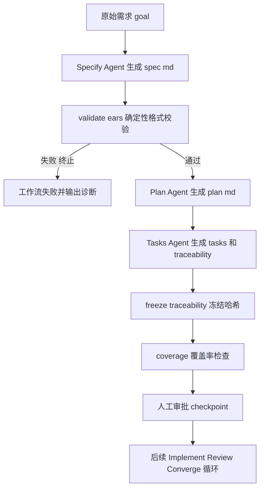

# EARS 改造 P0 执行文档：EARS 基础契约

> 阶段编号：EARS-P0
> 状态：待执行
> 需求来源：`dev-docs/planning/解释EARS语法.md`（改造需求文档 v1.0）
> 改造策略：Breaking Change，不兼容旧版 Spec，无 off/warn/enforce 开关，EARS 为强制标准
> 前置依赖：无（可直接启动）

## 一、阶段目标

把 `spec.md` 的验收条件从自由自然语言升级为 EARS 强制规范，并建立确定性格式门禁：

1. 所有 AC 必须符合 EARS 句式，格式错误无法进入 Plan 阶段。
2. FR 和 NFR 都必须有至少一条 AC，NFR 不再允许空验收路径。
3. Spec 解析统一为一个解析器，消灭 coverage.mjs 与 audit-spec-parse.mjs 各自维护正则的分裂状态。
4. 保留现有 FR/AC/NFR 稳定 ID、specHash、Traceability、Review、Evidence、Converge 机制不变。

**类比理解**：现有 Spec 像手写地址信封，能看懂但格式随意；P0 之后像标准化快递面单——收件人（主体）、触发条件（事件）、必须动作（shall 行为）各就各位，机器可分拣。

**本阶段覆盖的需求项**：ER-FR-001（Specify EARS 生成）、ER-FR-002（确定性格式校验）、ER-FR-005（统一解析器）、ER-FR-006（Coverage Gate 增强）、ER-FR-009（EARS Gate 前置于 Plan）、ER-FR-010（格式诊断输出）。

**不在本阶段**：语义质量审查、自动修复循环、人工澄清（属 P1）；PRD 防漏追踪（属 P2）。

## 二、新增与修改文件总览

| 文件 | 操作 | 任务 |
|------|------|------|
| `sdd/rules/ears-format.md` | 新增 | E0-T01 |
| `sdd/templates/spec.md` | 重写 | E0-T02 |
| `sdd/tools/spec-parser.mjs` | 新增 | E0-T03 |
| `sdd/tools/validate-ears.mjs` | 新增 | E0-T04 |
| `sdd/tools/validate-ears-example.mjs` | 新增（验证脚本） | E0-T04 |
| `sdd/tools/coverage.mjs` | 修改 | E0-T05 |
| `sdd/tools/audit-spec-parse.mjs` | 修改（改为薄封装） | E0-T06 |
| `.opencode-workflows/workflows/sdd-feature.js` | 修改 | E0-T07、E0-T08 |

## 三、任务拆解

### E0-T01 新建 sdd/rules/ears-format.md

基于 submodule `thirdparties/cc-sdd/tools/cc-sdd/templates/shared/settings/rules/ears-format.md` 提取并本地化，避免运行期依赖第三方仓库。

内容必须包含：

1. 五种基础句式 + 两种复合句式，触发关键字（When/While/If/Where/The/shall）保留英文，变量部分（事件、主体、行为）使用中文。
2. 主体选择规范：使用具体系统/服务名（如"登录系统"），禁止用"系统"泛指。
3. 质量标准：可测试、可观察、单一行为、一条 AC 只允许一个 shall、禁止模糊词（快速、稳定、安全）、禁止擅自补充原始需求未包含的业务数值。
4. 中文示例（正例 + 反例各一组）。

### E0-T02 重写 sdd/templates/spec.md

新版模板（保留 `- AC-NNN:` 行首格式，AC 内容允许折行）：

```markdown
# Feature: {{FEATURE_NAME}}

## 概述

{{FEATURE_GOAL}}

## 功能需求

### FR-001: 需求标题

需求描述。

**验收条件**：

- AC-001: When 玩家提交正确的账号和密码,
  the 登录系统 shall 验证身份并创建登录会话。

- AC-002: If 玩家提交错误密码,
  the 登录系统 shall 拒绝登录并返回认证失败结果。

## 非功能需求

### NFR-001: 非功能需求标题

非功能需求描述。

**验收条件**：

- AC-003: The 登录服务 shall 在 100 并发请求下
  保证 95% 的登录响应时间不超过 500ms。

<!-- ID 规则：FR-NNN 三位数字全局唯一；NFR-NNN 三位数字全局唯一；
     AC-NNN 三位数字在整个 Spec 内全局唯一，只归属一个 FR/NFR；
     每个 FR/NFR 至少一条 AC，且必须符合 sdd/rules/ears-format.md 句式 -->
```

关键约束：

- FR 与 NFR 一视同仁，都必须有验收条件块。
- 多行 AC 的续行使用两个空格缩进，续行不得以 `- ` 或 `#` 开头。

### E0-T03 新建 sdd/tools/spec-parser.mjs（统一解析器）

现状问题：`coverage.mjs` 用 `/###\s+(FR-\d{3})/` 与 `/-\s+(AC-\d{3})/`，`audit-spec-parse.mjs` 用 `/### (FR-\d+)/` 且逐行归属 AC——两套正则对多行 AC、ID 位数、空格容错的口径不一致。

新解析器 API（ESM，供各工具 import）：

```js
export function parseSpec(content) {
  // 返回：
  // {
  //   frIds, nfrIds, acIds,           // 按文档出现顺序
  //   acToReq,                        // { 'AC-001': 'FR-001', ... }
  //   requirements: [                 // FR 在前 NFR 在后，按出现顺序
  //     { id, type: 'FR'|'NFR', title, acs: [{ id, text, line }] }
  //   ]
  // }
}
```

解析规则：

1. 需求标题：`^###\s+(FR-\d{3}|NFR-\d{3}):` （与 coverage.mjs 现行三位数字口径一致）。
2. AC 块：以 `^-\s+(AC-\d{3}):` 开始，后续以空白开头的行都并入该块 `text`，直到遇到下一个 AC、`#` 标题或非缩进行。
3. `text` 为去掉 `- AC-NNN:` 前缀后的完整句子（跨行合并、空白折叠），`line` 记录 AC 起始行号（供诊断定位）。
4. 解析器只做结构解析，不做 EARS 句式判断（职责单一，句式判断归 validate-ears.mjs）。

### E0-T04 新建 sdd/tools/validate-ears.mjs（确定性格式校验）

用法：`node sdd/tools/validate-ears.mjs <feature>`，退出码 0=通过、1=失败。支持 `--json` 输出机器可读诊断。

校验规则（全部确定性，无 LLM 参与）：

1. **结构规则**（基于 spec-parser.mjs 输出）：
   - FR/NFR/AC ID 格式合法（三位数字）且全局唯一。
   - 每个 FR、每个 NFR 至少一条 AC。
   - 每条 AC 必须归属唯一 FR/NFR（acToReq 覆盖所有 AC）。

2. **句式规则**（对每条 AC 的归一化文本匹配，命中且仅命中一个句式类）：

```
归一化：全角逗号"，"替换为", "；多个空白折叠为单个空格；首尾去空白。

COMPOUND = /^While\s+\S.*?,\s*when\s+\S.*?,\s*the\s+\S.*?\s+shall\s+\S.*$/
EVENT    = /^When\s+\S.*?,\s*the\s+\S.*?\s+shall\s+\S.*$/
STATE    = /^While\s+\S.*?,\s*the\s+\S.*?\s+shall\s+\S.*$/
UNWANTED = /^If\s+\S.*?,\s*(?:then\s+)?the\s+\S.*?\s+shall\s+\S.*$/
OPTIONAL = /^Where\s+\S.*?,\s*the\s+\S.*?\s+shall\s+\S.*$/
UBIQ     = /^The\s+\S.*?\s+shall\s+\S.*$/
```

   - 关键字 When/While/If/Where/The/shall 必须为英文（中文关键字如"当...时""必须"直接判失败）。
   - `shall` 在单条 AC 中出现次数必须为 1（多个 shall 判定"疑似多行为"）。
   - 条件段、主体段、行为段均非空且长度不小于 2 个字符。
   - If 句式逗号后允许可选 `then`（与 cc-sdd 示例兼容）。

3. **诊断输出格式**（对应 ER-FR-010）：

```
[FAIL] EARS 校验失败（3 处问题）:
  - AC-007 (spec.md:24) [syntax] 不符合任何 EARS 句式，缺少触发关键字 When/While/If/Where/The
  - AC-011 (spec.md:38) [multi-behavior] 包含 2 个 shall 子句，应拆分为多条 AC
  - FR-004 (spec.md:52) [no-ac] 功能需求没有任何验收条件
```

错误类型枚举：`syntax`（句式不合规）、`multi-behavior`（多 shall）、`empty-segment`（条件/主体/行为为空）、`no-ac`（需求无 AC）、`orphan-ac`（AC 无归属）、`duplicate-id`（ID 重复）、`bad-id`（ID 格式错误）。

### E0-T05 coverage.mjs 接入统一解析器并增强

改动点：

1. 删除文件内的 FR/AC/NFR 手写正则，改为 `import { parseSpec } from './spec-parser.mjs'`。
2. 新增规则（对应 ER-FR-006）：
   - NFR 的 mapping `acceptanceIds` 为空数组时判失败（旧版允许）。
   - mapping 中 `acceptanceIds` 出现不属于该 requirement 的 AC（按 acToReq 校验归属）判失败。
   - mapping 引用了 spec 中不存在的 AC 判失败（现行仅检查反向遗漏）。
3. 输出摘要增加 NFR AC 覆盖统计。

注意：`specHash` 计算、tasks.md 的 `## T-NNN` 解析、verificationMethod 枚举校验保持不变。

### E0-T06 audit-spec-parse.mjs 改为统一解析器的 CLI 封装

- 内部改用 `parseSpec()`，stdout JSON 结构保持不变（`totalRequirements/frIds/nfrIds/acIds/acToReq/requirements`），保证 `sdd-audit.js` 与现有消费者零改动。
- 多行 AC 场景下 `acToReq` 归属结果与 coverage.mjs 完全一致（同一解析器，天然满足 ER-FR-005 的"各阶段解析一致"）。

### E0-T07 sdd-feature.js Specify 阶段改造 + EARS 格式门禁

1. 替换 Specify prompt（新版全文）：

```
依据原始需求：${goal}

读取以下文件：
- sdd/templates/spec.md（新版 EARS Spec 模板）
- sdd/rules/ears-format.md（EARS 语法规则）

要求：
1. 使用 FR-NNN / NFR-NNN / AC-NNN 稳定 ID，三位数字，全局唯一不重复
2. 每个 FR 和 NFR 必须至少包含一条 AC
3. 所有 AC 必须使用 EARS 句式，触发关键字 When While If Where The shall 保留英文
4. 每条 AC 只描述一个主要行为，只允许出现一个 shall
5. AC 必须可观察、可验证，禁止模糊词如 快速 稳定 安全
6. 不得擅自补充原始需求未提及的业务数值或规则
7. 无法确定的条件以 [待澄清: 原因] 标记，不得猜测
8. 按模板结构生成 ${dir}/spec.md

禁止调用 workflow 工具。
```

2. 在 Specify 之后、Plan 之前插入确定性门禁（对应 ER-FR-009：Gate 未通过不允许 Plan 启动）：

```js
// 1.5 EARS 格式门禁（确定性，无 LLM）
await check(
  () => commandSuccess(`node sdd/tools/validate-ears.mjs ${feature}`),
  'EARS 格式校验失败，详见诊断输出'
)
```

P0 阶段门禁失败即终止工作流（自动修复循环属 P1，见 EARS-P1 执行文档 E1-T02）。

### E0-T08 sdd-feature.js Tasks 阶段 prompt 调整

删除旧 prompt 中以下两行（与新版契约矛盾）：

- `NFR 的 acceptanceIds 可为空数组。`
- 示例 mapping 中 NFR 的 `"acceptanceIds": []`。

替换为：

```
- NFR 的 acceptanceIds 不允许为空，必须列出该 NFR 的全部 AC。
- acceptanceIds 中的 AC 必须归属对应的 requirementId。
```

### E0-T09 端到端冒烟验证

1. 删除或归档 `specs/login/` 旧产物（不迁移，Breaking Change）。
2. 以 login 需求跑一次完整 `sdd.feature()`：Specify → EARS Gate → Plan → Tasks → Analyze（freeze-traceability + coverage）→ checkpoint。
3. 确认 coverage.mjs、audit-spec-parse.mjs 对新生成 spec.md 解析一致。

## 四、新版工作流位置（P0 完成后）



## 五、测试计划

### validate-ears-example.mjs 用例矩阵

| 用例 | 输入要点 | 预期 |
|------|---------|------|
| V01 五句式正例 | When/While/If/Where/The 各一条 | 通过 |
| V02 复合句式正例 | While 前置 + When 复合、When and 条件 | 通过 |
| V03 多行折行 AC | 续行缩进两空格 | 解析为单条，通过 |
| V04 全角逗号 | 归一化后匹配 | 通过 |
| V05 缺 shall | `When 点击, the 系统执行动作` | 失败 syntax |
| V06 双 shall | 一条 AC 两个 shall | 失败 multi-behavior |
| V07 中文关键字 | `当玩家点击时 系统 必须...` | 失败 syntax |
| V08 空条件段 | `When , the X shall Y` | 失败 empty-segment |
| V09 FR 无 AC | 只有描述 | 失败 no-ac |
| V10 NFR 无 AC | 只有描述 | 失败 no-ac |
| V11 孤儿 AC | AC 出现在任何 FR/NFR 块外 | 失败 orphan-ac |
| V12 重复 AC ID | AC-001 出现两次 | 失败 duplicate-id |
| V13 诊断格式 | 各失败类型 | 输出含 AC ID 行号 类型 原因 |

### coverage 回归

| 用例 | 预期 |
|------|------|
| NFR mapping acceptanceIds 为空 | 失败 |
| AC 被映射到错误 requirement | 失败 |
| EARS 化的合法 spec + 完整 mapping | 通过 |

### 端到端

E0-T09 的 login 全流程跑通，Coverage Gate 通过，checkpoint 正常弹出。

## 六、风险与注意事项

1. **多行 AC 解析边界**：续行判定依赖缩进，模板和 prompt 必须明确"续行缩进两空格"。若 LLM 生成时不缩进，解析会截断——validate-ears 对"看起来像 EARS 但被截断"的行会报 syntax 错误，可据此定位。
2. **specHash 连锁**：E0-T09 重新生成 spec 后，旧 traceability/review/evidence 一并作废，必须整目录重来，不要混用新旧产物。
3. **审计夹具**：`audit-fixtures/`（v1-v4）与 `blind-test/` 仍是旧格式，本阶段不强制更新（属 P1 E1-T07），但 `sdd-audit.js` 对新格式 spec 的审计要等 P1 才端到端验证。
4. **正则口径**：`.*?` 惰性匹配 + `\S.*?` 保证段非空；匹配前必须归一化，避免 LLM 输出全角标点导致误报。
5. 中文内容中天然含 "the"（如 "other"）的概率低，但句式匹配以句首关键字为准，误报率可控。

## 七、完成定义（验收清单）

- [ ] sdd/rules/ears-format.md 存在且覆盖五句式 + 复合句式 + 质量标准
- [ ] sdd/templates/spec.md 为 EARS 版，FR/NFR 均含 AC 块
- [ ] spec-parser.mjs 被 coverage.mjs 与 audit-spec-parse.mjs 共同使用，解析结果一致
- [ ] validate-ears.mjs 通过 V01-V13 全部用例
- [ ] 非 EARS 句式、无 AC 的 FR/NFR、重复 ID、孤儿 AC 均被拒绝（ER-FR-002 验收）
- [ ] NFR 空 acceptanceIds 在 coverage.mjs 判失败（ER-FR-006 验收）
- [ ] EARS Gate 位于 Plan 之前，未通过则 Plan 不启动（ER-FR-009 验收）
- [ ] 失败输出含 AC ID、行号、错误类型、原因（ER-FR-010 验收）
- [ ] login feature 端到端冒烟通过
- [ ] 更新 dev-docs/progress/执行进度.md 与 progress-result 对应报告

## 八、引用说明

- 需求来源：`dev-docs/planning/解释EARS语法.md`（改造需求文档 v1.0）
- cc-sdd EARS 规则参考：`thirdparties/cc-sdd/tools/cc-sdd/templates/shared/settings/rules/ears-format.md`
- cc-sdd 需求审查门禁参考（P1 使用）：`thirdparties/cc-sdd/tools/cc-sdd/templates/shared/settings/rules/requirements-review-gate.md`
- EARS 原始方法：https://alistairmavin.com/ears/
- 现有 Artifact 契约：`dev-docs/design/sdd-artifact-contract.md`
