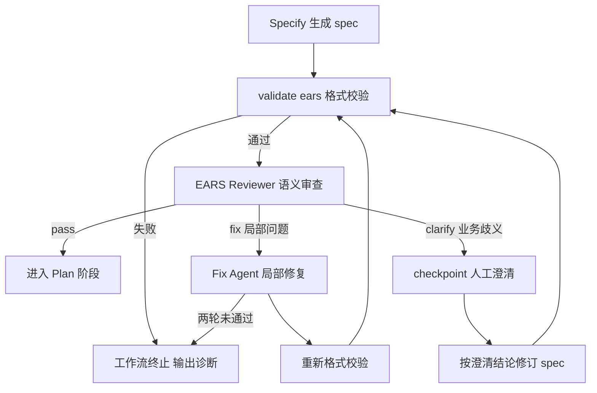

# EARS 改造 P1 执行文档：质量门禁与端到端集成

> 阶段编号：EARS-P1
> 状态：待执行
> 需求来源：`dev-docs/planning/解释EARS语法.md`（改造需求文档 v1.0）
> 前置依赖：EARS-P0 完成（统一解析器、validate-ears.mjs、EARS 格式门禁已就绪）

## 一、阶段目标

在 P0 确定性格式门禁之上，增加语义质量门禁与修复机制，并让 Feature 与 Audit 两条链路全面按"逐 AC"口径验收：

1. 格式正确但语义模糊、不可测试、混入实现细节的 AC 必须被独立 Reviewer 识别。
2. 局部问题自动修复（最多两轮），真正的业务歧义必须人工澄清，禁止猜测。
3. Review、Converge、Audit 全链路按 AC 粒度校验证据，NFR 不再有免检通道。
4. 审计夹具与决定性测试全部 EARS 化并回归通过。

**类比理解**：P0 的格式门禁像机场安检检查证件是否齐全；P1 的语义门禁像边检询问——证件齐全也要盘问来意（可测试性）、行程是否矛盾（歧义）、是否夹带违禁品（实现细节混入需求）。

**本阶段覆盖的需求项**：ER-FR-003（独立语义审查）、ER-FR-004（修复与澄清机制）、ER-FR-007（Review 与 Converge 增强）、ER-FR-008（独立 Audit 适配）、ER-FR-009（审批与基线一致性收尾）、ER-FR-010（语义诊断与状态区分）。

## 二、新增与修改文件总览

| 文件 | 操作 | 任务 |
|------|------|------|
| `.opencode-workflows/workflows/sdd-feature.js` | 修改 | E1-T01、E1-T02 |
| `sdd/rules/ears-semantic-review.md` | 新增 | E1-T01 |
| `sdd/tools/ears-review-verdict.mjs` | 新增 | E1-T01 |
| `sdd/tools/validate-review.mjs` | 修改 | E1-T03 |
| `sdd/tools/is-converged.mjs` | 修改 | E1-T04 |
| `.opencode-workflows/workflows/sdd-audit.js` | 修改 | E1-T05 |
| `sdd/tools/audit-converge.mjs` | 修改 | E1-T05 |
| `audit-fixtures/`、`blind-test/` | 重新生成 | E1-T07 |

## 三、任务拆解

### E1-T01 EARS 语义质量门禁（独立 Reviewer）

参考 cc-sdd `requirements-review-gate.md`，新建规则文件 `sdd/rules/ears-semantic-review.md`，审查维度：

| 维度 | 检查内容 |
|------|---------|
| 可测试性 | 行为是否可观察、可验证，是否含模糊词（快速、稳定、安全、友好） |
| 单一行为 | 一条 AC 是否混合多个行为（格式层已查双 shall，语义层查隐性复合） |
| 歧义 | 条件或行为是否有多重解读 |
| 一致性 | AC 之间是否重复或矛盾 |
| WHAT/HOW | 是否把技术实现（数据库、框架、API 形态）混入需求 |
| 无依据新增 | 是否擅自补充原始需求未提及的业务数值或规则 |
| 待澄清标记 | `[待澄清: 原因]` 是否存在（存在即走澄清路径，不自动放行） |

Reviewer Agent 在 Specify + 格式校验通过后运行，读取 `specs/<feature>/spec.md`、`sdd/rules/ears-format.md`、`sdd/rules/ears-semantic-review.md` 与原始 `${goal}`，将结论写入 `specs/<feature>/ears-review.json`：

```json
{
  "feature": "login",
  "verdict": "pass",
  "issues": [
    {
      "target": "AC-014",
      "type": "untestable",
      "severity": "blocker",
      "message": "响应时间不超过合理范围 中 合理 未定义可验证标准"
    }
  ]
}
```

字段契约：

- `verdict` 枚举：`pass`（全部通过）、`fix`（存在可自动修复的局部问题）、`clarify`（存在业务歧义，必须人工确认）。
- `issues[].target` 为 AC-NNN / FR-NNN / NFR-NNN / `spec`（整体问题）。
- `issues[].type` 枚举：`untestable`、`ambiguous`、`multi-behavior`、`contradicts`、`duplicate`、`implementation-detail`、`unsupported-rule`、`needs-clarification`、`coverage-gap`。
- `severity` 枚举：`blocker`（必须处理）、`warning`（记录不阻断）。

新增 `sdd/tools/ears-review-verdict.mjs <feature>`（确定性读取器）：

- 校验 ears-review.json 结构合法（verdict 枚举、blocker 与 verdict 一致性：有 blocker 时 verdict 不得为 pass）。
- 退出码：0=pass，2=fix，3=clarify，1=结构非法。

### E1-T02 修复循环与人工澄清

在 sdd-feature.js 的 EARS 格式门禁之后、Plan 之前插入（复用现有 `check` / `commandSuccess` / `checkpoint` 原语，不新增 DSL）：

```js
// 1.6 EARS 语义门禁 + 有限修复循环（最多 2 轮）
let earsPassed = false
for (let attempt = 1; attempt <= 2; attempt++) {
  const reviewer = await agent(earsReviewPrompt, {
    label: `EARS-Review-${attempt}`, agentType: 'general', timeoutMs: 3600000
  })
  await check(() => reviewer !== null, `EARS 语义审查第 ${attempt} 轮失败`)
  await check(
    () => fileExists(`${dir}/ears-review.json`),
    'ears-review.json 不存在'
  )
  const verdictCode = await command(`node sdd/tools/ears-review-verdict.mjs ${feature}`)
  if (verdictCode === 0) { earsPassed = true; break }

  if (verdictCode === 3) {
    // 业务歧义：人工澄清，不猜测
    await checkpoint(
      `EARS 审查发现业务歧义，请澄清后批准继续：\n${clarifySummary}`,
      { headless: 'approve' }
    )
    // 澄清后由 Agent 按澄清结论修订 spec，再重新走两道门禁各一次
  }
  // verdictCode === 2：自动修复
  const fixer = await agent(earsFixPrompt /* 携带 issues 列表，仅修复局部问题 */, {
    label: `EARS-Fix-${attempt}`, agentType: 'general', timeoutMs: 3600000
  })
  await check(() => fixer !== null, `EARS 修复第 ${attempt} 轮失败`)
  // 修复后必须重新通过确定性校验
  await check(
    () => commandSuccess(`node sdd/tools/validate-ears.mjs ${feature}`),
    'EARS 修复后格式校验失败'
  )
}
await check(() => earsPassed, 'EARS 语义门禁两轮未通过，流程终止（真歧义应走人工澄清）')
```

修复 prompt 关键约束（对应 ER-FR-004）：

1. 只允许修复 issues 列出的问题，禁止重写无关内容。
2. 禁止为解决歧义而凭空添加业务默认值。
3. 修复后保持 FR/AC/NFR ID 稳定（除非 issue 明确要求增删）。
4. 无法在问题层面解决时，把对应 AC 改标 `[待澄清: 原因]` 并在 ears-review.json 下一轮触发 clarify。

**状态区分**（对应 ER-FR-010）：工作流日志必须能区分 `format-error`（validate-ears 失败）、`semantic-fix`（自动修复中）、`semantic-clarify`（等待人工）、`ears-pass`（双门禁通过）四种状态。

### E1-T03 validate-review.mjs 逐 AC 证据增强

改动点（对应 ER-FR-007 前半）：

1. 用 `parseSpec()` 统一解析 spec.md，替代文件内手写正则。
2. 新规则：review.json 中每个 requirement 的 `verifications` 必须覆盖该 requirement 的**全部 AC**（按解析器输出的 acs 集合比对）。
3. 废除 NFR 的 `ac: null` 免检路径：新版 spec 中 NFR 必有 AC，verification 条目的 `ac` 字段必填且必须属于该 requirement。
4. `automated_test` 的 testId 必须存在于 evidence.json 的 testResults；`static_check` 必须有 `fileRef`；`manual` 必须有 `approver`（现行规则保留，校验基数从 requirement 扩展到 AC）。

### E1-T04 is-converged.mjs C4 逐 AC 收敛增强

改动点（对应 ER-FR-007 后半）：

1. C4 判定改为：对每个 requirement，`verifications` 中 result=passed 的 AC 集合 == spec 解析出的 AC 全集，任一缺失即 C4 失败并列出缺口 AC ID。
2. C3（全 pass）逻辑不变，但 NFR 的 pass 判定依赖 C4 的 AC 证据，不再允许 `ac: null` + static_check 组合直接通过。
3. 收敛报告 details 中按 `AC-NNN` 粒度输出缺口。

### E1-T05 sdd-audit.js 审计链适配

1. `audit-spec-parse.mjs` 已在 P0 切换统一解析器，本任务验证审计链对 EARS spec 的解析与 Feature 链路完全一致（同一 parseSpec）。
2. `audit-converge.mjs` 对齐 E1-T04 的逐 AC 口径：审计证据必须覆盖全部 AC，NFR 无免检。
3. Reviewer prompt（审计侧）同步更新：审查结论必须逐 AC 给出 verifications，NFR 同样逐 AC。
4. 审计入口 `sdd-audit.js` 的 phase 流程不变，只更新 prompt 与工具参数。

### E1-T06 sdd-feature.js Review prompt 更新

Review prompt 中示例 JSON 的 NFR 条目从 `ac: null` 改为真实 AC 引用，并新增约束行：

```
- NFR 与 FR 一致：每个 AC 都必须有 verification 条目，禁止 ac 为 null。
- verifications 覆盖该需求全部 AC，缺失视为 unverified。
```

### E1-T07 审计夹具 EARS 化

重新生成 `audit-fixtures/` 四套夹具与 `standard-answers.json`：

| 夹具 | 场景 | 关键变化 |
|------|------|---------|
| v1-complete | 全部实现 | spec 改 EARS 格式，标准答案逐 AC |
| v2-missing-fr003 | FR-003 遗漏 | 同上 |
| v3-partial-fr003 | FR-003 部分实现 | AC 粒度缺口 |
| v4-contradicts-fr003 | FR-003 实现矛盾 | 同上 |

`blind-test/` 的 project-a~d 同步重新生成（spec、源码、标准答案），确保盲测基线与新契约一致。

### E1-T08 端到端回归

1. **Feature 链路**：`sdd.feature()` 完整跑通 login（含 EARS 双门禁、checkpoint、Implement/Review/Converge），最终 converged。
2. **决定性测试**：`skipRequirement=FR-002` 运行，Reviewer 必须独立发现该需求缺失（验证逐 AC 审查未被削弱）。
3. **Audit 链路**：`sdd.audit()` 对 v1 夹具审计结果与 standard-answers 全对齐；对修改过源码的夹具判 invalid。
4. **语义门禁负向测试**：构造含模糊 AC（如"系统 shall 快速响应"）的 spec，验证 semantic Gate 拦截并进入修复循环；构造含 `[待澄清]` 的 spec，验证走 checkpoint 而非自动放行。

## 四、EARS 双门禁流程（P1 完成后）



## 五、测试计划

| 用例 | 验证点 | 预期 |
|------|--------|------|
| R01 合法 EARS spec | 双门禁直通 | 进入 Plan |
| R02 模糊词 AC | semantic Gate | verdict=fix，修复后通过 |
| R03 实现细节混入 | semantic Gate | issues 含 implementation-detail |
| R04 业务歧义 | clarify 路径 | 弹出 checkpoint，不自动放行 |
| R05 两轮修复失败 | 循环上限 | 工作流终止，不进 Plan |
| R06 NFR 缺 AC 证据 | validate-review | 结构校验失败 |
| R07 AC 证据缺失一条 | is-converged C4 | 不收敛，缺口列出 AC ID |
| R08 skipRequirement 决定性测试 | Reviewer 独立性 | 缺失被发现 |
| R09 v1-v4 夹具审计 | audit 链路 | 与标准答案一致 |
| R10 源码被改后审计 | 审计可信性 | 判 invalid |

## 六、风险与注意事项

1. **Reviewer 与 Fixer 合谋风险**：语义 Reviewer 与修复 Agent 必须是独立 agent 调用（不同 label、无共享上下文），修复后必须重新过两道门禁，防止自我评审通过。
2. **checkpoint 在 headless 模式**：现有 `headless: 'approve'` 会自动批准，决定性测试中 clarify 路径要确认该行为是否符合预期（人工确认语义在 headless 下退化为自动通过，测试时用非 headless 验证一次）。
3. **修复循环成本**：每轮修复 = 1 次 agent 调用 + 1 次确定性校验 + 1 次语义审查，最坏 2 轮共 6 次调用，注意 timeoutMs 预算。
4. **ears-review.json 不参与 specHash**：它是审查产物不是需求真相源，不要纳入 freeze-baseline 哈希范围。
5. **旧 review prompt 的 NFR 示例**（`ac: null`）必须同步删除，否则 LLM 会模仿旧示例生成非法结构。
6. **盲测标准答案外置**：沿用 P0.7.1 的经验（标准答案放工作区外），重新生成时保持该约定。

## 七、完成定义（验收清单）

- [ ] 语义 Reviewer 独立运行，输出 ears-review.json 且结构被确定性校验
- [ ] 格式正确但不可测试的 AC 被语义门禁拦截（ER-FR-003 验收）
- [ ] 修复最多两轮；真歧义走人工确认；无人工确认不得添加业务默认值（ER-FR-004 验收）
- [ ] 所有 FR/NFR 逐 AC 有验证证据，缺失或失败不得收敛（ER-FR-007 验收）
- [ ] sdd-audit 全链路适配新版 Spec，逐 AC 审计（ER-FR-008 验收）
- [ ] EARS 双门禁全部位于 Plan 与人工审批之前；审批后 spec 修改被 check-baseline 拦截（ER-FR-009 验收）
- [ ] 工作流可区分 format-error / semantic-fix / semantic-clarify / ears-pass（ER-FR-010 验收）
- [ ] R01-R10 全部通过
- [ ] 更新 dev-docs/progress/执行进度.md 与 progress-result 对应报告

## 八、引用说明

- 需求来源：`dev-docs/planning/解释EARS语法.md`（改造需求文档 v1.0）
- cc-sdd 需求审查门禁：`thirdparties/cc-sdd/tools/cc-sdd/templates/shared/settings/rules/requirements-review-gate.md`
- cc-sdd EARS 规则：`thirdparties/cc-sdd/tools/cc-sdd/templates/shared/settings/rules/ears-format.md`
- 现有收敛条件定义：`sdd/tools/is-converged.mjs`（C1-C7）与 `dev-docs/design/sdd-artifact-contract.md`
- 决定性测试先例：`dev-docs/progress/progress-result/P0.4-P0.5-执行报告.md`
