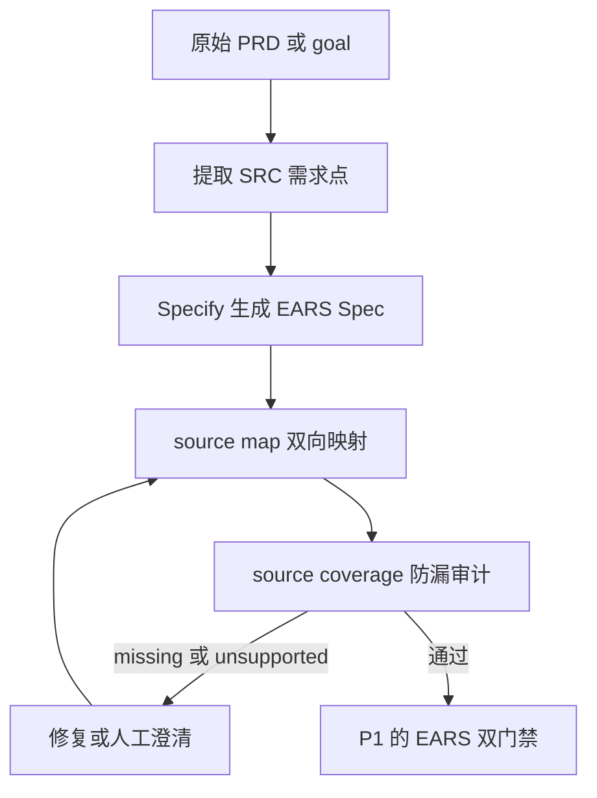

# EARS 改造 P2 执行文档：PRD 需求防漏追踪（规划稿）

> 阶段编号：EARS-P2
> 状态：暂缓（候选方案规划，不在 EARS 改造完成条件内）
> 需求来源：`dev-docs/planning/解释EARS语法.md`（改造需求文档 v1.0 第六节）
> 前置依赖：EARS-P0、EARS-P1 完成，且经过若干真实 Feature 的实际运行验证

## 一、阶段定位

P0/P1 解决的是"已识别需求表达规范、验收不漏"；P2 解决的是"原始 PRD 里的需求有没有被漏掉、改错、或无依据地新增"。

**边界声明**（来自需求文档）：

- P2 是独立增强项，EARS 改造的完成不以 P2 为条件。
- EARS 与 Coverage Gate 无法证明 PRD 第 21 条没被漏掉——Spec 内部自洽不等于忠实转译了 PRD。

**类比理解**：P0/P1 像检查译文语法正确、段落齐全；P2 像逐句对照原文，找出漏译、错译和译者私自加戏。

## 二、候选方案概要

### 核心机制：Source ID 双向追踪

1. **PRD 需求点提取**：Specify 阶段先从原始 `${goal}` / PRD 提取需求点，编号 `SRC-001`、`SRC-002`...
2. **来源映射文件** `specs/<feature>/source-map.json`：

```json
{
  "feature": "login",
  "goalHash": "sha256-...",
  "sources": [
    {
      "sourceId": "SRC-001",
      "text": "玩家点击登录按钮进行登录",
      "mappedTo": ["FR-001", "AC-001"],
      "status": "covered"
    },
    {
      "sourceId": "SRC-002",
      "text": "登录失败时显示错误提示",
      "mappedTo": [],
      "status": "missing"
    }
  ]
}
```

3. **防漏审计工具** `sdd/tools/source-coverage.mjs`，检查四类问题：

| 问题类型 | 含义 | 判定方式 |
|---------|------|---------|
| missing | PRD 需求点无 FR/AC 映射 | mappedTo 为空 |
| mutated | FR/AC 语义偏离来源需求点 | LLM 审查（非确定性） |
| unsupported | Spec 中无 PRD 依据的需求/数值 | 无 SRC 反向映射 |
| conflict | PRD 内部矛盾或与 Spec 矛盾 | LLM 审查 |

4. **确定性部分与语义部分分层**（沿用 P0/P1 模式）：
   - 确定性：mappedTo 引用的 ID 必须存在于 spec；每个 SRC 必须有 status；goalHash 冻结后 PRD 不得被改写。
   - 语义：mutated/conflict 由独立 LLM Reviewer 判断。

### 工作流接入点



## 三、暂缓理由

1. **依赖真实数据校准**：需求点提取的粒度（一句话一个 SRC 还是一个功能一个 SRC）、mutated 的判定标准，需要 P0/P1 上线后用真实 Feature 跑若干轮才能定标，现在定标准是拍脑袋。
2. **成本**：每个 Feature 增加提取、映射、双向审计三步 LLM 调用，收益要先经 P1 的语义门禁验证盲区有多大再决定投入。
3. **需求文档明示**：P2 不属于本次 EARS 改造完成条件。

## 四、启动条件（满足任一即可重新评估）

1. P1 完成后累计 3 个以上真实 Feature 跑通，且人工复核发现存在"PRD 有但 Spec 没有"的漏需求案例。
2. 出现需要向策划/产品方交付"需求覆盖率报告"的对外承诺。

## 五、启动时需先补的前置工作

1. 确定 SRC 提取粒度与 prompt 模板（新增 `sdd/rules/source-extraction.md`）。
2. source-map.json 的 Artifact 契约登记进 `dev-docs/design/sdd-artifact-contract.md`（写入者、读取者、哈希冻结规则）。
3. `coverage.mjs`/`is-converged.mjs` 是否纳入 source 覆盖条件的决策（建议先独立工具，不进收敛条件 C1-C7，观察后再定）。
4. 决定性测试设计：构造"故意漏译一条 PRD 需求"的夹具，验证 source-coverage 能检出。

## 六、引用说明

- 需求来源：`dev-docs/planning/解释EARS语法.md`（P2 章节：PRD 原始需求 Source ID、来源到 Spec 的双向追踪与遗漏审计）
- 现有 Artifact 契约：`dev-docs/design/sdd-artifact-contract.md`
- EARS 官方说明：https://alistairmavin.com/ears/
