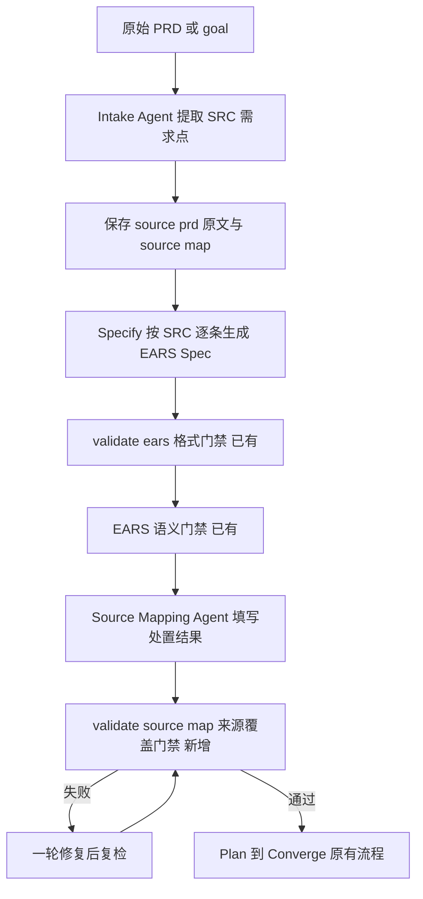

# EARS 改造 P2 执行文档：PRD 来源追踪与防遗漏审计

> 阶段编号：EARS-P2
> 状态：待执行（2026-10-15 调整定位后启动）
> 需求来源：`dev-docs/planning/解释EARS语法.md` + 本次定位调整（见下）+ `dev-docs/planning/prd-spec部分的需求补充1.md`（sdd.intake / analyzeSourceCoverage 早期设想）
> 前置依赖：EARS-P0、EARS-P1 完成

## 一、定位调整（本版核心变更）

**旧定位**（已废弃）：PRD → Spec 转换。该能力已由 Specify Agent + EARS P0/P1 覆盖，不再重复开发。

**新定位**：验证 PRD 中的每条原始需求是否被 Spec 完整、准确地保留——补齐"原始需求 → Spec"这一段目前缺失的确定性追踪。

### 能力边界

| 能力 | 状态 | 实现归属 |
|------|------|---------|
| 自然语言需求 → Spec | 已实现 | Specify Agent（sdd-feature.js） |
| FR / NFR / AC 生成 | 已实现 | sdd-feature.js |
| EARS 规范化 | 已实现 | EARS-P0 |
| 需求语义审查 | 已实现 | EARS-P1 |
| Spec → Tasks 覆盖率 | 已实现 | coverage.mjs |
| PRD 逐条提取 SRC-ID | **本阶段新增** | Intake Agent + source-extraction 规则 |
| SRC → FR/NFR/AC 来源映射 | **本阶段新增** | Source Mapping Agent + source-map.json |
| 原始 PRD 遗漏审计 | **本阶段新增** | validate-source-map.mjs 确定性门禁 |

关键区别：P1 语义 Reviewer 的覆盖完整性检查是 LLM 对照判断，无独立保存的原始需求清单；30 条 PRD 需求漏掉 2 条时，只有逐条 SRC 对照的确定性检查能强制暴露。coverage.mjs 检查的是 Spec → Tasks 方向，不含 PRD → Spec 方向。

## 二、目标流程



## 三、Artifact 契约

### 3.1 source-prd.md

原始需求原文的逐字保存（Intake Agent 将 goal / PRD 原样写入）。作用：给 source-map 的 prdHash 提供哈希基准，防止提取后原始需求被静默改写。

### 3.2 source-map.json

```json
{
  "feature": "login",
  "prdHash": "sha256-...",
  "sources": [
    { "sourceId": "SRC-001", "text": "连续 5 次密码错误锁定 15 分钟", "status": "confirmed" }
  ],
  "mappings": [
    {
      "sourceId": "SRC-001",
      "requirementIds": ["FR-003"],
      "acceptanceIds": ["AC-009"],
      "disposition": "covered",
      "note": null
    },
    {
      "sourceId": "SRC-008",
      "requirementIds": [],
      "acceptanceIds": [],
      "disposition": "excluded",
      "note": "注册流程不在本轮范围"
    }
  ]
}
```

字段契约：

- `sources[].sourceId`：`SRC-NNN` 三位数字，全局唯一，按原文出现顺序编号。
- `sources[].status` 枚举：`confirmed`（PRD 明确）/ `assumed`（提取时推断，需在 text 中注明推断依据）。
- `mappings[].disposition` 枚举：
  - `covered`：已转换为 Spec 需求，requirementIds 必填。
  - `excluded`：明确不做，必须给 note 理由，不允许静默丢失。
  - `pending`：待业务澄清，必须给 note 说明待澄清内容。
- 每个 SRC 必须有且仅有一条 mapping。

## 四、任务拆解

### E2-T01 新增 sdd/rules/source-extraction.md

规则文件，约束 Intake 与 Mapping 两个 Agent：

1. 提取粒度：一个可独立验证的需求点 = 一个 SRC（一句话含多个行为时拆分）；原文的每一条明确要求都必须有 SRC，不得合并丢失；数量级参考：30 条 PRD → 约 25~35 个 SRC。
2. status 判定：confirmed 与 assumed 的区分，assumed 不得伪装成 confirmed。
3. disposition 判定纪律：covered 需真实对应 FR/NFR；excluded 需明确理由；pending 用于真歧义，禁止用 excluded 吞掉不确定项。
4. 无依据新增的识别口径：Spec 中的 FR/NFR 若无法追溯到任何 SRC，属于 unsupported addition。

### E2-T02 新增 sdd/tools/validate-source-map.mjs（Source Coverage Gate）

用法：`node sdd/tools/validate-source-map.mjs <feature>`，退出码 0=通过 / 1=失败，支持 `--json`。

确定性检查：

1. 结构：source-map.json 可解析；sources 非空；SRC-NNN 三位数字全局唯一；feature 一致；mappings 数组存在。
2. 一一对应：每个 SRC 恰好一条 mapping；mapping 不得引用不存在的 SRC。
3. disposition 枚举合法；excluded/pending 必须有非空 note；covered 的 requirementIds 非空且 excluded/pending 的 requirementIds/acceptanceIds 必须为空。
4. 引用存在性：covered 的 requirementIds 必须存在于 spec.md（用统一解析器 parseSpec）；acceptanceIds 若非空必须存在于 spec 且归属对应 requirement（acToReq 校验）。
5. 反向防漏（核心）：spec 中每个 FR/NFR 必须被至少一条 covered mapping 引用，否则报 `unsupported-requirement`（识别无 PRD 依据的新增需求）。
6. prdHash：source-prd.md 的 sha256 必须与 prdHash 一致（防止提取后原文被改写）。

诊断输出格式与 validate-ears 一致：`[FAIL] SRC-009 [disposition] ...`，错误类型枚举：`structure` / `duplicate-id` / `bad-id` / `missing-mapping` / `extra-mapping` / `disposition` / `note-required` / `empty-requirement` / `unknown-id` / `ownership` / `unsupported-requirement` / `prd-hash`。

### E2-T03 新增 sdd/tools/validate-source-map-example.mjs

用例矩阵 S01~S12（见测试计划）。

### E2-T04 sdd-feature.js 接入

1. Specify 之前新增 `phase('Intake')`：Agent 读取 goal，按 source-extraction 规则提取 SRC，写 `specs/<feature>/source-prd.md`（原文逐字）与 `source-map.json`（sources 填好、mappings 留空数组）。
2. Specify prompt 增加一行：读取 source-map.json 的 sources，逐条转换，不得遗漏。
3. EARS 语义门禁（1.6）通过后、Plan 之前新增 `phase('Source Coverage')`：
   - Mapping Agent 读取 spec.md + source-map.json + 规则，填写每条 SRC 的 mapping（disposition 判定）。
   - `check(validate-source-map.mjs)` 失败时给一轮修复 Agent（按诊断修复 source-map 或补 spec），复检仍失败则终止（Plan 不启动）。

### E2-T05 文档同步

1. `docs/glossary.md`：新增 SRC / source-map / disposition / Intake / Source Coverage Gate 术语；修正过时的"NFR 可无 AC"描述（EARS P0 后 NFR 必须有 AC）。
2. `dev-docs/design/sdd-artifact-contract.md`：登记 source-prd.md 与 source-map.json 的真相源角色、写入者、读取者。
3. `docs/ears-manual-testing.md`：新增第四层 P2 手动测试。

## 五、测试计划

### validate-source-map 用例矩阵

| 用例 | 输入要点 | 预期 |
|------|---------|------|
| S01 完整正例 | 3 SRC 全 covered + 引用正确 | 通过 |
| S02 excluded 带理由 | disposition=excluded + note | 通过 |
| S03 pending 带理由 | disposition=pending + note | 通过 |
| S04 SRC 缺 mapping | 3 SRC 只有 2 条 mapping | 失败 missing-mapping |
| S05 excluded 无理由 | note 为空 | 失败 note-required |
| S06 covered 空引用 | requirementIds=[] | 失败 empty-requirement |
| S07 引用不存在 FR | FR-099 | 失败 unknown-id |
| S08 AC 错误归属 | AC 属 FR-001 却映射到 FR-002 | 失败 ownership |
| S09 无依据新增 | spec 有 FR-004 无任何 SRC 引用 | 失败 unsupported-requirement |
| S10 重复 SRC ID | SRC-001 两次 | 失败 duplicate-id |
| S11 prdHash 不匹配 | source-prd.md 被改 | 失败 prd-hash |
| S12 pending 带映射 | pending 却填了 requirementIds | 失败 disposition |

### 工作流级（移交手动测试文档）

- 正常：Intake → Specify → 双门禁 → Source Coverage → Plan 全链通过。
- 防漏决定性测试：goal 含 5 条需求，人工从 source-map 删除 1 条 SRC 的 mapping → Gate 拒绝。

## 六、风险与注意事项

1. **提取粒度波动**：LLM 提取 SRC 数量因模型而异，规则文件给出粒度锚点（一个可独立验证的需求点一个 SRC），不追求跨模型完全一致。
2. **Assumed 项**：status=assumed 的 SRC 是推断，进入 pending 需 note；不得伪装 confirmed 直接过门禁。
3. **NFR 来源**：PRD 未提性能但 Spec 加 NFR → unsupported-requirement 拒绝；确属合理新增时必须先补 PRD（修改 goal 重跑），而不是放宽门禁。
4. **与 check-baseline 的关系**：source-map 在 Plan 前校验，审批冻结（freeze-baseline）仍只保护 spec + traceability；source-prd.md 的完整性由 prdHash 保护。
5. **成本**：每个 Feature 新增 2 次 Agent 调用（Intake + Mapping）+ 1 次确定性校验。

## 七、完成定义

- [ ] source-extraction 规则就位
- [ ] validate-source-map 通过 S01-S12 全部用例
- [ ] sdd-feature.js 含 Intake 与 Source Coverage Gate，Gate 未通过不进 Plan
- [ ] 术语表与 Artifact 契约同步更新
- [ ] 手动测试文档新增 P2 测试层
- [ ] 执行报告落盘 + git 提交 push

## 八、引用说明

- 定位调整讨论：本轮需求输入（PRD → Spec 已实现，P2 聚焦防漏）
- 早期设想：`dev-docs/planning/prd-spec部分的需求补充1.md`（sdd.intake / sdd.clarify / sdd.analyzeSourceCoverage；本阶段实现 intake 与 source coverage，多轮 clarify 不在本期范围）
- spec-harness 参考：`thirdparties/spec-harness`（设计思想参考，注意 PolyForm Noncommercial 许可，不复制实现代码）
- 统一解析器：`sdd/tools/spec-parser.mjs`（EARS-P0 交付）
