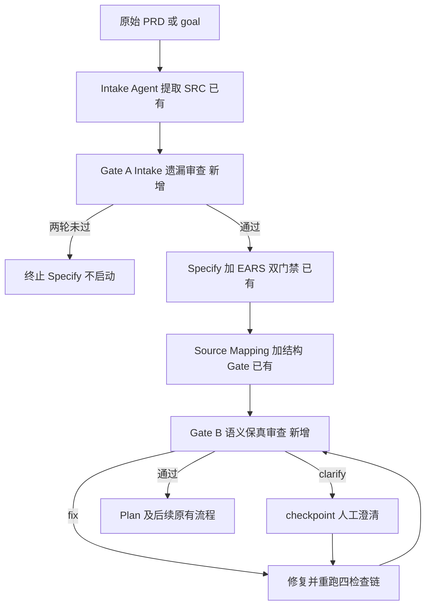

# EARS 改造 P3 执行文档：Claim 逐条保真闭环

> 阶段编号：EARS-P3（Claim-level Semantic Preservation）
> 状态：待执行
> 需求来源：`dev-docs/planning/BMAD Claim Preservation 方案分析.md`（建议优先级 P0）
> 定位：不重建 PRD → Spec 转换，在 EARS-P2 的来源追踪之上，把「声明式映射」升级为「有证据的语义保真审查」，并补上 PRD → SRC 的独立遗漏检查
> 前置依赖：EARS-P2 完成（source-map.json / validate-source-map.mjs / Intake 链路已就位）

## 一、阶段目标

EARS-P2 的 Gate 只能证明「映射在结构上成立」，不能证明「映射在语义上真实、完整、没有曲解」。本阶段补两道新门禁与一个重跑链：

1. **Gate A（Intake Preservation）**：独立审查 PRD → SRC 提取是否漏提关键 Claim。
2. **Gate B（Semantic Preservation）**：逐条对照 SRC 与 Spec，判定 preserved / partial / missing / contradicted / uncertain / excluded，阻断语义矛盾与曲解。
3. **失效校验重跑链**：任何 Agent 修改 spec.md 后，四类检查（EARS 格式、EARS 语义、Source Coverage、Claim Preservation）必须针对同一版本 Spec 重新成立。

**解决的缺口**（对应方案分析第二节 P0 行）：

| 缺口 | 本阶段对策 |
|------|-----------|
| Intake 提取遗漏无独立校验 | Gate A 独立读原文比对 SRC 台账 |
| 映射真实性未验证（语义相反也能过） | Gate B 逐 Claim 证据化审查 |
| acceptanceIds 可为空（关键条件未进 AC） | validate-source-map 强化：loadBearing Claim 的 covered 映射必须含 AC |
| Source Coverage 修复后不重跑 EARS 门禁 | 重跑链：spec 变更后四检查全部复验 |

**类比理解**：P2 的 source-map 像「快递揽收清单」——证明每个包裹都登记了去向；P3 的 Preservation 像「开箱验货」——逐箱核对内容与订单是否一致、有没有调包（contradicted）、有没有缺件（partial/missing）。

## 二、与方案分析的偏差说明

1. **Gate A 产物独立成文件**：方案分析建议 intakeFindings 放在 preservation-review.json 内。但该文件锚定 specHash（Spec 生成后才有），而 Gate A 在 Specify 之前运行，两阶段写入会污染哈希契约。本设计改为 Gate A 独立写 `specs/<feature>/intake-review.json`（锚定 prdHash），Gate B 写 preservation-review.json（锚定 specHash + sourceMapHash + prdHash）。职责不变，哈希链更干净。
2. **acceptanceIds 强化的归属**：方案分析的修改清单把它放在 P1，但缺口优先级是 P0。它是纯结构检查（十几行代码 + 用例），本阶段一并做掉，P4 专注类型化映射与审批。
3. **提取工具参数化**：不直接复用 extract-review.mjs（写死 Audit-Reviewer 标签与 requirements 结构），新建参数化工具，Gate A / Gate B 共用。

## 三、新增与修改文件总览

| 文件 | 操作 | 任务 |
|------|------|------|
| `sdd/rules/source-extraction.md` | 修改 | T01 |
| `sdd/rules/claim-preservation.md` | 新增 | T02 |
| `sdd/tools/validate-source-map.mjs` | 修改 | T03 |
| `sdd/tools/validate-source-map-example.mjs` | 修改（用例扩展） | T03 |
| `sdd/tools/extract-agent-json.mjs` | 新增（参数化 journal 提取） | T04 |
| `sdd/tools/validate-intake-review.mjs` | 新增 | T05 |
| `sdd/tools/validate-preservation.mjs` | 新增 | T06 |
| `sdd/tools/validate-preservation-example.mjs` | 新增（用例矩阵） | T06 |
| `.opencode-workflows/workflows/sdd-feature.js` | 修改 | T07 |
| `docs/glossary.md`、`docs/ears-manual-testing.md`、`dev-docs/design/sdd-artifact-contract.md` | 修改 | T08 |

## 四、任务拆解

### T01 扩展 source-extraction.md：Claim 元数据契约

sources[] 增加三个必填字段：

```json
{
  "sourceId": "SRC-005",
  "text": "背包满时有可堆叠格子仍允许获得物品",
  "status": "confirmed",
  "claimType": "exception",
  "loadBearing": true,
  "sourceRef": {
    "file": "source-prd.md",
    "lineStart": 42,
    "lineEnd": 44,
    "quote": "已有物品可以堆叠，则仍然允许获得"
  }
}
```

- `claimType` 枚举：`functional`（功能）/ `constraint`（约束）/ `exception`（例外）/ `non-goal`（非目标）/ `assumption`（假设）/ `decision`（决策）。
- `loadBearing`：布尔，是否影响下游开发决策（方案分析：否定性约束、非目标、关键数值、异常处理必须提取且常为 loadBearing）。
- `sourceRef.quote`：必须是 source-prd.md 中逐字存在的原文片段（由 T03 确定性校验行号区间内包含该引文，不允许只信 Agent 填的行号）。
- Intake prompt 同步更新：要求填写新字段，非功能/否定性/例外 Claim 不得漏提。

### T02 新增 sdd/rules/claim-preservation.md：Gate B 审查规则

核心规则（给只读 Preservation Reviewer）：

1. **逐条全覆盖**：claims 数组必须覆盖 source-map 中全部 SRC，禁止只返回有问题的几条（否则可骗过通过结论）。
2. **六状态枚举**：

| 状态 | 含义 | 处置 |
|------|------|------|
| preserved | 完整保留原语义 | 通过 |
| partial | 保留部分信息（丢条件/丢数值） | 修复 |
| missing | 无有效承接 | 修复 |
| contradicted | 与原文语义矛盾 | 修复 |
| uncertain | 证据不足无法判断 | 人工澄清 |
| excluded | 有明确范围排除决策 | 核对排除依据（P4 强化为审批） |

3. **组合语义**：一条 SRC 可由多个 FR/AC 共同实现，Reviewer 分析组合语义，不强制一对一。
4. **证据要求**：每个非 preserved 状态必须给 sourceEvidence（原文引文）与 specEvidence（Spec 原文），可独立复核。
5. **数值敏感性**：原文 99 写成 999 属 contradicted/partial（数值曲解），不是"大体保留"。
6. **例外敏感性**：丢失"除非可以继续堆叠"类例外条件属 partial（条件丢失）。
7. **intakeFindings**：Gate A 的遗漏发现列表（结构见 T05）。
8. **unsupportedRequirements**：Spec 中无 SRC 依据的需求（与 validate-source-map 反向检查互补，这里做语义级确认）。
9. **verdict 判定**：pass（无 blocker）/ fix（可修复）/ clarify（真业务歧义，人工处理）——与 EARS-P1 语义门禁同款纪律。

### T03 validate-source-map.mjs 强化（结构级，确定性）

1. 新字段校验：claimType 枚举、loadBearing 布尔、sourceRef 结构完整。
2. **引文一致性**：source-prd.md 的 lineStart..lineEnd 行拼接后必须包含 quote 文本（空白归一化后匹配）；不匹配报 `quote-mismatch`。
3. **AC 映射强化**（关闭 P0 缺口）：covered 且 claim 满足 `loadBearing=true && claimType ∈ {functional, exception}` 时，acceptanceIds 不得为空（关键条件必须进入 AC）。其他类型（constraint/non-goal/decision/assumption）不强制 AC。
4. 用例矩阵扩展：S13（quote 不一致被拒）、S14（loadBearing functional covered 无 AC 被拒）、S15（claimType 枚举外被拒）、S16（non-goal 类 covered 无 AC 允许通过）。

### T04 新增 extract-agent-json.mjs（参数化 journal 提取）

仿照 extract-review.mjs 的机制（journal 目录、label+agentType 匹配、markdown 围栏剥离、花括号截取、key 缺值修复、.raw 兜底），但：

- 用法：`node sdd/tools/extract-agent-json.mjs --label <label> --agentType explore --out <file>`
- 不写死标签与 JSON 结构（结构校验交给后续 validate-* 工具）。
- 只取**最近一次**匹配 entry（同 label 多轮修复时避免读到旧轮输出）：journal entries 按 key 顺序取最后一个匹配项。
- Gate A 用 label `Intake-Preservation-Reviewer`，Gate B 用 label `Claim-Preservation-Reviewer`，均为 explore 只读。

### T05 Gate A：Intake Preservation（PRD → SRC 遗漏审查）

1. 产物 `specs/<feature>/intake-review.json`：

```json
{
  "feature": "inventory",
  "prdHash": "sha256-...",
  "verdict": "pass",
  "missedClaims": [
    { "quote": "第一期不支持背包扩容", "lineStart": 51, "lineEnd": 51,
      "suggestedClaimType": "non-goal", "reason": "否定性约束未提取" }
  ]
}
```

2. 位置：Intake + freeze-source-map 之后、Specify 之前。
3. 流程：explore 只读 Reviewer 独立通读 source-prd.md 原文（不预设已有 SRC 完整），对照 source-map.json sources，输出遗漏 → extract-agent-json 提取 → `validate-intake-review.mjs`（确定性：prdHash 匹配、verdict 枚举、missedClaims 的 quote 在原文中存在、blocker 一致性）。
4. 修复循环（最多 2 轮）：verdict=fix 时由 general Agent 把 missedClaims 补入 sources（新 SRC 追加编号，不改已有），重新 freeze + 重审。两轮未过 → 终止（Specify 不启动）。

### T06 Gate B：validate-preservation.mjs（确定性保真门禁）

产物 `specs/<feature>/preservation-review.json` 契约：

```json
{
  "feature": "inventory",
  "verdict": "fix",
  "prdHash": "sha256-...", "specHash": "sha256-...", "sourceMapHash": "sha256-...",
  "claims": [
    { "sourceId": "SRC-005", "requirementIds": ["FR-003"], "acceptanceIds": ["AC-010"],
      "status": "contradicted", "severity": "blocker",
      "sourceEvidence": "已有格子可以继续堆叠", "specEvidence": "背包满时拒绝所有物品",
      "finding": "Spec 丢失了允许继续堆叠的例外条件" }
  ],
  "intakeFindings": [],
  "unsupportedRequirements": []
}
```

确定性检查（不判断语义对错，只验结构、证据、哈希、完整性）：

1. 三哈希与当前 source-prd.md / spec.md / source-map.json 逐一匹配（**P3-07 过期 Review 拒绝**：Spec 改了但 review 没重跑 → specHash 不匹配 → 拒绝）。
2. claims 覆盖 source-map 全部 SRC（缺失即失败，防止靠漏报骗通过）。
3. 每 claim：sourceId 存在、requirementIds/acceptanceIds 存在且归属正确（用统一解析器）、status 六枚举、非 preserved 必须有 sourceEvidence+specEvidence+finding、severity 枚举 blocker/warning。
4. verdict 一致性：有 blocker 不得 pass；verdict 非 pass 必须有 blocker（与 ears-review-verdict 同款纪律）。
5. intakeFindings 与 unsupportedRequirements 数组结构合法；unsupportedRequirements 引用的需求 ID 存在于 spec。
6. `--expect pass|fix|clarify|invalid` 模式（复用 EARS-P1 的 commandSuccess 适配方案），退出码 0/2/3/1。

用例矩阵 PV-01~PV-12：

| 用例 | 输入 | 预期 |
|------|------|------|
| PV-01 | 全 preserved 正例 | 通过 |
| PV-02 | claims 缺一个 SRC | 失败 missing-claim |
| PV-03 | status 枚举外 | 失败 |
| PV-04 | contradicted 无 specEvidence | 失败 evidence-required |
| PV-05 | specHash 过期（改 spec 后不重跑） | 失败 hash-mismatch |
| PV-06 | sourceMapHash 过期 | 失败 hash-mismatch |
| PV-07 | blocker 与 pass 矛盾 | invalid |
| PV-08 | requirementIds 引用不存在 | 失败 unknown-id |
| PV-09 | acceptanceIds 归属错误 | 失败 ownership |
| PV-10 | excluded 状态带 finding | 通过（结构层） |
| PV-11 | uncertain 状态无 severity | 失败 |
| PV-12 | --expect 三态探测 | 退出码正确 |

### T07 sdd-feature.js 接入与重跑链

新阶段顺序：



关键实现点：

1. Gate B 流程：explore Reviewer（读 source-prd.md + source-map.json + spec.md + claim-preservation.md 规则）→ extract-agent-json 提取 → freeze 三个哈希（新工具 `freeze-preservation.mjs` 或并入 validate 的 --freeze 参数）→ validate-preservation --expect pass。
2. 修复循环（最多 2 轮）：verdict=fix → general 修复 Agent（按 claims 里的 finding 修 spec 或修 source-map）→ **重跑链**：validate-ears → EARS 语义审查（1 轮）→ freeze-source-map 不需要（PRD 没变，但 source-map 若被修则重算 sourceMapHash）→ validate-source-map → Gate B 重审。clarify → checkpoint 人工，澄清后同重跑链。
3. **失效校验重跑**（对现有 Source-Map-Fix 的修正）：Source-Map-Fix 若修改了 spec.md，修复后同样走重跑链（当前只复检 Source Coverage，P0 缺口）。实现方式：把"spec 变更后的复验序列"抽成工作流内复用的提示与 check 序列。
4. 四检查同版本保证：进入 Plan 前的最终 check 序列为 validate-ears、validate-source-map、validate-preservation（三者读的都是当前盘上文件，天然同版本；语义审查与 Gate B 的哈希锚定防中间被改）。

### T08 文档同步

1. glossary 新增：Claim / claimType / loadBearing / sourceRef / intake-review.json / preservation-review.json / 六状态枚举 / Gate A / Gate B / 重跑链。
2. sdd-artifact-contract.md 登记 intake-review.json 与 preservation-review.json。
3. ears-manual-testing.md 新增第五层（P3-01/P3-02/P3-03/P3-04/P3-07/P3-09 的 LLM 级验证步骤与预期）。

## 五、测试计划

| 来源 | 内容 | 执行方式 |
|------|------|---------|
| S13-S16 | validate-source-map 新规则 | 确定性（本机） |
| PV-01~PV-12 | validate-preservation | 确定性（本机） |
| intake-review 校验矩阵 IR-01~IR-06 | prdHash/quote 存在性/verdict 一致性 | 确定性（本机） |
| P3-01 Intake 漏提 5 提 4 | Gate A 拦截 | LLM 手动 |
| P3-02 ID 合法语义相反 | Gate B contradicted | LLM 手动 |
| P3-03 数值 99 变 999 | Gate B 拦截 | LLM 手动 |
| P3-04 丢失例外条件 | Gate B partial 拦截 | LLM 手动 |
| P3-07 Spec 修复后未重审 | 哈希门禁拒绝 | 确定性 + 手动 |
| P3-09 擅自加业务规则 | unsupportedRequirements 拦截 | 确定性（结构）+ 手动（语义） |

## 六、风险与注意事项

1. **Reviewer 成本**：Gate A + Gate B 各 1 次 explore 调用，修复轮各 +2；单 Feature 增量约 2~6 次 Agent 调用。Token 预算与耗时列入手动测试观察项。
2. **只读纪律**：两个 Preservation Reviewer 均为 explore（不可写），产物一律经宿主 extract 落盘，禁止 Reviewer 自写文件（防止自评自写）。
3. **journal 定位**：extract-agent-json 取最新匹配 entry，避免修复多轮后读到旧输出（extract-review.mjs 现取第一个匹配，参数化工具改为取最后一个）。
4. **preserved 不等于正确**：确定性工具只验证据与结构；preserved 判断本身是 LLM 结论，可信度靠 explore 独立性 + 证据可复核 + P5 的 A/B 盲测兜底。
5. **哈希冻结时机**：Gate B 的三个哈希在提取成功后立即由 freeze 工具写入；validate 只比对不计算写入。
6. **EARS 语义门禁与 Gate B 的分工**：前者审 Spec 内部质量（可测试性/歧义/EARS 句式），后者审 PRD → Spec 保真；都过才进 Plan，互不替代。

## 七、完成定义

- [ ] source-extraction.md 含 claimType/loadBearing/sourceRef 契约，Intake prompt 同步
- [ ] validate-source-map S01-S16 全过（quote 一致性 + loadBearing AC 强制）
- [ ] extract-agent-json 参数化提取（取最新匹配 entry）
- [ ] validate-intake-review + validate-preservation（--expect 模式）就位，PV/IR 矩阵全过
- [ ] sdd-feature.js：Gate A 在 Specify 前、Gate B 在 Plan 前，重跑链对 Source-Map-Fix 同样生效
- [ ] 过期 Review（改 spec 不重审）被哈希门禁拒绝
- [ ] glossary / artifact 契约 / 手动测试文档同步
- [ ] 执行报告落盘 + git 提交 push；LLM 级 P3-01~04/07/09 转入手动测试

## 八、引用说明

- 需求来源：`dev-docs/planning/BMAD Claim Preservation 方案分析.md`
- BMAD-METHOD 参考实现：`thirdparties/BMAD-METHOD`（ submodule，设计思想参考）
- 既有链路：EARS-P2 交付（`sdd/rules/source-extraction.md`、`sdd/tools/validate-source-map.mjs`、`sdd/tools/freeze-source-map.mjs`）
- journal 提取机制蓝本：`sdd/tools/extract-review.mjs`
- verdict --expect 模式先例：`sdd/tools/ears-review-verdict.mjs`（EARS-P1）
