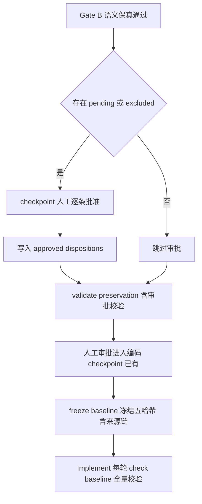

# EARS 改造 P4 执行文档：来源契约强化

> 阶段编号：EARS-P4（Source Contract Hardening）
> 状态：待执行
> 需求来源：`dev-docs/planning/BMAD Claim Preservation 方案分析.md`（建议优先级 P1）
> 前置依赖：EARS-P3 完成（Claim 元数据、Gate A/Gate B、preservation-review.json 已就位）

## 一、阶段目标

解决方案分析第六节的核心设计问题——**不是所有 Claim 都是 FR**——并把来源链全部纳入审批基线：

1. **类型化覆盖目标**：Claim 可映射到 FR/NFR/AC/Non-goal/Constraint，不再强制把非目标、约束塞进 FR/NFR。
2. **pending / excluded 审批**：关键 Claim 未澄清或被排除时，必须人工批准才能进 Plan（P3-06 对应）。
3. **审批基线冻结来源链**：source-prd.md、source-map.json、preservation-review.json、审批记录纳入 freeze-baseline / check-baseline（P3-08 对应）。
4. **稳定 SRC ID**：审批后 SRC 编号不得重排、复用；新增只允许追加。

**解决的缺口**（方案分析第二节 P1 行）：

| 缺口 | 本阶段对策 |
|------|-----------|
| pending 和 excluded 可以通过 Gate | 审批记录 + 未批准阻断 |
| 审批基线没有冻结来源链 | 基线扩展四件套 |
| 非目标/约束只能伪装成 FR | NG/CON 类型化目标 |

**类比理解**：P3 之前是"每个包裹都验货"；P4 是"拒收和缓收的包裹必须有收件人签字，且整个入库台账拍照存档（冻结），之后谁改台账立刻报警"。

## 二、新增与修改文件总览

| 文件 | 操作 | 任务 |
|------|------|------|
| `sdd/templates/spec.md` | 修改（新增非目标与约束章节） | T01 |
| `sdd/tools/spec-parser.mjs` | 修改（解析 NG/CON） | T01 |
| `sdd/rules/source-extraction.md`、`sdd/rules/claim-preservation.md` | 修改（类型化映射规则） | T02 |
| `sdd/tools/validate-source-map.mjs` | 修改（coverageTargets + 基线联动） | T02 |
| `sdd/tools/validate-source-map-example.mjs` | 修改（用例扩展） | T02 |
| `sdd/tools/freeze-baseline.mjs`、`sdd/tools/check-baseline.mjs` | 修改（来源链四件套 + SRC 稳定性） | T03 |
| `.opencode-workflows/workflows/sdd-feature.js` | 修改（审批 checkpoint） | T04 |
| `sdd/tools/validate-preservation.mjs` | 修改（审批记录校验） | T04 |
| `docs/glossary.md`、`docs/ears-manual-testing.md`、`dev-docs/design/sdd-artifact-contract.md` | 修改 | T05 |

## 三、任务拆解

### T01 Spec 模板与解析器支持 NG/CON

1. `sdd/templates/spec.md` 新增章节：

```markdown
## 非目标与约束

### NG-001: 第一期不支持背包扩容

明确本轮不做的范围，来源见 source-map（claimType=non-goal）。

### CON-001: 物品堆叠上限 99

来自 PRD 的业务约束，实现不得突破。
```

2. `spec-parser.mjs`：REQ_RE 扩展为 `### (FR|NFR|NG|CON)-\d{3}`；NG/CON 进 requirements（type 对应），**不要求 AC**（与 FR/NFR 差异点）。
3. 联动调整：
   - `validate-ears.mjs`：no-ac 检查跳过 NG/CON（它们是范围/约束声明，不是可验收行为；若 NG/CON 附带 AC 则照常校验句式）。
   - `coverage.mjs`：NG/CON 不强制任务映射（它们约束实现而非产生任务），但出现在 traceability 的 extraReqs 白名单中。
   - `validate-source-map.mjs` 反向检查：NG/CON 与 FR/NFR 一样必须可追溯到 SRC（无依据的 NG/CON 也是擅自新增）。

### T02 类型化覆盖目标（coverageTargets）

source-map.json 的 mappings 增加渐进兼容字段：

```json
{
  "sourceId": "SRC-008",
  "requirementIds": [],
  "acceptanceIds": [],
  "coverageTargets": [
    { "type": "non-goal", "id": "NG-001", "note": null },
    { "type": "constraint", "id": "CON-001", "note": null }
  ],
  "disposition": "covered",
  "note": null
}
```

规则：

1. `coverageTargets[].type` 枚举：`requirement`（FR/NFR）/ `non-goal`（NG）/ `constraint`（CON）/ `companion`（伴随说明，仅 note 无 id，用于决策背景类 Claim）。
2. covered 的判定放宽为：requirementIds 非空 **或** coverageTargets 含 requirement/non-goal/constraint 任一。
3. 保留 requirementIds 字段不动（渐进兼容，validate 同时接受两种写法；P3 已强化的 loadBearing functional 必须含 AC 规则继续生效，AC 归属校验不变）。
4. validate-source-map 用例扩展：S17（non-goal Claim 映射 NG-001 通过）、S18（companion 型 Claim 仅 note 通过）、S19（coverageTargets 引用不存在 NG 报错）、S20（requirement 与 coverageTargets 同时空引用报错）。

### T03 审批基线冻结扩展

1. `freeze-baseline.mjs`：基线哈希对象在 specHash/traceabilityHash 之外增加：
   - `prdHash`（source-prd.md）
   - `sourceMapHash`（source-map.json）
   - `preservationHash`（preservation-review.json）
   - `dispositionsHash`（approved-dispositions.json，见 T04）
2. `check-baseline.mjs`：Implement 每轮前校验上述五哈希；任何一项被改 → 基线失效（P3-08：审批后修改 source-map 即被拦截）。
3. **稳定 SRC ID**：check-baseline 增加规则——当前 source-map 的 SRC ID 集合必须包含基线中的全部 SRC ID（允许追加新 SRC，禁止删除/复用/重排已有编号）。
4. 旧行为保持：spec/traceability 的原有校验不动。

### T04 pending / excluded 审批（P3-06）

1. 新产物 `specs/<feature>/approved-dispositions.json`：

```json
{
  "feature": "inventory",
  "approver": "zhang",
  "approvedAt": "2026-10-16T10:00:00Z",
  "items": [
    { "sourceId": "SRC-009", "disposition": "excluded", "decision": "扩容第二期做", "claimType": "non-goal", "loadBearing": true },
    { "sourceId": "SRC-010", "disposition": "pending", "decision": "按保守默认 99 执行", "claimType": "constraint", "loadBearing": true }
  ]
}
```

2. sdd-feature.js 在 Gate B 通过后、Plan 之前新增审批 checkpoint：若 source-map 存在 pending 或 excluded 的 Claim，checkpoint 汇总列出（sourceId、原文、disposition、note、loadBearing），要求人工批准；批准后由 general Agent 写入 approved-dispositions.json。无 pending/excluded 时跳过。
3. `validate-preservation.mjs` 增加规则：
   - source-map 中每个 disposition ∈ {pending, excluded} 的 SRC 必须在 approved-dispositions.json 的 items 中有对应记录；
   - loadBearing=true 的 Claim 被 excluded 时，审批记录必须存在（非 loadBearing 的历史遗留可豁免，向前兼容）；
   - 缺记录 → verdict 校验失败，Plan 不启动。
4. `checkpoint headless 注意`：headless approve 不等于业务决策——prompt 中明确要求人工把决定写入 decision 字段，decision 为空的审批记录视为无效（确定性校验）。

### T05 文档同步

glossary（NG/CON、coverageTargets、approved-dispositions、稳定 SRC ID）、artifact 契约（approved-dispositions.json + 基线五哈希）、手动测试文档（第六层：P3-05 非目标遗漏、P3-06 未批准排除、P3-08 审批后改 source-map）。

## 四、审批后完整链路（P4 完成后）



## 五、测试计划

| 用例 | 内容 | 方式 |
|------|------|------|
| S17-S20 | coverageTargets 类型化映射 | 确定性 |
| B01 | 基线含五哈希，冻结后全一致 | 确定性 |
| B02 | 审批后改 source-map.json | check-baseline 拒绝（P3-08） |
| B03 | 审批后删一个 SRC 重排编号 | 稳定 SRC ID 拒绝 |
| B04 | SRC 追加新编号 | 允许 |
| D01 | pending Claim 无审批记录 | validate-preservation 拒绝（P3-06） |
| D02 | excluded loadBearing 无审批 | 拒绝 |
| D03 | 审批记录 decision 为空 | 拒绝 |
| D04 | 全部审批齐备 | 通过 |
| P3-05 | 原文非目标未进 NG 章节 | Gate B + 反向检查拦截（手动 + 确定性） |
| NG 解析 | NG/CON 无 AC 合法、FR 无 AC 仍非法 | 确定性（validate-ears 用例扩展） |

## 六、风险与注意事项

1. **NG/CON 引入的连锁**：parser/validate-ears/coverage/audit-spec-parse/audit-converge/validate-review/is-converged 全部基于统一解析器，改动 REQ_RE 后必须全量回归（P0-P3 的全部矩阵重跑）。
2. **NG/CON 不产生任务**：coverage.mjs 白名单实现要防止"把功能需求写成 NG 绕过任务映射"的漏洞——Gate B 的 preserved 判定 + claimType 由 Gate A/Intake 阶段确定，Mapping Agent 不得为逃逸校验把 functional 改成 non-goal（validate-preservation 校验 claimType 与 source-map 一致）。
3. **审批真实性**：approved-dispositions 的 decision 空值校验是底线；headless 模式下的自动批准语义在手动测试文档中明确标注风险。
4. **基线兼容**：旧基线 JSON 无新哈希字段时 check-baseline 的行为——按"缺失即校验失败"处理（Breaking Change 原则，与既有 spec 兼容立场一致）。

## 七、完成定义

- [ ] spec.md 模板与解析器支持 NG/CON，全工具链回归通过（V/S/PV/IR 矩阵 + frozen-spec）
- [ ] coverageTargets 类型化映射 + S17-S20 通过
- [ ] 基线五哈希 + 稳定 SRC ID，B01-B04 通过
- [ ] pending/excluded 审批链路 + D01-D04 通过
- [ ] glossary / artifact 契约 / 手动测试文档（第六层）同步
- [ ] 执行报告落盘 + git 提交 push

## 八、引用说明

- 需求来源：`dev-docs/planning/BMAD Claim Preservation 方案分析.md`（第六节 类型化覆盖目标、第五节 P1 行）
- EARS-P3 交付：`dev-docs/planning/EARS改造-P3-执行文档.md`
- 现有基线机制：`sdd/tools/freeze-baseline.mjs`、`sdd/tools/check-baseline.mjs`
- 现有审批点：`sdd-feature.js` checkpoint 与 freeze-baseline 调用序列
