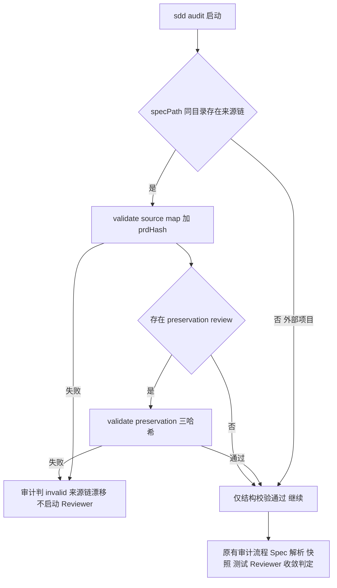

# EARS 改造 P5 执行文档：跨阶段延伸与实证验证

> 阶段编号：EARS-P5（Cross-stage Extension）
> 状态：待执行
> 需求来源：`dev-docs/planning/BMAD Claim Preservation 方案分析.md`（建议优先级 P2 + 第七节验收要求）
> 前置依赖：EARS-P3、EARS-P4 完成；P3/P4 的 LLM 手动测试（手动测试文档第五、六层）已通过至少一轮

## 一、阶段目标

把来源保真能力延伸到审计链与需求变更场景，并用对抗性实验证明整套机制真实补上了 EARS-P2 的盲区：

1. **审计链接入**：sdd_audit 在存在来源链产物时执行来源保真前置检查——Spec 与 PRD 来源链不一致的审计直接判不可信，堵住"Spec 本身漏了 PRD 内容，但 Spec → Code 审计照样通过"的缺口。
2. **需求变更增量影响分析**：PRD 变更后，定位受影响的 SRC → FR/NFR/AC → Tasks 链路，输出影响清单，支撑定向重跑而非全量重来。
3. **大 PRD 分批审核**：Claim 数超阈值时 Preservation Review 分批执行，控制单次上下文与成本。
4. **A/B 盲测**：同一份 30~50 条需求 PRD，EARS-P2 机制组 vs P3/P4 完整机制组，人工标注标准答案，量化关键需求遗漏率、错误排除率、语义矛盾检出率、误报率、Token 成本——证明"加 Reviewer 确实提升质量"，这是整套 P3/P4 投入的最终验收。

**类比理解**：P3/P4 是给生产线装了验货员；P5 是让质检章盖到出库单上（审计）、给返工开出精准工单（影响分析），最后做一次双盲对照试验证明这条产线真的比旧的良品率高。

## 二、新增与修改文件总览

| 文件 | 操作 | 任务 |
|------|------|------|
| `.opencode-workflows/workflows/sdd-audit.js` | 修改 | T01 |
| `sdd/tools/audit-converge.mjs` | 修改（可选来源链维度） | T01 |
| `sdd/tools/impact-analysis.mjs` | 新增 | T02 |
| `sdd/rules/source-extraction.md`、`sdd/rules/claim-preservation.md` | 修改（分批规则） | T03 |
| `sdd/tools/validate-preservation.mjs` | 修改（分批合并校验） | T03 |
| `experiments/`（AB 盲测脚手架与标准答案） | 新增 | T04 |
| `docs/glossary.md`、`docs/ears-manual-testing.md` | 修改 | T05 |

## 三、任务拆解

### T01 sdd_audit 来源保真前置检查

1. 新前置阶段（在现有 Spec 解析之前）：

```
phase('来源链校验')
若 specs/<feature>/（或 specPath 同目录）存在 source-prd.md + source-map.json：
  1. validate-source-map（结构 + prdHash）
  2. 若存在 preservation-review.json：validate-preservation（三哈希）
  3. 任一失败 → 审计直接返回 status: invalid（reason: source-chain-drift），
     不启动 Reviewer——Spec 与来源链不一致时，代码审计结论无意义。
不存在来源链产物（外部项目审计）：跳过，行为与现在一致。
```

2. Reviewer prompt 增强（可选维度）：来源链存在时，审计 Reviewer 额外对照 source-map 的 claims——Spec 需求与 PRD 声称的映射关系纳入一致性判断（发现 Spec↔Code 都自洽但 PRD→Spec 断裂的情况标注 finding）。
3. `audit-converge.mjs`：审计报告增加 `sourceChain` 段（presence / validated / drift-reason），不新增收敛条件（拦截在工作流层完成）。
4. 实现约束：specPath 可能指向任意路径（审计夹具），来源链探测以 specPath 同目录为准，不硬绑 specs/<feature>/。

### T02 需求变更增量影响分析

新增 `sdd/tools/impact-analysis.mjs <feature>`：

1. 输入：变更后的 source-prd.md（工作区当前版）+ 冻结基线中的 prdHash 对应旧版（基线目录留存旧文件快照，或要求用户提供旧版路径）。
2. 确定性部分：文本 diff → 变更行区间 → 通过 sourceRef（lineStart/lineEnd）反查受影响 SRC → source-map 映射到 FR/NFR/NG/CON/AC → traceability 映射到 Tasks。输出：

```json
{
  "feature": "inventory",
  "changedLines": [{ "start": 42, "end": 44, "kind": "modified" }],
  "affectedClaims": ["SRC-005", "SRC-012"],
  "affectedRequirements": ["FR-003", "CON-001"],
  "affectedTasks": ["T-002", "T-007"],
  "unmappedChanges": [{ "start": 60, "end": 61, "note": "变更未落在任何 SRC 的 sourceRef 区间，疑似新增需求" }]
}
```

3. `unmappedChanges` 是关键防御：变更行不在任何 sourceRef 区间 → 要么 Intake 漏提了新需求，要么是无关编辑，交人工/LLM 判定。
4. 定位：独立诊断工具 + 使用指南（docs/how-to-guides），不阻塞主工作流；产出供人工决策"重跑哪些阶段"（最小：受影响 Claim 重过 Gate B；最大：全量）。
5. 行号漂移限制：sourceRef 锚定旧版行号，diff 后需换算；v1 只支持"旧版基线快照 vs 当前"的简单对照，复杂重排降级为全量重跑提示（ponytail: 行号锚定的增量分析有已知天花板，PRD 大幅重排时退化为全量）。

### T03 大 PRD 分批 Preservation Review

1. 阈值：SRC 数 > 40 时启用分批（配置进 sdd/config.json 的可选字段 `preservation.batchSize`，默认 0=不分批）。
2. 分批策略：按 claimType 优先级排序（exception/constraint/functional 的 loadBearing 优先），每批 ≤ batchSize 条 Claim 交给一次 Gate B 审查；verdict 合并规则：任一批 fix → 整体 fix；任一批 clarify → 整体 clarify。
3. validate-preservation 增加 `--batch <n>/<total>` 或合并模式（claims 覆盖检查按批内集合 + 已通过批的累计集合判定）。
4. 默认关闭：等 AB 盲测与真实大 PRD 数据再决定默认值（YAGNI）。

### T04 A/B 盲测（最终验收，参照方案分析第七节）

1. 材料：构造一份 30~50 条需求的游戏系统 PRD（建议背包系统：含功能、例外、非目标、约束、关键数值），独立人工标注 Claim 标准答案（沿用 P0.7 经验：标准答案放工作区外）。
2. 分组：
   - A 组：EARS-P2 机制（Source Coverage Gate，无 Gate A/Gate B/审批）
   - B 组：P3/P4 完整机制
   - 各 3 次独立运行（不同 trial 目录，参照 experiments/setup-run.mjs 模式）
3. 指标：

| 指标 | 定义 | 合格线（建议） |
|------|------|--------------|
| 关键需求遗漏率 | 标准答案 loadBearing Claim 未进 Spec 的比例 | B 组显著低于 A 组，且 ≤5% |
| 错误排除率 | 被错误 excluded/pending 的 Claim 占比 | B 组 0（审批拦截） |
| 语义矛盾检出率 | 注入的 contradicted/partial 缺陷被发现的比率 | B 组 ≥ 9/10（P3-01~04 缺陷注入复用） |
| 误报率 | preserved 被误判为问题的比例 | ≤10% |
| 成本 | Token 与耗时 | B 组增量 ≤ A 组的 60% |

4. 产物：`experiments/`（PRD、标注答案外置、运行脚本、collect-results 汇总），盲测结论写入执行报告；不合格项回滚或修复对应 Gate 后重测。
5. P3-01~P3-09 全部缺陷注入用例在 B 组机制下复验（确定性部分本机、LLM 部分随盲测跑）。

### T05 文档与出口评估

1. glossary：source-chain-drift、impact-analysis、unmappedChanges、batchSize/分批合并、AB 盲测指标。
2. 手动测试文档：第七层（审计来源链前置、变更影响分析操作步骤、分批配置）。
3. **出口评估（不实施，只记录结论）**：整套机制在独立项目验证稳定后，是否封装进 opencode-dynamicworkflows 的 sdd.* API（方案分析最终建议：先在 spec-kit-workflow 验证，稳定后再动第二个仓库）。评估结论写入执行报告，作为后续独立提案。

## 四、审计链新流程（P5 完成后）



## 五、测试计划

| 用例 | 内容 | 方式 |
|------|------|------|
| SC-01 | 有来源链且一致 | 审计正常继续 |
| SC-02 | source-map 被改（prdHash 失配） | 审计 invalid（source-chain-drift） |
| SC-03 | spec 被改但 preservation 未重跑 | 审计 invalid |
| SC-04 | 无来源链（现有夹具） | 行为与现在一致（回归） |
| IA-01 | 单行变更命中 SRC-005 区间 | 影响清单含 FR-003/T-002 |
| IA-02 | 变更不在任何 sourceRef 区间 | unmappedChanges 告警 |
| IA-03 | PRD 大幅重排 | 降级提示全量重跑 |
| BT-01~03 | A/B 盲测 3+3 次运行 | 人工标注 + collect-results |
| P3-01~09 | 全缺陷注入复验 | 确定性 + LLM 随盲测 |

## 六、风险与注意事项

1. **审计前置的成本**：来源链校验是纯确定性命令（毫秒级），不增加 LLM 成本；只有 Reviewer prompt 增强会略增上下文。
2. **影响分析的行号锚定天花板**：sourceRef 行号在 PRD 重排后失准，v1 明确降级策略（全量重跑），不追求完美 diff 换算。
3. **分批的 verdict 合并语义**：跨批 Claim 的组合语义矛盾（批 A 与批 B 单独看都 preserved，合并矛盾）在分批模式下可能漏检——阈值默认关闭，启用时在规则文件中标注该已知盲区。
4. **盲测的公平性**：A/B 两组使用同一模型与温度配置；标准答案标注人不得参与任一组运行；运行目录隔离（沿用 experiments/runs 结构）。
5. **sdd-audit 兼容**：来源链探测失败不得让既有审计崩溃——探测仅为目录存在性检查，异常按"无来源链"处理并 log 提示。

## 七、完成定义

- [ ] sdd_audit 来源链前置（SC-01~04 通过，现有 v1-v4 夹具审计回归无变化）
- [ ] impact-analysis.mjs（IA-01~03 通过）+ 使用指南
- [ ] 分批审核（默认关闭）+ 合并校验用例通过
- [ ] A/B 盲测 3+3 运行完成，五项指标达标，结论与数据落盘
- [ ] P3-01~09 全部缺陷注入在 B 组机制下被拦截
- [ ] glossary / 手动测试文档（第七层）同步；sdd.* API 封装出口评估结论记录
- [ ] 执行报告落盘 + git 提交 push

## 八、引用说明

- 需求来源：`dev-docs/planning/BMAD Claim Preservation 方案分析.md`（第五节 P2 行、第七节验收、最终建议）
- 审计链现状：`.opencode-workflows/workflows/sdd-audit.js`、`sdd/tools/audit-converge.mjs`
- 盲测先例：`dev-docs/progress/progress-result/P0.7-执行报告.md`、`experiments/setup-run.mjs`
- EARS-P3/P4 交付：`dev-docs/planning/EARS改造-P3-执行文档.md`、`dev-docs/planning/EARS改造-P4-执行文档.md`
