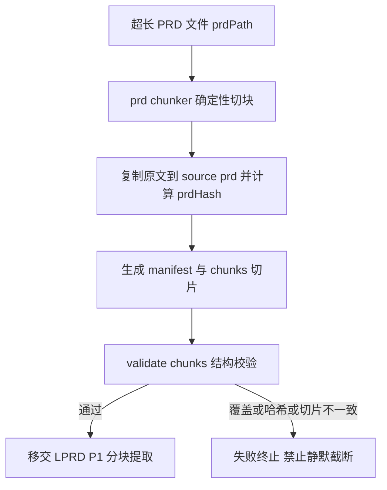

# LPRD-P0 执行文档：PRD Chunker 与 Manifest

> 阶段编号：LPRD-P0
> 状态：待执行
> 需求来源：`dev-docs/planning/超长Prd切块功能.md`（FR-001、FR-002 + 交付阶段表 LPRD-P0）
> 前置依赖：无（纯确定性工具，不依赖 EARS-P3/P4 执行状态）
> 定位：解决超长 PRD 的输入层瓶颈——程序化切块保证原文完整覆盖，后续阶段的 LLM 分块提取才有可靠基础

## 一、阶段目标

1. **文件输入与原文保护**（FR-001）：支持 `prdPath` 引用 Markdown PRD，程序字节级复制到 `specs/<feature>/source-prd.md`（不经 LLM），SHA256 锚定。
2. **结构化自动切块**（FR-002）：按 Markdown 标题/段落/逻辑块切分，保护表格、代码围栏、嵌套列表；Token 预算与上下文重叠可配置；记录每个 Chunk 的原文位置、章节路径与哈希；**禁止静默截断**。
3. **确定性结构校验**：Chunk 主覆盖区间必须完整覆盖原文每一行，无遗漏、无重叠、无篡改。

**类比理解**：把一本厚书按章节撕成可单手阅读的活页，每页盖编号章（哈希），最后清点：每一段原文都恰好在某一页上，一页不多一页不少；表格和代码块像整幅插图，绝不从中间撕开。

## 二、新增文件总览

| 文件 | 操作 | 任务 |
|------|------|------|
| `sdd/tools/prd-chunker.mjs` | 新增 | T01 切块器 + 原文复制 |
| `sdd/tools/validate-chunks.mjs` | 新增 | T02 结构校验器 |
| `sdd/tools/prd-chunker-example.mjs` | 新增 | T03 用例矩阵 C01-C10 |
| `sdd/rules/large-prd-intake.md` | 新增 | T04 大文档规则（含切块约定与局部 Claim 契约，P1/P2 共用） |

## 三、任务拆解

### T01 prd-chunker.mjs

用法：`node sdd/tools/prd-chunker.mjs <feature> --from <prdPath> [--budget 3000] [--overlap 1] [--force]`

执行步骤：

1. **原文复制**：读 prdPath 原始字节，写入 `specs/<feature>/source-prd.md`（不做任何改写，保留 BOM/换行原样），计算 prdHash。
2. **结构解析**：
   - 标题行 `^#{1,6}\s` 构建章节树；每个章节 = 标题行 + 正文区间（到下一个同级或更高级标题前）。
   - 章节正文按空行切成**原子块**（连续非空行）；围栏内（``` 配对）的空行不切分；表格行（| 开头连续）不切分；嵌套列表整体为一个块。
3. **Token 估算**（保守启发式，无外部依赖）：`est = 中日韩字符数 * 1 + 其他字符数 * 0.25`，向上取整。
4. **装包**：章节内贪心打包连续原子块到 Chunk，直到加入下一块会超 `--budget`（默认 3000 est-tokens）则封块开新块。
   - **overlap**（默认 1 块）：新块文件前置上一块的末尾块作为上下文，manifest 中记 `overlapStart`；该前置块的主归属仍是上一块。
   - **原子块自身超预算**（巨型表格/围栏）：独立成块并标 `oversize: true`，绝不从中间切开（禁止静默截断，交给下游容量门禁决策）。
   - 章节不跨块合并：不同章节的块不进同一 Chunk（章节语义边界优先）。
5. **产物**：
   - `specs/<feature>/intake/manifest.json`：

```json
{
  "feature": "inventory",
  "prdHash": "sha256-...",
  "totalLines": 1820,
  "estTokensTotal": 48200,
  "chunkCount": 17,
  "params": { "budget": 3000, "overlap": 1 },
  "chunks": [
    { "chunkId": "CHUNK-001", "sectionPath": ["一", "系统概述"],
      "overlapStart": null, "lineStart": 1, "lineEnd": 46,
      "estTokens": 1180, "hash": "sha256-...", "oversize": false }
  ]
}
```

   - `specs/<feature>/intake/chunks/CHUNK-001.md ...`：每个 Chunk 文件是原文 `overlapStart（若有）..lineEnd` 行的**字节级切片**。
6. `--force` 允许重跑覆盖（默认已存在 manifest 时拒绝，防误覆盖已进入提取阶段的产物）。

### T02 validate-chunks.mjs

用法：`node sdd/tools/validate-chunks.mjs <feature> [--json]`，退出码 0/1。

确定性检查（对应验收要求 1"原文完整覆盖、无遗漏或静默截断"）：

1. manifest 的 prdHash 与 source-prd.md 实际哈希一致。
2. **主覆盖完整性**：全部 chunks 的 `lineStart..lineEnd` 主区间按行拼起来恰为 `1..totalLines`，无缺口、无重叠（overlap 区间不计入主覆盖）。
3. **overlap 一致性**：`overlapStart` 区间必须是前一 Chunk 主区间的尾部后缀。
4. **字节级切片校验**：每个 Chunk 文件内容与原文对应行区间逐字节一致，且其哈希与 manifest 记录一致。
5. **截断防护**：原文任意一行必须出现在恰一个主区间内（双向检查：原文行全覆盖 + Chunk 文件无额外内容）。
6. oversize Chunk 仅允许由"原子块超预算"产生（其 estTokens 必须 > budget）。

### T03 prd-chunker-example.mjs（用例矩阵 C01-C10）

在临时目录构造 fixture PRD 后运行 chunker + validate：

| 用例 | 输入要点 | 预期 |
|------|---------|------|
| C01 | 多级标题（# 至 ####）混合正文 | 章节边界正确，validate 通过 |
| C02 | 含 Markdown 表格（10 行） | 表格不被切断，validate 通过 |
| C03 | 含代码围栏（``` 内有空行） | 围栏整体在一个块，validate 通过 |
| C04 | 单章节超预算（长段落序列） | 按块拆分为多 Chunk，主区间连续 |
| C05 | 单个巨型表格超预算 | 独立 oversize Chunk，不截断 |
| C06 | 覆盖完整性 | validate 通过（默认组合 fixture） |
| C07 | 删除原文一行后重验 | validate 拒绝（prdHash + 覆盖失败） |
| C08 | 篡改 Chunk 文件后重验 | validate 拒绝（字节级不一致） |
| C09 | overlap 开启 | overlapStart 是前块尾部后缀，主区间仍无重叠 |
| C10 | 稳定性 | 同输入连续运行两次，manifest 逐字节一致（纯函数） |

### T04 large-prd-intake.md 规则文件（切块约定部分）

记录：Token 估算口径、原子块定义、overlap 语义（主归属唯一）、oversize 语义、manifest/chunks 契约、以及 P1 将用的局部 Claim 契约（占位，P1 细化）。

## 四、流程位置



## 五、风险与注意事项

1. **Token 估算只是启发式**：est-tokens 不追求与真实 tokenizer 一致，只做保守预算；预算参数可调，宁可块小不可超上下文。
2. **超长单行**（整段无换行的巨型段落）无法按空行切块：按句号/分号二次切分？v1 不做——巨型无换行段落整体成块并标 oversize，由容量门禁报告（罕见场景，避免复杂化）。
3. **CRLF/换行**：切片按行数组 join 保持原样，Windows CRLF 文件哈希基于原始内容（不做换行归一），保证字节级一致。
4. **重跑保护**：chunks 已存在且 manifest 有效时默认拒绝重切（--force 才覆盖），防止提取中途原文被换。

## 六、完成定义

- [ ] prd-chunker 对 C01-C10 全部 fixture 行为正确，validate 全绿
- [ ] 原文任意行删除/Chunk 篡改/哈希不符均被 validate 拒绝
- [ ] 同输入两次运行 manifest 逐字节一致
- [ ] sdd/rules/large-prd-intake.md 就位
- [ ] glossary 新增 Chunk / manifest / 主覆盖区间 / oversize 术语
- [ ] 执行报告落盘 + git 提交 push

## 七、引用说明

- 需求来源：`dev-docs/planning/超长Prd切块功能.md`（FR-001/FR-002、交付阶段 LPRD-P0、验收要求 1）
- 既有原文保护机制：`sdd/tools/freeze-source-map.mjs`（prdHash 锚定）
- 后续阶段：`LPRD-P1-执行文档.md`（分块提取与合并）
