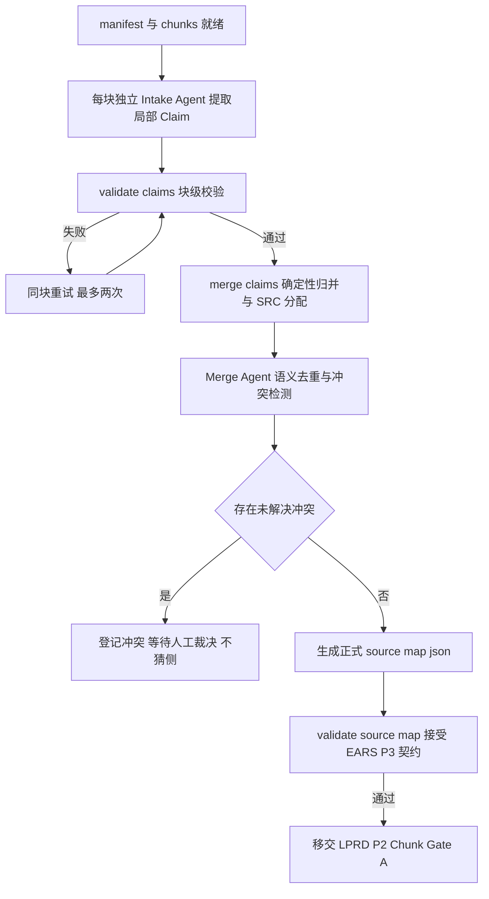

# LPRD-P1 执行文档：分块 Claim 提取与全局合并

> 阶段编号：LPRD-P1
> 状态：待执行
> 需求来源：`dev-docs/planning/超长Prd切块功能.md`（FR-003、FR-004 + 交付阶段表 LPRD-P1）
> 前置依赖：LPRD-P0 完成（manifest 与 chunks/ 可用）

## 一、阶段目标

1. **Chunk Intake**（FR-003）：每个 Chunk 独立调用 Intake Agent，产出带**局部 ID** 的原子 Claim（类型、原文引文、Chunk 内相对位置）；任一 Chunk 失败不得跳过，有限重试。
2. **Claim Merge / Reduce**（FR-004）：聚合全部 Chunk 结果——确定性识别完全重复，LLM 识别语义重复与跨章节冲突；冲突只报告不猜测；合并后统一分配 `SRC-NNN` 写入现有 `source-map.json`（与 EARS-P3 契约无缝衔接）。

**类比理解**：Map——每个抄写员只读自己那几页活页并登记"这一页说了什么"；Reduce——总账房把所有登记条目并账：一字不差的重复合并、意思相同的合并、说法打架的单独挂牌等东家裁决；最后统一编号入总账（source-map）。

## 二、新增与修改文件总览

| 文件 | 操作 | 任务 |
|------|------|------|
| `sdd/rules/large-prd-intake.md` | 修改（细化局部 Claim 契约与合并纪律） | T01 |
| `sdd/tools/validate-claims.mjs` | 新增 | T02 |
| `sdd/tools/merge-claims.mjs` | 新增 | T03 |
| `sdd/tools/validate-claims-example.mjs`、`sdd/tools/merge-claims-example.mjs` | 新增 | T02/T03 |

## 三、任务拆解

### T01 局部 Claim 契约与合并纪律（规则文件）

每块产物 `specs/<feature>/intake/claims/CHUNK-NNN.json`：

```json
{
  "chunkId": "CHUNK-001",
  "claims": [
    {
      "localId": "L-001",
      "text": "背包已满时若有可堆叠格子仍允许获得物品",
      "claimType": "exception",
      "loadBearing": true,
      "lineStart": 12,
      "lineEnd": 12,
      "quote": "已有物品可以堆叠，则仍然允许获得"
    }
  ]
}
```

契约要点：

- `localId`：`L-NNN` 在**块内**编号（并行提取互不冲突，避免重复分配全局 SRC）。
- `lineStart/lineEnd`：**Chunk 文件内**的相对行号；quote 为该 Chunk 文件中逐字存在的引文（确定性校验）。
- claimType 六枚举与 EARS-P3 一致；每个可独立验证的需求点一条，非功能/否定性/例外/关键数值不漏。
- 合并纪律：确定性重复（quote 归一化后相同）直接归并；语义重复由 Merge Agent 判定并给 reason；**冲突只登记不允许选边**。

### T02 validate-claims.mjs（块级确定性校验）

用法：`node sdd/tools/validate-claims.mjs <feature> [chunkId] [--json]`（省略 chunkId 校验全部已提取块）。

检查：

1. JSON 结构与枚举（claimType 六枚举、loadBearing 布尔、localId 块内唯一递增）。
2. **quote 存在性**：quote 归一化后存在于对应 Chunk 文件文本中，且行号区间包含该引文。
3. 行号不越界（1..chunk 文件行数）。
4. 空块（无 Claim）合法——纯背景章节允许零 Claim，但 manifest 保留其覆盖记录。

### T03 merge-claims.mjs（确定性归并 + SRC 分配 + 语义合并入口）

用法：`node sdd/tools/merge-claims.mjs <feature> [--semantic <mergeReportPath>]`

分两步：

1. **确定性部分（无参数运行）**：
   - 读取全部 `intake/claims/*.json` + manifest。
   - 相对行号 → 绝对行号换算（`绝对行 = chunk 主区间起点 + 相对行 - overlap偏移`，由 manifest 的 overlapStart/lineStart 精确计算）。
   - **完全重复归并**：quote 归一化（空白折叠）相同 → 同一 Claim 组。
   - 按（chunkId, 绝对 lineStart, localId）排序分配 `SRC-001..N`。
   - 生成草稿 `intake/draft-source-map.json`（sources 就绪、mappings 空）与 `intake/merge-report.json` 骨架：

```json
{
  "feature": "inventory",
  "duplicateGroups": [{ "kept": "L-001@CHUNK-001", "merged": ["L-003@CHUNK-002"], "reason": "quote 完全相同" }],
  "conflicts": [],
  "srcAssignments": [{ "sourceId": "SRC-001", "from": "L-001@CHUNK-001", "alsoFrom": [] }],
  "unresolvedConflicts": 0
}
```

   - **绝对引文复核**：换算后对 source-prd.md 全文重验每个 quote（与 EARS-P3 validate-source-map 同口径），失配即失败——块内校验通过但全文失配说明 overlap 换算错误，属工具缺陷必须拦截。

2. **语义部分（`--semantic` 指向 Merge Agent 写好的 merge-report）**：
   - Merge Agent（general，由工作流在 P3 接线；本阶段先定 prompt 契约）读取全部 claims 文件（紧凑 JSON，量小），输出：语义重复组（kept/merged/reason）、冲突列表（涉及 claims、描述、status=unresolved）。
   - merge-claims 以语义报告为准重算归并：语义重复的保留 kept 并在 alsoFrom 记录来源（**去重前完整来源记录不丢失**）；冲突项不参与 SRC 分配决策，计入 unresolvedConflicts。
   - 最终写出正式 `specs/<feature>/source-map.json`（sources 含 EARS-P3 全部元数据：claimType/loadBearing/sourceRef 绝对行号+quote；mappings 空）。
   - `unresolvedConflicts > 0` 时退出码 2（工作流据此走 checkpoint 人工裁决，P3 接线）。

## 四、用例矩阵

### validate-claims（CL-01~CL-06）

| 用例 | 预期 |
|------|------|
| CL-01 合法块产物 | 通过 |
| CL-02 quote 不在块文本中 | 拒绝 |
| CL-03 行号越界 | 拒绝 |
| CL-04 claimType 枚举外 | 拒绝 |
| CL-05 localId 重复 | 拒绝 |
| CL-06 空块（零 Claim） | 通过 |

### merge-claims（M01~M07）

| 用例 | 预期 |
|------|------|
| M01 相对→绝对行号换算（含 overlap 偏移） | 换算正确，quote 全文复核通过 |
| M02 quote 完全相同跨块 | 确定性归并，alsoFrom 保留 |
| M03 语义重复组（--semantic 注入） | 归并正确，来源保留 |
| M04 冲突未解决 | unresolvedConflicts>0，退出码 2 |
| M05 SRC 分配顺序 | 按 chunk 顺序+行号排序，无重号 |
| M06 生成的 source-map 被 validate-source-map 接受 | 通过（元数据/quote 联动校验） |
| M07 块内校验通过但全文失配 | 工具失败（换算缺陷拦截） |

## 五、流程位置



## 六、风险与注意事项

1. **并行提取的一致性**：不同块的 Agent 各自独立编号（L-NNN），全局唯一性由 merge 工具保证，Agent 之间零协调。
2. **重试纪律**：单块最多 2 次尝试（结构非法或超时），仍失败则总流程失败——验收要求 3"任一 Chunk 失败不得跳过"。
3. **语义去重上限**：claims 聚合后的紧凑 JSON 仍可能很大（数百条）；Merge Agent 输入只含 text/claimType/quote 摘要（不带全文），超限时按 chunk 分组做层级合并——v1 先整批，实测超限再分级（ponytail: 整批优先，实测超限再加层级）。
4. **冲突裁决不自动化**：unresolvedConflicts 永远交人工（P3 的 checkpoint），禁止 Merge Agent 选边。
5. **provenance 完整性**：merge-report 的 srcAssignments.alsoFrom 必须覆盖全部被归并的局部 ID（确定性检查：局部 ID 总数 = kept 数 + alsoFrom 数 + 冲突未分配数）。

## 七、完成定义

- [ ] validate-claims CL-01~CL-06 全过
- [ ] merge-claims M01~M07 全过（M04 冲突退出码 2、M06 与 validate-source-map 联动）
- [ ] 规则文件细化完成；provenance 守恒检查就位
- [ ] glossary 新增局部 Claim ID / merge-report / 语义重复 / 跨章节冲突术语
- [ ] 执行报告落盘 + git 提交 push；LLM 提取/语义合并链路转入手动测试

## 八、引用说明

- 需求来源：`dev-docs/planning/超长Prd切块功能.md`（FR-003/FR-004、关键产物 claims/ 与 merge-report.json、验收要求 2/3）
- EARS-P3 契约：`sdd/rules/source-extraction.md`（claimType/loadBearing/sourceRef）
- 既有校验联动：`sdd/tools/validate-source-map.mjs`（quote 全文复核口径）
