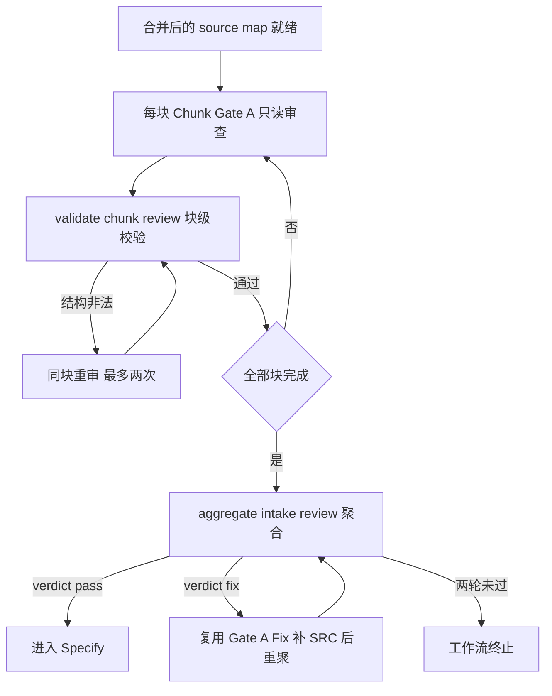

# LPRD-P2 执行文档：Chunk 级独立漏提审查

> 阶段编号：LPRD-P2
> 状态：待执行
> 需求来源：`dev-docs/planning/超长Prd切块功能.md`（FR-005 + 交付阶段表 LPRD-P2）
> 前置依赖：LPRD-P1 完成（source-map.json 已由合并生成）

## 一、阶段目标

把 EARS-P3 的 Gate A（整篇通读式漏提审查）升级为**Chunk 级独立复查**，解决超长文档下 Reviewer 自身上下文溢出、注意力分散的问题：

1. 每块由只读 Reviewer（explore）独立重读**原始 Chunk 文件**，对照已提取 Claim 识别遗漏。
2. 每块的审查产物 `intake/reviews/CHUNK-NNN.json`，quote/行号必须落在该块主区间内（确定性校验）。
3. 聚合全部块审查为现有 `intake-review.json` 契约（零改动复用 EARS-P3 的 validate-intake-review 与 Gate-A-Fix 修复路径）。
4. **全部块通过且冲突解决后才能进入 Specify**（验收要求 3/4）。

**类比理解**：整本书的校对改为逐页校对——每个校对员只对自己那页负责，页页签字；任何一页没签，全书不能付印。汇总表沿用原来的"校对总签"格式，下游流程无感。

## 二、新增与修改文件总览

| 文件 | 操作 | 任务 |
|------|------|------|
| `sdd/rules/claim-preservation.md` | 修改（新增 Chunk Gate A 纪律小节） | T01 |
| `sdd/tools/validate-chunk-review.mjs` | 新增 | T02 |
| `sdd/tools/aggregate-intake-review.mjs` | 新增 | T03 |
| `sdd/tools/validate-chunk-review-example.mjs` | 新增 | T02 |

## 三、任务拆解

### T01 审查规则扩展

`claim-preservation.md` 新增第三节「Chunk Gate A 纪律」：

1. Reviewer 只读**本块 Chunk 文件**与本块已提取 Claim（含被合并归并的重复项），不预设 Claim 完整。
2. missedClaims 的 quote 必须逐字来自本块主区间，行号为 Chunk 文件内相对行号。
3. verdict：pass / fix（无 clarify，漏了就补）。
4. 工作流 Agent label：`Chunk-GateA-CHUNK-NNN`（按块独立，explore 只读，宿主 extract-agent-json 落盘）。

块审查产物 `intake/reviews/CHUNK-001.json`：

```json
{
  "chunkId": "CHUNK-001",
  "verdict": "fix",
  "missedClaims": [
    { "quote": "第一期不支持背包扩容", "lineStart": 33, "lineEnd": 33,
      "suggestedClaimType": "non-goal", "reason": "否定性约束未提取" }
  ]
}
```

### T02 validate-chunk-review.mjs

用法：`node sdd/tools/validate-chunk-review.mjs <feature> [chunkId] [--expect pass|fix|invalid]`

确定性检查：

1. chunkId 存在于 manifest；verdict 枚举 pass/fix。
2. missedClaims 与 verdict 一致性（pass → 空；fix → 非空）。
3. **quote 落界校验**：quote 归一化后存在于该 Chunk 文件，且相对行号区间在**主区间**内（overlap 前缀区不算——遗漏归属唯一的责任块）。
4. suggestedClaimType 六枚举、reason 非空、行号合法。

`--expect` 三态模式与既有 verdict 工具一致（commandSuccess 适配）。

### T03 aggregate-intake-review.mjs

用法：`node sdd/tools/aggregate-intake-review.mjs <feature> [--json]`

聚合规则：

1. 前置：manifest 的全部 chunk 都有 `reviews/CHUNK-NNN.json` 且各自通过结构校验（缺一块即失败——"审查缺失不能成功"）。
2. 相对行号 → 绝对行号（与 merge-claims 同口径换算），missedClaims 逐条打上 chunkId 来源标记。
3. verdict：全部块 pass → pass；任一块 fix → fix（missedClaims 全量拼接）。
4. 写入现有契约 `specs/<feature>/intake-review.json`（feature/verdict/prdHash/missedClaims）——**EARS-P3 的 validate-intake-review.mjs 与 Gate-A-Fix 补漏路径零改动复用**（Gate-A-Fix 补 SRC 时 sourceRef 用聚合后的绝对行号与 quote）。

## 四、用例矩阵（CR-01~CR-08）

| 用例 | 预期 |
|------|------|
| CR-01 单块全 pass + 其余块 pass | 聚合 verdict=pass，intake-review.json 被 validate-intake-review 接受 |
| CR-02 某块 fix（含遗漏） | 聚合 verdict=fix，missedClaims 含绝对行号 |
| CR-03 缺一块审查文件 | 聚合失败（审查缺失不得成功） |
| CR-04 quote 落在 overlap 前缀区 | 块校验拒绝（主区间才算责任块） |
| CR-05 quote 不在本块文本 | 块校验拒绝 |
| CR-06 verdict=pass 但 missedClaims 非空 | 块校验拒绝 |
| CR-07 行号换算正确性 | 聚合后绝对行号处的原文包含 quote |
| CR-08 --expect 三态 | 退出码正确 |

## 五、流程位置



## 六、风险与注意事项

1. **责任块唯一性**：一条遗漏只属于其 quote 所在主区间的块；overlap 区出现的文字已在原块审查过，不重复计遗漏（防重复补 SRC）。
2. **补漏后的连锁**：Gate-A-Fix 追加 SRC 后 source-map 变化——需重跑 merge 的 provenance 守恒（追加不破坏 alsoFrom 记录），并重聚合审查。v1 简化：补漏直接进 source-map（EARS-P3 既有路径），merge-report 不回写（provenance 以 srcAssignments + 追加日志为准，报告中注明）。
3. **成本**：每块 1 次 explore 调用 + 修复重试；20 块 PRD ≈ 20~40 次调用，成本统计进 run-report（P3 记录）。
4. **块数上限**：块审查天然并行友好，但 v1 串行执行（工作流简单循环），并行化留实测后决定。

## 七、完成定义

- [ ] validate-chunk-review CR-01~CR-08 全过
- [ ] 聚合产物被 EARS-P3 validate-intake-review 零改动接受
- [ ] quote 落界/责任块唯一性规则生效
- [ ] 规则文件、glossary（Chunk Gate A / 责任块 / 块审查聚合）同步
- [ ] 执行报告落盘 + git 提交 push；LLM 级逐块审查转入手动测试

## 八、引用说明

- 需求来源：`dev-docs/planning/超长Prd切块功能.md`（FR-005、关键产物 reviews/、验收要求 3/4）
- 复用契约：`sdd/tools/validate-intake-review.mjs`、`sdd-feature.js` Gate A 段（EARS-P3）
- 行号换算口径：与 `merge-claims.mjs`（LPRD-P1）一致
