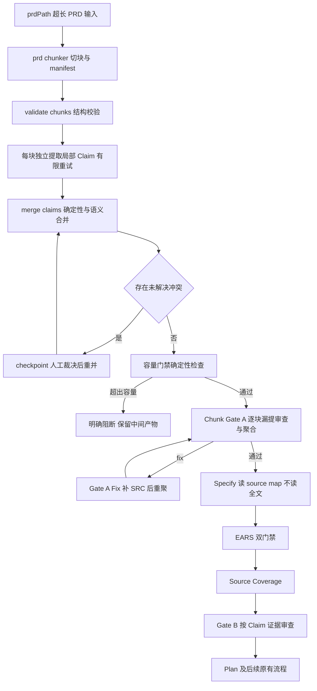

# LPRD-P3 执行文档：sdd_feature 大文档模式集成

> 阶段编号：LPRD-P3
> 状态：待执行
> 需求来源：`dev-docs/planning/超长Prd切块功能.md`（FR-006 + 交付阶段表 LPRD-P3）
> 前置依赖：LPRD-P0/P1/P2 全部完成

## 一、阶段目标

把 Chunker → 分块提取 → 合并 → Chunk Gate A 全链接入 `sdd-feature.js`，形成与现有短需求模式并列的**大文档模式**：

1. 新增 `args.prdPath` 参数：提供即为大文档模式；仅 `goal` 时维持现有流程零改动。
2. 大文档模式下，**任何阶段都不把整份 PRD 拼进 Prompt**（Specify 读 source-map 清单；Gate B 按 Claim 证据审查）。
3. **容量门禁**：合并后 Claim 清单或预期 Spec 规模超出下游处理容量时，明确阻断并保留全部中间产物，不允许截断后继续（FR-006 / 验收要求 6）。
4. 冲突与澄清人工化：跨章节冲突（unresolvedConflicts）与 Chunk Gate A 的 clarify 场景走 checkpoint。
5. 全链端到端验证 + 既有功能零回归 + 按仓库规则更新 `docs/workflows.md`。

## 二、新增与修改文件总览

| 文件 | 操作 | 任务 |
|------|------|------|
| `.opencode-workflows/workflows/sdd-feature.js` | 修改 | T01~T04 |
| `sdd/config.json` | 修改（largePrd 配置节） | T05 |
| `sdd/tools/run-report.mjs` | 新增（处理状态/成本统计汇总） | T06 |
| `docs/workflows.md` | 修改（按 CLAUDE.md 规则同步流程图与阶段表） | T07 |
| `docs/glossary.md`、`docs/ears-manual-testing.md` | 修改 | T07 |

## 三、任务拆解

### T01 大文档模式入口与 Intake 替换

1. 输入校验扩展：`prdPath` 为字符串且文件存在（与 goal 二选一必填；两者同给时以 prdPath 为原始需求源、goal 作为补充说明）。
2. `phase('Intake')` 分支：
   - 短需求模式（无 prdPath）：现有 Intake Agent + Gate A 原样保留。
   - 大文档模式：
     1. `check(prd-chunker.mjs <feature> --from <prdPath>)` → validate-chunks 通过。
     2. 分块提取循环（基于 manifest 的 chunk 列表）：每块 `Chunk-Intake-CHUNK-NNN`（general）读 Chunk 文件提取局部 Claim → `check(validate-claims.mjs <feature> CHUNK-NNN)`；失败同块重试最多 2 次，仍失败总流程终止。
     3. Merge Agent（`Claim-Merge`，general）产出语义合并报告 → `check(merge-claims.mjs <feature> --semantic ...)`。
     4. 冲突分支：退出码 2 → checkpoint 列出 unresolvedConflicts 请人工裁决，裁决后 Merge Agent 按裁决重出报告再合并（最多 2 轮）。
     5. `check(freeze-source-map.mjs)`。
   - Chunk Gate A（P2 交付）：逐块审查循环 + 聚合 + 复用 Gate-A-Fix。

### T02 Specify 大文档 prompt 变体

- 读取 `source-map.json` 的 sources（含 quote/claimType）+ EARS 规则 + 模板；**不读 source-prd.md 全文**（需要上下文时按 sourceRef 行号读 Chunk 文件片段）。
- 其余约束（EARS 句式、逐 SRC 对照、待澄清标记）与现有 prompt 一致。

### T03 Gate B 大文档 prompt 变体

- Preservation Reviewer（explore 只读）依据 `source-map.json` 的逐 Claim sourceRef（绝对行号 + quote + chunkId）定位 `intake/chunks/` 对应片段与 spec 对照审查；不要求通读全文。
- preservation-review.json 契约、六状态、三哈希锚定不变；validate-preservation 零改动（其只读文件校验哈希，与阅读方式无关）。

### T04 容量门禁

合并完成后（进入 Specify 前）执行确定性检查：

1. Claim 总数 > `largePrd.maxClaims`（默认 400）→ 阻断。
2. manifest 中 oversize Chunk 数 > `largePrd.maxOversizeChunks`（默认 0）→ 阻断（原子块已超单次处理容量）。
3. estTokensTotal > `largePrd.maxTotalTokens`（默认 300000）→ 阻断。
4. 阻断行为：工作流终止并输出明确报告（缺口数值与建议拆分方式），**保留 intake/ 全部中间产物**供人工处理或拆分为多个 Feature 重跑；禁止截断 Claim 清单继续。

### T05 sdd/config.json 配置节

```json
"largePrd": {
  "budgetTokens": 3000,
  "overlapBlocks": 1,
  "maxClaims": 400,
  "maxOversizeChunks": 0,
  "maxTotalTokens": 300000
}
```

工具默认值与配置节联动（config 覆盖默认）。

### T06 run-report.mjs

汇总 `specs/<feature>/intake/run-report.json`：chunk 数、每块提取重试次数、merge 轮次、Gate A 修复轮次、容量判定结果、失败块清单。确定性聚合，供执行报告与成本分析。

### T07 文档同步（CLAUDE.md 强制规则）

1. `docs/workflows.md`：总流程图新增大文档模式分支（Intake 段替换为切块链），阶段表补 prd-chunker/validate-chunks/merge-claims/aggregate-intake-review/容量门禁行。
2. glossary：大文档模式 / prdPath / 容量门禁 / run-report / Chunk-Intake 术语。
3. 手动测试文档新增第六层（见测试计划）。

## 四、大文档模式总流程



## 五、测试计划

### 确定性（本机）

| 用例 | 内容 |
|------|------|
| 回归 | 既有全部矩阵重跑：V01-13 / S01-16 / PV01-12 / C01-10 / CL / M / CR，短需求模式零回归 |
| CAP-01 | Claim 数超 maxClaims → 阻断且中间产物保留 |
| CAP-02 | oversize 块存在 → 阻断 |
| CAP-03 | 各项未超限 → 放行 |
| RUN-01 | run-report 汇总字段正确 |
| node --check | sdd-feature.js 语法 |

### 手动测试文档第六层（LLM 端到端）

| 用例 | 验证点 |
|------|--------|
| E2E-01 | 真实长 PRD（建议 ≥ 2 万字，30~50 需求）全链跑到收敛：切块完整、Claim 追溯引文真实、Gate A 逐块通过、Gate B 保真 |
| E2E-02 | 人工从某块删一条 Claim 注入遗漏 → Chunk Gate A 命中 |
| E2E-03 | 注入跨章节冲突（两块写不同堆叠上限）→ 冲突登记 + checkpoint 人工裁决 |
| E2E-04 | 构造超量 Claim → 容量门禁阻断且 intake/ 保留 |
| E2E-05 | 短需求模式（仅 goal）跑 login 冒烟 → 与 EARS-P3 行为一致 |
| 成本 | run-report 记录 Agent 调用数与轮次，对比短模式的增量 |

## 六、风险与注意事项

1. **工作流膨胀**：sdd-feature.js 已 700+ 行，大文档分支再增约 150 行。v1 用 if 分支保持单文件（不拆模块——workflow 运行时按单脚本执行）；若后续难以维护，再评估拆子 workflow（`workflow()` 全局已支持嵌套）。
2. **修复连锁成本**：大文档模式下任何 spec 修改触发的重跑链成本更高（Gate B 读片段而非全文，已尽量收敛）；重跑链语义与 EARS-P3 完全一致，不新增豁免。
3. **分块提取的块间一致性**：相邻块对同一需求的重复提取由语义合并兜底（M02/M03 已测确定性部分）；语义误合并（两条独立需求被判重复）由 Gate B 逐 Claim 保真审查兜底。
4. **checkpoint 人工裁决内容**：冲突裁决要求人工在 checkpoint 给出明确决定（哪个值正确/是否两期），裁决记录进 run-report；headless approve 不构成裁决（与 EARS-P1 同款警示）。
5. **验收红线**：任何阶段失败（块提取重试耗尽、审查缺失、冲突未决、容量超限）总流程必须失败退出——不允许降级跳过。

## 七、完成定义

- [ ] prdPath 大文档模式全链接入（T01-T04），node --check 通过
- [ ] 短需求模式零回归（全部既有矩阵 + workflows.md 图更新后人工核对）
- [ ] 容量门禁 CAP-01~03 通过
- [ ] run-report 就位
- [ ] docs/workflows.md / glossary / 手动测试文档第六层同步（CLAUDE.md 工作流文档规则履行）
- [ ] 执行报告落盘 + git 提交 push；E2E-01~05 与成本统计转入手动测试

## 八、引用说明

- 需求来源：`dev-docs/planning/超长Prd切块功能.md`（FR-006、验收要求 1~6、非目标边界）
- 工具链：LPRD-P0（prd-chunker/validate-chunks）、LPRD-P1（validate-claims/merge-claims）、LPRD-P2（validate-chunk-review/aggregate-intake-review）
- 复用机制：EARS-P3 重跑链与 Gate-A-Fix、freeze-source-map、validate-preservation 三哈希
- 文档维护规则：`CLAUDE.md` 工作流文档章节
