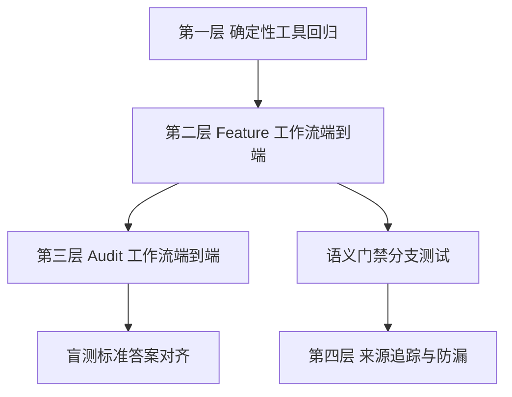

# EARS 改造手动测试文档

> 适用版本：EARS-P0 + EARS-P1 + EARS-P2（来源追踪与防漏审计）完成后
> 日期：2026-10-15（P2 层于同日补充）
> 关联文档：`dev-docs/planning/EARS改造-P0-执行文档.md`、`dev-docs/planning/EARS改造-P1-执行文档.md`
> 目的：验证确定性工具链（本机可直接跑）与 LLM 运行时链路（需 OpenCode）的完整行为

## 一、测试范围与前置条件

### 前置条件

1. Node.js 24+，仓库根目录可执行 `node` 命令。
2. OpenCode 已安装并加载 `@mickorz/opencode-dynamic-workflows` 插件（`opencode.json` 已配置）。
3. LLM 运行时测试需要有效的模型 API 配置。
4. 术语：FR（功能需求）、NFR（非功能需求）、AC（验收条件）、EARS（简易需求语法）、Gate（门禁）。

### 测试分层

| 层 | 是否需要 LLM | 覆盖内容 |
|----|-------------|---------|
| 第一层 确定性工具回归 | 否 | 校验器、解析器、Coverage、逐 AC 收敛、verdict 读取器 |
| 第二层 Feature 工作流端到端 | 是 | sdd.feature 全流程含双门禁、修复循环、决定性测试 |
| 第三层 Audit 工作流端到端 | 是 | sdd.audit 对夹具的逐 AC 审计、标准答案对齐 |
| 第四层 来源追踪与防漏（EARS-P2） | 否+是 | Source Coverage Gate 确定性用例 + Intake/Mapping 工作流链路 |



## 二、第一层：确定性工具回归（无 LLM）

在仓库根目录依次执行，全部期望退出码 0：

### T1.1 EARS 校验器用例矩阵

```bash
node sdd/tools/validate-ears-example.mjs
```

预期：`13/13 通过, 0 失败`（V01-V13 覆盖五句式、复合句式、折行、全角逗号、缺 shall、双 shall、中文关键字、空条件、无 AC、孤儿 AC、重复 ID、诊断格式）。

### T1.1b Source Coverage 校验器用例矩阵（EARS-P2）

```bash
node sdd/tools/validate-source-map-example.mjs
```

预期：`12/12 通过, 0 失败`（S01-S12 覆盖完整正例、excluded/pending 带理由、缺 mapping、无理由排除、空引用、未知 ID、AC 错误归属、无依据新增、重复 SRC、prdHash 不匹配、pending 带映射）。

### T1.2 冻结 Spec 的 EARS 校验与解析

```bash
mkdir -p specs/ears-t1 && cp experiments/fixtures/frozen-spec.md specs/ears-t1/spec.md
node sdd/tools/validate-ears.mjs ears-t1
node sdd/tools/audit-spec-parse.mjs experiments/fixtures/frozen-spec.md
```

预期：

- 校验通过，输出 `FR: 7 个, NFR: 5 个, AC: 33 条`。
- 解析 JSON 中 `totalAC: 33`，`acToReq` 含 `AC-028..AC-033` 分别归属 `NFR-001..NFR-005`。

### T1.3 verdict 读取器三态

```bash
cd specs/ears-t1
cat > ears-review.json << 'EOF'
{"feature":"ears-t1","verdict":"fix","issues":[{"target":"AC-001","type":"untestable","severity":"blocker","message":"模糊词 快速"}]}
EOF
cd ../../..
node sdd/tools/ears-review-verdict.mjs ears-t1 --expect fix; echo $?
node sdd/tools/ears-review-verdict.mjs ears-t1 --expect pass; echo $?
```

预期：第一条退出 0 并输出 `{"verdict":"fix","blockers":1,...}`；第二条退出 1（期望不匹配）。

结构非法探测（blocker 与 pass 矛盾）：

```bash
node -e "const fs=require('fs');const j=JSON.parse(fs.readFileSync('specs/ears-t1/ears-review.json','utf8'));j.verdict='pass';fs.writeFileSync('specs/ears-t1/ears-review.json',JSON.stringify(j))"
node sdd/tools/ears-review-verdict.mjs ears-t1 --expect invalid; echo $?
```

预期：退出 0（三种 verdict 期望都不满足，判定为结构非法）。

### T1.4 逐 AC 收敛负向（validate-review 拒绝 NFR 免检）

构造最小 spec 与 review（NFR 使用旧式 ac=null），执行：

```bash
node sdd/tools/validate-review.mjs ears-t1 1
```

预期（使用手工构造的含 `ac: null` 条目的 review.json 时）：`valid: false`，错误包含 `存在 ac=null 的 verification（EARS 契约禁止，NFR 必须逐 AC）` 与该 NFR 各 AC 的 `缺少 verification 条目`。

### T1.5 清理

```bash
rm -rf specs/ears-t1
```

## 三、第二层：Feature 工作流端到端（需 OpenCode）

### T2.1 正常全流程（R01）

在 OpenCode 中对主 Agent 说：

```
运行 workflow sdd_feature，参数：
feature: ears-manual-1
goal: 开发一个包含失败锁定的账号密码登录系统：连续 5 次密码错误锁定 15 分钟，
锁定期间拒绝登录，到期自动解锁，管理员可手动解锁，密码用 bcrypt 加盐存储，
登录成功签发带过期时间的凭证，支持登出。性能要求 95 分位响应不超过 500ms。
审计日志记录所有登录事件。
```

预期判定点（按顺序检查产物与日志）：

| 检查点 | 位置 | 预期 |
|--------|------|------|
| Specify 生成 EARS spec | `specs/ears-manual-1/spec.md` | 所有 AC 为 EARS 句式，FR/NFR 均含 AC |
| 格式门禁 | 工作流日志 | `validate-ears` 通过（无 format-error） |
| 语义门禁 | `specs/ears-manual-1/ears-review.json` | verdict=pass，或经历至多 2 轮 fix 后 pass |
| 状态日志 | 工作流日志 | 出现 `EARS 双门禁通过（ears-pass）` |
| Plan/Tasks | `plan.md`、`tasks.md`、`traceability.json` | NFR mapping 的 acceptanceIds 非空 |
| Coverage | 日志 | `[OK] Coverage Gate 通过`，含 NFR AC 统计 |
| 审批 checkpoint | OpenCode 交互 | 弹出批准确认 |
| 收敛 | `converge-report.json` | `converged: true`，C1-C7 全 PASS，C4 按 AC 粒度 |
| review.json | `specs/ears-manual-1/review.json` | NFR verifications 无 ac=null，覆盖全部 AC |

### T2.2 语义门禁 fix 分支（R02）

预置坏 AC 再半程驱动（不依赖 LLM 恰好生成模糊句）：

1. 复制 T2.1 产物：`cp -r specs/ears-manual-1 specs/ears-manual-2`，将其中的 feature 字段（traceability.json 等）替换为 `ears-manual-2`。
2. 手工把 `specs/ears-manual-2/spec.md` 中某条 AC 改为 `- AC-0xx: The 系统 shall 快速响应。`（模糊词 + 泛化主体）。
3. 在 OpenCode 中让主 Agent 按 `sdd-feature.js` 1.6 节的 `earsReviewPrompt` 原文执行一次 EARS Reviewer（读取该 spec 与两个规则文件，写 ears-review.json）。
4. 执行 `node sdd/tools/ears-review-verdict.mjs ears-manual-2 --expect fix`，预期退出 0，issue 含 `untestable` 或 `ambiguous`。
5. 再按 1.6 节 `EARS-Fix` prompt 执行修复 Agent，修复后执行 `node sdd/tools/validate-ears.mjs ears-manual-2`，预期通过。

### T2.3 语义门禁 clarify 分支（R04）

1. 在 `specs/ears-manual-2/spec.md` 中把某条 AC 改为含 `[待澄清: 超时策略未定义]` 标记。
2. 重复 T2.2 步骤 3 的审查，预期 verdict=clarify 且 issue 含 `needs-clarification`。
3. 验证工作流语义：真歧义必须走 checkpoint 人工确认，不得自动放行（检查 sdd-feature.js 1.6 的 clarify 分支在 `--expect clarify` 后调用 checkpoint）。

### T2.4 修复上限（R05）

确认行为边界（代码审查级验证）：1.6 节循环上限为 2，两轮后 `await check(() => earsPassed, ...)` 失败终止工作流，Plan 不会启动。可通过日志出现两次 `semantic-fix` 后终止来验证。

### T2.5 决定性测试（R08）

在 OpenCode 中运行 sdd_feature，参数 `feature: ears-manual-3`，goal 同 T2.1，附加参数 `skipRequirement: FR-003`。

预期：Review 阶段 Reviewer 独立发现 FR-003 缺失（status=missing 或 partial），工作流不收敛（not-converged），`findings.json` 含 requirement_gap。

### T2.6 旧格式 Spec 被拒（Breaking Change 验证）

```bash
node sdd/tools/validate-ears.mjs login
```

预期：失败，错误覆盖旧 spec 的全部非 EARS AC 与无 AC 的 NFR。

## 四、第三层：Audit 工作流端到端（需 OpenCode）

### T3.1 完整实现审计（R09，v1 夹具）

在 OpenCode 中运行 workflow `sdd_audit`，参数：

```
specPath: experiments/fixtures/frozen-spec.md
projectPath: audit-fixtures/v1-complete
outputDir: audit-results/ears-manual-v1
feature: ears-manual-v1
```

预期：

- `audit-report.json` 的 `converged: true`，全部 FR/NFR status=pass。
- review.json 中 NFR 的 verifications 逐 AC（AC-028~AC-033 各有 static_check 且 fileRef 指向真实文件）。

### T3.2 缺陷检出（R09，v2-v4 夹具）

分别对 `v2-missing-fr003`、`v3-partial-fr003`、`v4-contradicts-fr003` 重复 T3.1，对照 `audit-fixtures/standard-answers.json` 的 `expectedGaps`：

预期：各缺陷 FR 的 status 与 expectedStatus 一致（missing / partial / contradicts），审计不收敛。

### T3.3 源码修改判 invalid（R10）

1. 对 v1 夹具先启动审计，在 Reviewer 运行期间修改 `audit-fixtures/v1-complete/src/auth.ts`（任意一行改动）。
2. 预期：快照比对失败，工作流返回 `status: invalid`，结论不采纳。

### T3.4 盲测重跑（校准）

按 `experiments/setup-run.mjs` 既有流程重跑一轮盲测（spec 已 EARS 化），核对 9/9 缺陷检出、0 假阳性基线是否保持。若 NFR 新增 AC 导致额外发现，先按 P0.7.1 的方法人工判定真阳性再更新标准答案。

## 五、第四层：来源追踪与防漏（EARS-P2，需 OpenCode）

### T4.1 Intake → Source Coverage 全链路

在 OpenCode 中运行 workflow `sdd_feature`，参数 `feature: ears-manual-4`，goal 使用含明确多条需求的描述（例如 5 条：登录、锁定、解锁、bcrypt、审计日志）。

预期判定点：

| 检查点 | 位置 | 预期 |
|--------|------|------|
| Intake 产物 | `specs/ears-manual-4/source-prd.md` | 原文逐字保存 |
| SRC 提取 | `specs/ears-manual-4/source-map.json` | sources 覆盖 goal 全部需求点，SRC-NNN 唯一 |
| prdHash 冻结 | source-map.json | 与 source-prd.md 哈希一致 |
| Specify 逐条转换 | spec.md | 每 SRC 有对应 FR/NFR（或后续被 excluded） |
| Mapping 处置 | source-map.json mappings | 每 SRC 恰一条 covered/excluded/pending |
| Source Coverage Gate | 工作流日志 | `Source Coverage Gate 通过` 后才进入 Plan |

### T4.2 防遗漏决定性测试

1. 正常跑完 T4.1 后，手工从 source-map.json 删除一条 mapping（如 SRC-003 的条目）。
2. 执行 `node sdd/tools/validate-source-map.mjs ears-manual-4`。
3. 预期：失败，错误含 `SRC-003 [missing-mapping]`，且对应 FR 触发 `unsupported-requirement`。

### T4.3 无依据新增拦截

1. 在 spec.md 中追加一条无 PRD 依据的 `### FR-099: 自动注册`（含合法 EARS AC）。
2. 执行 `node sdd/tools/validate-ears.mjs ears-manual-4`（应通过）后执行 `node sdd/tools/validate-source-map.mjs ears-manual-4`。
3. 预期：Source Coverage Gate 失败，错误含 `FR-099 [unsupported-requirement]`。

### T4.4 原文改写防护

1. 修改 source-prd.md 任意内容后执行 `node sdd/tools/validate-source-map.mjs ears-manual-4`。
2. 预期：失败，错误含 `[prd-hash]`。恢复原文后通过。

## 六、判定标准汇总

| 编号 | 测试 | 通过标准 |
|------|------|---------|
| T1.1 | 校验器矩阵 | 13/13 |
| T1.1b | Source Coverage 矩阵 | 12/12 |
| T1.2 | 冻结 Spec 校验 | 7 FR / 5 NFR / 33 AC 全通过 |
| T1.3 | verdict 三态 | 退出码与摘要正确 |
| T1.4 | NFR 免检拒绝 | ac=null 被拒 |
| T2.1 | 端到端正常 | converged=true，ears-review verdict=pass |
| T2.2 | fix 分支 | 模糊 AC 触发 fix，修复后双门禁通过 |
| T2.3 | clarify 分支 | 待澄清走 checkpoint |
| T2.4 | 修复上限 | 两轮后终止，Plan 不启动 |
| T2.5 | 决定性测试 | skipRequirement 被 Reviewer 发现 |
| T2.6 | Breaking Change | 旧 spec 被格式门禁拒绝 |
| T3.1 | v1 审计 | converged=true，NFR 逐 AC |
| T3.2 | v2-v4 审计 | 与标准答案一致 |
| T3.3 | 完整性 | 源码被改判 invalid |
| T3.4 | 盲测校准 | 缺陷检出率不低于既有基线 |
| T4.1 | Intake 到 Gate 全链 | 每 SRC 有处置，Gate 通过后才进 Plan |
| T4.2 | 防遗漏决定性 | 删 mapping 后 Gate 拒绝 |
| T4.3 | 无依据新增拦截 | FR-099 被拒 |
| T4.4 | 原文改写防护 | prdHash 不匹配被拒 |

## 七、注意事项

1. **headless 模式**：checkpoint 在 `headless: 'approve'` 下自动批准，T2.3 的 clarify 人工确认语义需在交互模式下验证一次。
2. **网络**：LLM 调用依赖模型 API；git push 依赖代理（本机 127.0.0.1:7897）可用。
3. **旧产物**：`specs/login`、`specs/experiment-B-*`、`dev-examples/task-manager` 均为旧格式，重新运行工作流前需整目录删除重建（specHash 链条会全部失效）。
4. **修复循环成本**：语义门禁最坏 2 轮 = 6 次额外 Agent 调用，注意 token 与时长预算。
5. **测试后清理**：手动测试产生的 `specs/ears-manual-*`、`fixtures/ears-manual-*-app`、`audit-results/ears-manual-*` 与 `sdd/config.json` 临时条目，验收完成后清理。
6. **NFR 新增 AC 的证据**：审计中 NFR 的 AC-028~033 依赖 static_check 的 fileRef，Reviewer 必须给出真实文件行号；`audit-converge.mjs` 会校验文件存在性。
7. **P2 成本**：每个 Feature 新增 Intake 与 Source Mapping 两次 Agent 调用；确属必要的新增需求应先补 PRD 重跑，不要放宽 Source Coverage Gate。
8. **pending 处置**：disposition=pending 的 SRC 进入 Plan 前不会被阻断（待澄清项允许存在但必须有 note），若需强制清零 pending 可在人工审批 checkpoint 时一并确认。

## 七、引用说明

- EARS 规则：`sdd/rules/ears-format.md`、`sdd/rules/ears-semantic-review.md`、`sdd/rules/source-extraction.md`
- 工作流定义：`.opencode-workflows/workflows/sdd-feature.js`（1.5 格式门禁、1.6 语义门禁）、`.opencode-workflows/workflows/sdd-audit.js`
- Artifact 契约：`dev-docs/design/sdd-artifact-contract.md`
- 执行报告：`dev-docs/progress-result/EARS-P0-执行报告.md`、`dev-docs/progress-result/EARS-P1-执行报告.md`、`dev-docs/progress-result/EARS-P2-执行报告.md`
- EARS 原始方法：https://alistairmavin.com/ears/
- cc-sdd 参考：`thirdparties/cc-sdd/tools/cc-sdd/templates/shared/settings/rules/ears-format.md`
