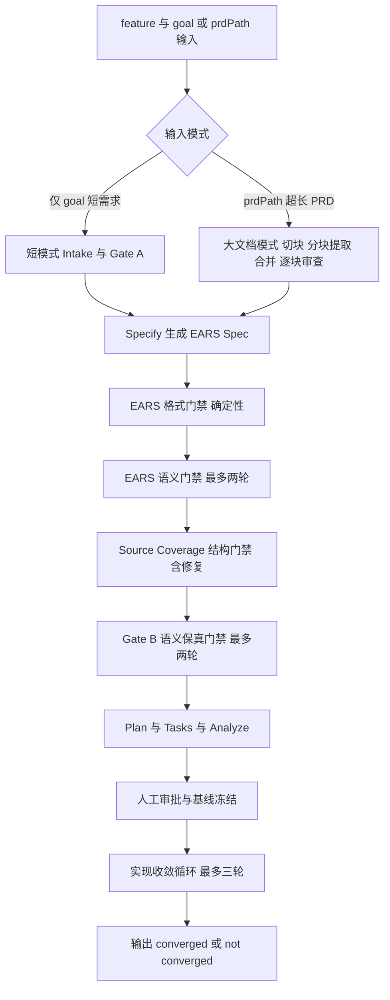
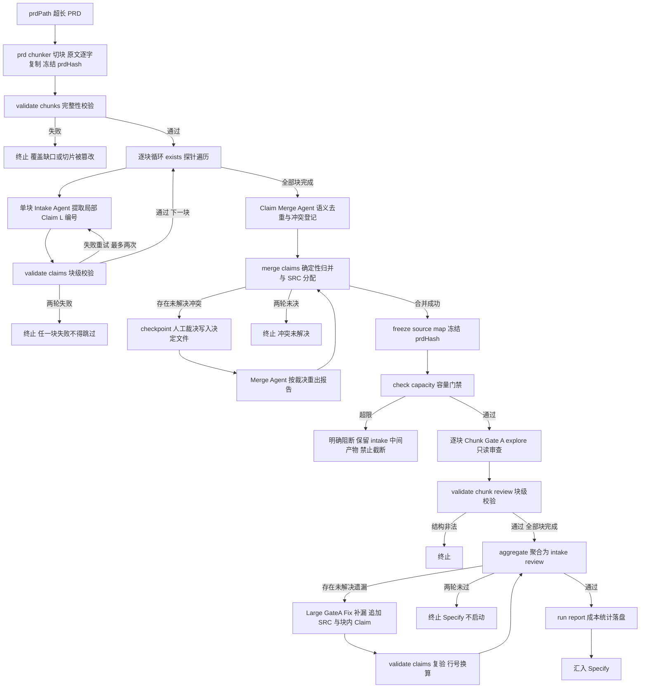
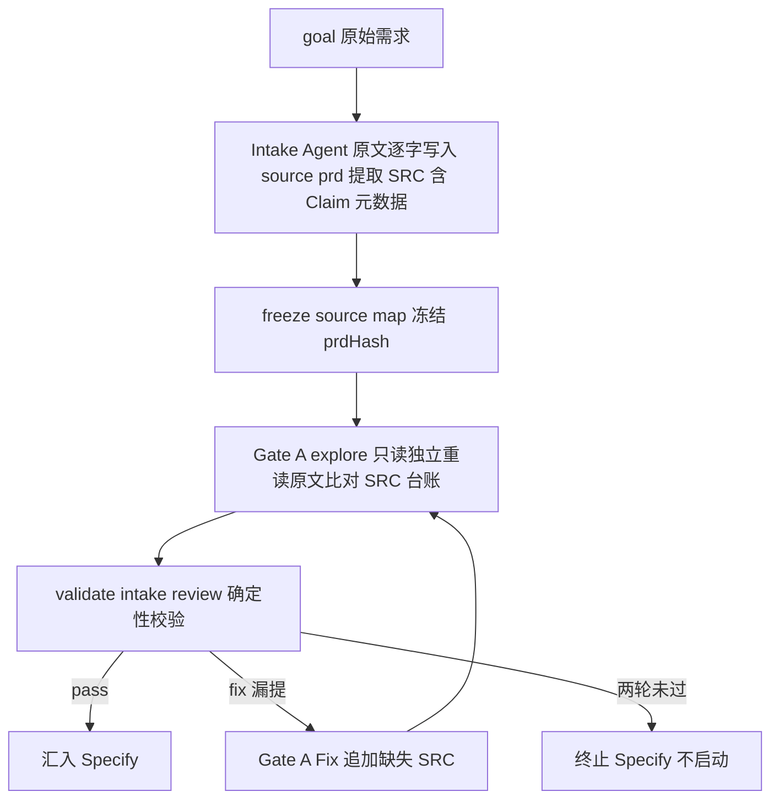
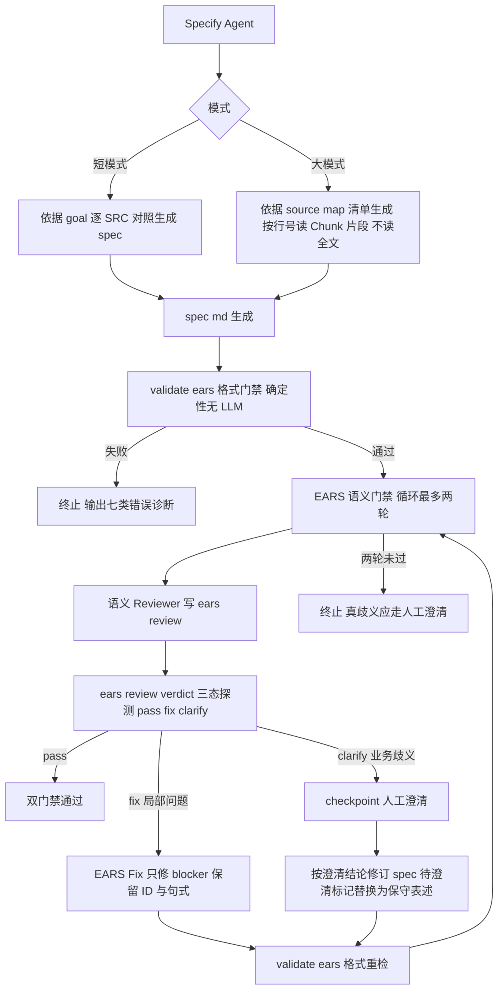
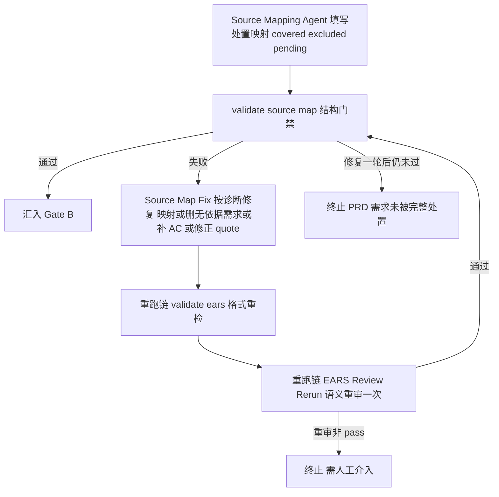
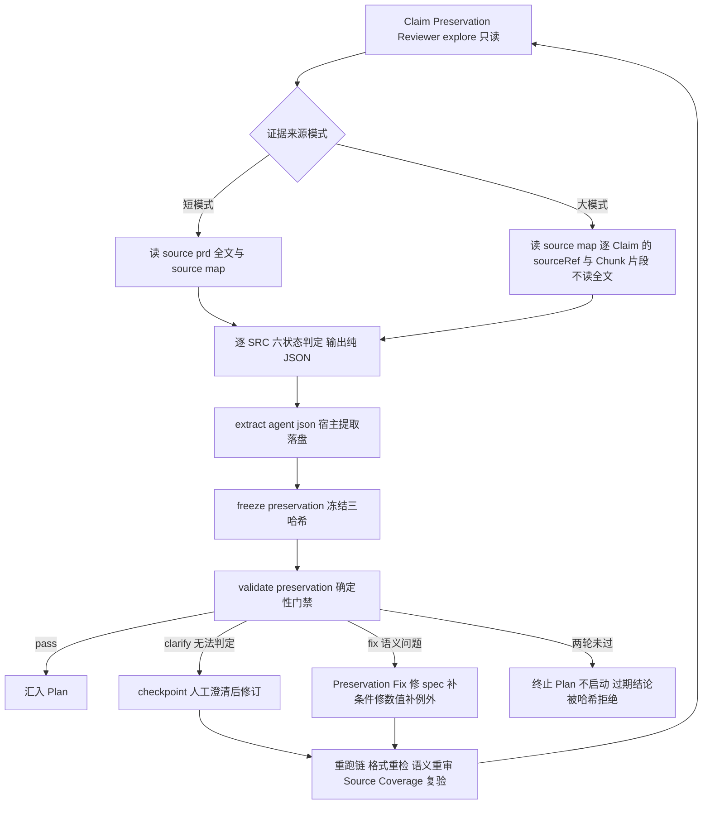
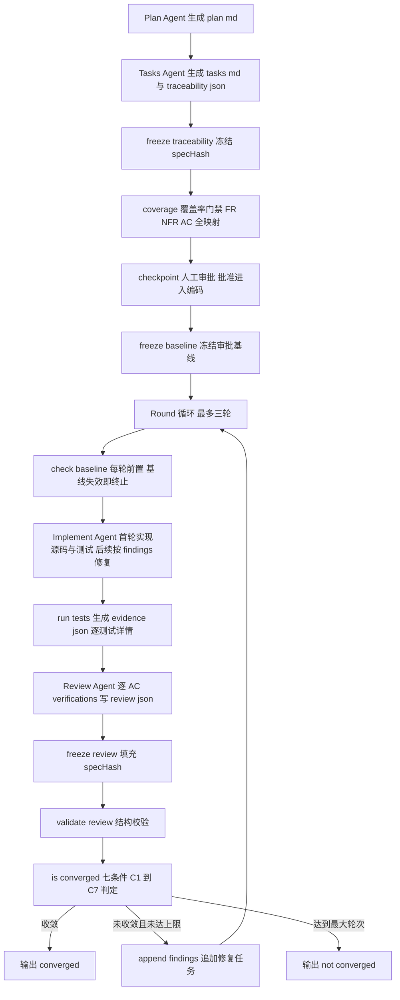

# SDD 工作流文档（sdd-feature）

> 本文档用 mermaid 记录 `.opencode-workflows/workflows/sdd-feature.js` 的完整详细流程。
> 维护规则见 `CLAUDE.md`：工作流脚本变更时必须同步更新本文档的图与阶段说明。
> 术语见 `docs/glossary.md`；Artifact 契约见 `dev-docs/design/sdd-artifact-contract.md`。
> 图中节点只标行为与产物名；工具与文件名见「阶段与门禁一览表」。

## 一、总流程总览

两种输入模式在 Intake 阶段分流，汇合后共用 Specify → EARS 双门禁 → Source Coverage → Gate B → 实现收敛的完整链路。

## 二、Intake 阶段详细

### 2.1 大文档模式（prdPath，LPRD）

切块 → 逐块提取局部 Claim → 语义合并（冲突人工裁决）→ 容量门禁 → 逐块漏提审查 → 聚合补漏。任何 Prompt 都不包含整份 PRD。

### 2.2 短需求模式（goal）

## 三、Specify 与 EARS 双门禁详细

## 四、Source Coverage 详细（含重跑链）

## 五、Gate B 语义保真详细（含重跑链）

## 六、实现收敛阶段详细

## 七、阶段与门禁一览

| 阶段 | 执行者 | 产物 | 确定性校验 | 失败行为 |
|------|--------|------|-----------|---------|
| Intake（短模式 goal） | Intake Agent（general） | source-prd.md、source-map.json（sources 含 claimType/loadBearing/sourceRef） | freeze-source-map.mjs 冻结 prdHash | 冻结失败即终止 |
| Intake（大模式 prdPath，LPRD） | prd-chunker + Chunk-Intake-*（general 逐块） + Claim-Merge（general） | intake/manifest.json + chunks/ + claims/ + semantic.json + merge-report.json + source-map.json | validate-chunks / validate-claims / merge-claims（--expect ok/conflict）/ check-capacity | 任一块提取两轮失败、冲突未决、容量超限均终止并保留中间产物 |
| Chunk Gate A（大模式，LPRD） | Chunk-GateA-CHUNK-NNN（explore 只读，宿主提取落盘） | intake/reviews/ + 聚合 intake-review.json | validate-chunk-review / aggregate-intake-review（--expect） | 遗漏补漏后重聚，两轮未过终止，Specify 不启动 |
| Gate A（短模式） | Intake-Preservation-Reviewer（explore 只读，宿主提取落盘） | intake-review.json（missedClaims + verdict） | validate-intake-review.mjs（--expect pass/fix） | fix 走 Gate-A-Fix 补 SRC，两轮未过终止，Specify 不启动 |
| Specify | Specify Agent（general；大模式读清单不读全文） | spec.md（EARS 句式，逐 SRC 对照） | — | — |
| EARS 格式门禁 | 确定性，无 LLM | — | validate-ears.mjs（七类结构错误） | 失败即终止（P0 级格式错误不自动修复） |
| EARS 语义门禁 | EARS-Review（general） | ears-review.json | ears-review-verdict.mjs（--expect pass/fix/clarify） | fix 自动修复、clarify 走 checkpoint，修复后重过格式门禁；两轮未过终止 |
| Source Coverage | Source-Mapping Agent（general） | source-map.json（mappings：covered/excluded/pending） | validate-source-map.mjs（结构/归属/引文/AC 强制/反向防漏） | 失败走 Source-Map-Fix + 重跑链（EARS 格式与语义重审）；两轮未过终止 |
| Gate B 语义保真 | Claim-Preservation-Reviewer（explore 只读，宿主落盘） | preservation-review.json（六状态逐 Claim + 三哈希） | freeze-preservation.mjs + validate-preservation.mjs（--expect pass/fix/clarify） | fix/clarify 修复后走重跑链并重审；两轮未过终止，Plan 不启动 |
| Plan | Plan Agent（general） | plan.md | — | — |
| Tasks | Tasks Agent（general） | tasks.md、traceability.json | — | — |
| Analyze | 确定性 | — | freeze-traceability.mjs、coverage.mjs | 失败即终止 |
| 人工审批 | checkpoint | — | — | 人工拒绝则终止 |
| 基线冻结 | 确定性 | approved-baseline | freeze-baseline.mjs | 失败即终止 |
| Implement | Coding Agent（general） | 源码 + 测试 | check-baseline.mjs（每轮前置） | 基线失效即终止 |
| Test | run-tests.mjs | evidence.json | — | 执行器自身异常终止 |
| Review | Reviewer Agent（general） | review.json（逐 AC verifications） | freeze-review.mjs、validate-review.mjs | 结构非法终止 |
| Converge | is-converged.mjs | converge-report.json | C1 到 C7 全过才收敛 | 未收敛追加 findings 进入下一轮，最多 3 轮 |

## 八、关键机制说明

1. **四道门禁的分工**：validate-source-map 管 SRC 到 Spec 的结构；Gate A 管 PRD 到 SRC 的完整性；Gate B 管 SRC 到 Spec 的语义保真；EARS 双门禁管 Spec 内部质量。全部通过才能进入 Plan。
2. **失效校验重跑链**：任何 Agent 修改 spec.md 后，EARS 格式校验、EARS 语义重审、Source Coverage、Gate B 必须针对同一版本 Spec 重新成立；Gate B 的三哈希（prdHash/specHash/sourceMapHash）锚定保证过期审查结论被确定性拒绝。
3. **只读纪律**：Gate A 与 Gate B 的 Reviewer 均为 explore 只读，产物经宿主 extract-agent-json.mjs 落盘，禁止 Reviewer 自写结论。
4. **修复循环上限**：Gate A/Gate B/EARS 语义门禁均为最多 2 轮；块提取单块最多 2 次；Claim 合并最多 2 轮；Implement 到 Converge 循环默认 3 轮（maxRounds 参数可调）。
5. **决定性测试钩子**：skipRequirement 参数可要求 Implement 故意跳过指定需求，用于验证 Reviewer 独立发现遗漏的能力。
6. **大文档模式（LPRD）**：prdPath 触发；容量门禁三项阈值（Claim 总数 / oversize 块 / 总 Token）来自 sdd/config.json 的 largePrd 节，超限明确阻断并保留 intake/ 中间产物；处理状态与成本统计落盘 intake/run-report.json；Specify 与 Gate B 在大模式下读 source-map 与 Chunk 片段，不读全文。
7. **退出码三态适配**：workflow 运行时只提供 commandSuccess 布尔原语，各 verdict 工具（ears-review-verdict / merge-claims / validate-preservation / validate-intake-review / validate-chunk-review / aggregate-intake-review）均带 --expect 模式，用多次布尔探测区分 pass/fix/clarify。

## 九、变更维护

- 本文档对应 `.opencode-workflows/workflows/sdd-feature.js` 的当前 master 版本（含 EARS-P0~P3 与 LPRD-P0~P3）。
- 修改工作流脚本（新增/删除/移动 phase、调整门禁分支或轮次、变更产物文件名或哈希冻结点）时，必须同步更新本文档的 mermaid 图与阶段表。
- sdd-audit 工作流的图待 EARS-P5（审计来源链前置）落地后补充到本文档。
